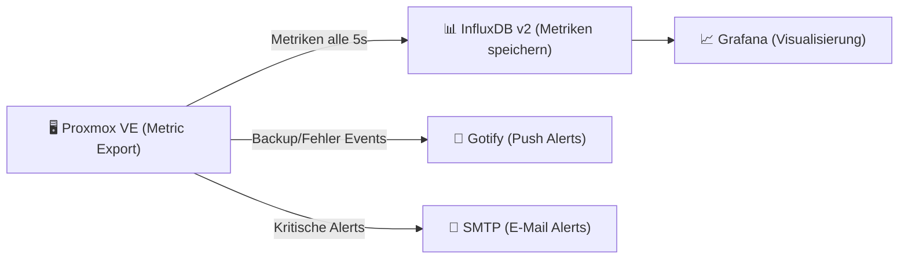

---
tags:
  - virtualization
  - proxmox
  - monitoring
  - metrics
  - influxdb
  - grafana
  - notifications
  - alerting
aliases:
  - Proxmox Monitoring
  - PVE Monitoring
  - Proxmox Metriken
---

# Proxmox Monitoring

> [!ABSTRACT] TL;DR
> Proxmox VE bringt ein integriertes Monitoring-System mit RRD-basierten Graphen für Host, VMs und Container. Für erweitertes Monitoring können Metriken an **InfluxDB** oder **Graphite** exportiert und in **Grafana** visualisiert werden. Das **Notification-System** (ab PVE 8.1) ermöglicht Alerts über Email, Gotify, Pushover und SMTP.

---

## Integriertes Monitoring (Web-UI)

### Verfügbare Graphen

Jeder Node, jede VM und jeder Container hat im Web-UI unter **Summary** und **More → RRD Data** eingebaute Graphen:

| Objekt | Verfügbare Metriken |
|---|---|
| **Node** | CPU, RAM, Load, Netzwerk (tx/rx), Disk I/O, Swap |
| **VM (QEMU)** | CPU, RAM (assigned/used), Netzwerk (tx/rx), Disk I/O |
| **Container (LXC)** | CPU, RAM, Netzwerk (tx/rx), Disk I/O |
| **Storage** | Genutzt / Verfügbar |
| **Ceph** | IOPS, Throughput, Latenz, OSD-Status |

### Zeiträume

| Zeitraum | Auflösung |
|---|---|
| Stunde | 1 Sekunde |
| Tag | 1 Minute |
| Woche | 30 Minuten |
| Monat | 2 Stunden |
| Jahr | 1 Tag |

> [!NOTE] RRD (Round Robin Database)
> PVE nutzt intern RRD für Metriken — eine zirkuläre Datenbank mit fester Größe. Ältere Daten werden automatisch durch Aggregation komprimiert (Average, Max). Für langfristige Datenhaltung und Alerting: externe Metrik-Datenbank empfohlen.

---

## Metrik-Export (InfluxDB / Graphite)

### InfluxDB v2 einrichten

InfluxDB v2 empfängt PVE-Metriken und kann als Grafana-Datenquelle genutzt werden:

```bash
# Web-UI: Datacenter → Metric Server → Add → InfluxDB

# Via CLI:
pvesh set /cluster/config/options --metric-server '{
  "name": "influxdb-prod",
  "type": "influxdb",
  "server": "192.168.1.200",
  "port": 8086,
  "influxdbtoken": "MEIN_INFLUX_TOKEN",
  "organization": "homelab",
  "bucket": "proxmox",
  "proto": "https",
  "verify-certificate": 1
}'
```

#### InfluxDB v1 (Legacy)

```bash
pvesh set /cluster/config/options --metric-server '{
  "name": "influxdb-v1",
  "type": "influxdb",
  "server": "192.168.1.200",
  "port": 8086,
  "database": "proxmox"
}'
```

### Graphite einrichten

```bash
# Graphite-Metrik-Server konfigurieren
pvesh set /cluster/config/options --metric-server '{
  "name": "graphite",
  "type": "graphite",
  "server": "192.168.1.201",
  "port": 2003,
  "path": "proxmox"
}'
```

### Metrik-Pfade in InfluxDB / Graphite

PVE exportiert Metriken mit folgenden Pfaden:

```
proxmox.nodes.<node>.cpu
proxmox.nodes.<node>.memory.used
proxmox.nodes.<node>.memory.total
proxmox.nodes.<node>.netin
proxmox.nodes.<node>.netout
proxmox.qemu.<vmid>.cpu
proxmox.qemu.<vmid>.mem
proxmox.qemu.<vmid>.diskread
proxmox.qemu.<vmid>.diskwrite
proxmox.lxc.<ctid>.cpu
proxmox.lxc.<ctid>.mem
```

---

## Grafana-Dashboard

### Grafana mit InfluxDB verbinden

```bash
# Grafana installieren (auf separatem System oder Docker)
docker run -d \
    --name grafana \
    -p 3000:3000 \
    -v grafana-data:/var/lib/grafana \
    grafana/grafana:latest

# InfluxDB als Datenquelle hinzufügen:
# Configuration → Data Sources → Add → InfluxDB
# URL: http://influxdb:8086
# Token: (InfluxDB API Token)
# Organization: homelab
# Bucket: proxmox
```

### Empfohlene Community-Dashboards

| Dashboard | Grafana-ID | Beschreibung |
|---|---|---|
| **Proxmox VE Metrics** | 15356 | Vollständiges PVE-Dashboard |
| **Proxmox Cluster** | 10048 | Cluster-Übersicht |
| **Proxmox Ceph** | 15400 | Ceph-spezifische Metriken |

```bash
# Dashboard importieren:
# Grafana → Dashboards → Import → ID eingeben → Load
```

---

## Notification-System (ab PVE 8.1)

Ab PVE 8.1 gibt es ein neues, flexibles Notification-Framework das Meldungen über verschiedene Kanäle senden kann.

### Notification-Quellen (was löst Notifications aus)

| Quelle | Beschreibung |
|---|---|
| **vzdump** | Backup-Job abgeschlossen (Erfolg / Fehler) |
| **package-updates** | Verfügbare Paket-Updates |
| **replication** | Replikations-Fehler |
| **cluster** | Cluster-Ereignisse |

### Notification-Kanäle konfigurieren

#### SMTP (E-Mail)

```bash
# Via Web-UI: Datacenter → Notifications → Add → Sendmail / SMTP

# SMTP-Endpoint per CLI:
pvesh create /cluster/notifications/endpoints/smtp \
    --name smtp-main \
    --server smtp.example.com \
    --port 587 \
    --mode starttls \
    --username alerts@example.com \
    --password 'SmtpPasswort' \
    --from-address alerts@example.com \
    --to admin@example.com \
    --comment "Haupt E-Mail Alerting"
```

#### Gotify (Self-hosted Push)

```bash
pvesh create /cluster/notifications/endpoints/gotify \
    --name gotify-push \
    --server https://gotify.example.com \
    --token GOTIFY_APP_TOKEN \
    --comment "Gotify Push-Notifications"
```

#### Sendmail (lokaler MTA, einfachste Option)

```bash
# Postfix auf dem Proxmox-Host konfigurieren
nano /etc/postfix/main.cf
# relayhost = [smtp.example.com]:587
# smtp_use_tls = yes

postfix reload

# Sendmail-Endpoint erstellen
pvesh create /cluster/notifications/endpoints/sendmail \
    --name sendmail-local \
    --to admin@example.com \
    --author "Proxmox pve1"
```

### Notification-Matcher (Routing)

Matcher definieren, welche Events an welchen Endpoint geschickt werden:

```bash
# Matcher erstellen: Backup-Fehler → sofort per E-Mail
pvesh create /cluster/notifications/matchers \
    --name backup-failures \
    --target smtp-main \
    --match-field "type=vzdump" \
    --match-severity error,warning \
    --comment "Backup-Fehler per E-Mail"

# Matcher: Alle Notifications → Gotify
pvesh create /cluster/notifications/matchers \
    --name all-to-gotify \
    --target gotify-push \
    --comment "Alle Events per Push"

# Matcher anzeigen
pvesh get /cluster/notifications/matchers
```

---

## Prozess- und Ressourcenmonitoring (CLI)

### Host-Ressourcen

```bash
# Echtzeit-Ressourcenübersicht
htop
iotop -o        # Nur Prozesse mit I/O

# CPU-Statistiken
mpstat -P ALL 2

# Speicherdetails
free -h
cat /proc/meminfo

# Netzwerkauslastung
iftop -i vmbr0
nload vmbr0

# Disk I/O
iostat -x 2
iotop

# Zusammenfassung aller VMs und Container
pvesh get /cluster/resources --type vm
pvesh get /cluster/resources --type node
```

### PVE-spezifische Monitoring-Befehle

```bash
# Ressourcen-Übersicht aller Nodes im Cluster
pvesh get /cluster/resources

# Status eines Nodes
pvesh get /nodes/pve1/status

# CPU/Memory-Auslastung einer VM
qm status 100

# Alle laufenden Tasks
pvesh get /cluster/tasks

# Aktive Tasks eines Nodes
pvesh get /nodes/pve1/tasks --typefilter running

# Task-Log (nach UPID)
pvesh get /nodes/pve1/tasks/UPID:pve1:001A2B3C:00000001:65F1A2B3:vzdump:100:root@pam:/log
```

---

## Ceph-Monitoring

Ceph hat ein eigenes umfangreiches Monitoring-System:

```bash
# Cluster-Gesamtstatus
ceph status
ceph -w                 # Live-Watcher

# Detaillierte Gesundheitsinformationen
ceph health detail

# Speicherauslastung
ceph df
ceph df detail

# OSD-Auslastung und Performance
ceph osd df
ceph osd perf

# Echtzeit IOPS / Throughput
ceph iostat

# Placement Group Status
ceph pg stat
ceph pg dump | grep -v "active+clean"

# Monitor-Status
ceph mon stat
ceph quorum_status

# Laufende Recovery / Backfill-Operationen
ceph status | grep -A5 "io:"
```

### Ceph Dashboard (eingebaut)

```bash
# Ceph Dashboard aktivieren
ceph mgr module enable dashboard
ceph dashboard create-self-signed-cert
ceph dashboard set-login-credentials admin

# Dashboard-URL anzeigen
ceph mgr services
# Aufruf: https://<ceph-mgr-host>:8443
```

---

## Log-Monitoring und Alerting

### Wichtige Logs aggregieren

```bash
# Alle PVE-Dienste auf Fehler überwachen (letzter Tag)
journalctl -p err -S -24h --no-pager \
    -u pvedaemon -u pveproxy -u pve-cluster -u corosync

# Backup-Logs auswerten
grep -E "ERROR|WARN|failed" /var/log/syslog | grep vzdump

# Alle Task-Logs mit Fehler-Status
pvesh get /cluster/log --max 500 | python3 -c "
import sys, json
logs = json.load(sys.stdin)
for l in logs:
    if l.get('level') in ['err', 'warning']:
        print(f\"{l.get('t', '')} [{l.get('level')}] {l.get('msg', '')}\")
"
```

### Logwatch / Fail2ban Integration

```bash
# Fail2ban für SSH und PVE Web-UI installieren
apt install fail2ban

# Proxmox Web-UI Jail konfigurieren
cat > /etc/fail2ban/jail.d/proxmox.conf << 'EOF'
[proxmox]
enabled  = true
port     = https,8006
filter   = proxmox
backend  = systemd
maxretry = 3
findtime = 3600
bantime  = 86400
EOF

cat > /etc/fail2ban/filter.d/proxmox.conf << 'EOF'
[Definition]
failregex = pvedaemon\[.*authentication failure; rhost=<HOST> user=.* msg=.*
ignoreregex =
EOF

systemctl restart fail2ban
fail2ban-client status proxmox
```

---

## Monitoring-Stack Empfehlung

Für produktive Umgebungen empfohlener Stack:



| Komponente | Empfehlung | Begründung |
|---|---|---|
| Metrik-DB | InfluxDB v2 | Native PVE-Integration, einfaches Setup |
| Visualisierung | Grafana | Community-Dashboards für PVE verfügbar |
| Push-Alerts | Gotify (self-hosted) | Kein Cloud-Dependency, einfach |
| E-Mail | SMTP via Postfix-Relay | Für kritische Alerts und Backup-Reports |

---

## Verwandte Notizen

- [[Was ist Proxmox]]
- [[Proxmox Best Practices]]
- [[Proxmox Troubleshooting]]
- [[Proxmox Cluster und HA]]
- [[Proxmox CLI Cheatsheet]]
- [[Proxmox Benutzerverwaltung]]
