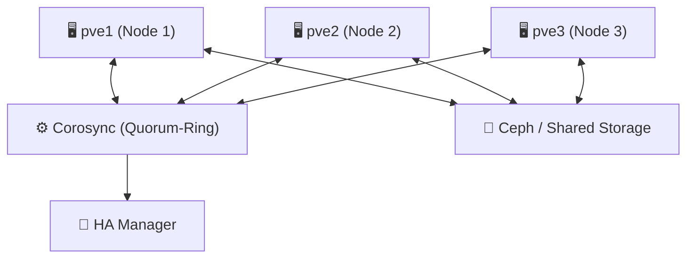
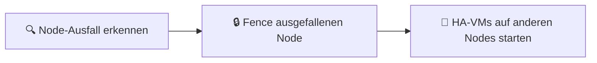

---
tags:
  - virtualization
  - proxmox
  - cluster
  - ha
  - hochverfügbarkeit
  - corosync
  - fencing
aliases:
  - Proxmox Cluster
  - Proxmox HA
  - Proxmox Hochverfügbarkeit
---

# Proxmox Cluster und HA

> [!ABSTRACT] TL;DR
> Ein Proxmox-Cluster verbindet mehrere Nodes über **Corosync** zu einer gemeinsamen Management-Einheit. **HA (High Availability)** überwacht VMs und Container automatisch und startet sie bei Node-Ausfall neu — vorausgesetzt, Shared Storage (Ceph oder NFS) ist vorhanden. **Fencing** ist zwingend erforderlich, um Split-Brain-Szenarien zu verhindern.

---

## Cluster-Grundlagen

### Architektur



### Quorum-Regel

Proxmox-Cluster benötigen **Quorum** — die Mehrheit der Nodes muss erreichbar sein, damit der Cluster operativ bleibt:

| Nodes gesamt | Quorum benötigt | Ausfall toleriert |
|---|---|---|
| 1 | 1 | 0 |
| 2 | 2 | 0 (kein Ausfall toleriert!) |
| **3** | **2** | **1** |
| 4 | 3 | 1 |
| 5 | 3 | 2 |

> [!WARNING] 2-Node-Cluster vermeiden
> Ein 2-Node-Cluster hat kein Quorum-Backup — fällt ein Node aus, verliert der Cluster das Quorum und VMs werden nicht neu gestartet. Für 2-Node-Setups ist ein **QDevice (Quorum Device)** auf einem dritten System (z.B. Raspberry Pi) notwendig.

---

## Cluster erstellen und verwalten

### Neuen Cluster erstellen

```bash
# Auf dem ersten Node: Cluster erstellen
pvecm create mein-cluster \
    --link0 192.168.10.1       # Corosync-Ring-0 (Cluster-Netzwerk)

# Optional: zweiter Corosync-Ring für Redundanz
pvecm create mein-cluster \
    --link0 192.168.10.1 \
    --link1 192.168.20.1

# Cluster-Status anzeigen
pvecm status
```

### Nodes hinzufügen

```bash
# Auf dem neuen Node: Cluster beitreten
pvecm add 192.168.10.1 \
    --link0 192.168.10.2       # Eigene IP im Cluster-Netzwerk

# Alternativ: via Web-UI → Datacenter → Cluster → Join Cluster
# Join-Information (Token) auf dem ersten Node anzeigen:
pvecm info
```

> [!NOTE] Cluster-Join Voraussetzungen
> - Alle Nodes müssen per SSH (Port 22) erreichbar sein
> - Uhrzeiten müssen synchron sein (NTP!)
> - Cluster-Netzwerk muss ohne Firewall-Blockade erreichbar sein (Ports 5405 UDP, 22 TCP)

### Cluster-Management

```bash
# Cluster-Status anzeigen
pvecm status

# Quorum-Details
pvecm quorum status

# Node-Liste
pvecm nodes

# Node aus Cluster entfernen (nur wenn Node dauerhaft ausgefallen)
# 1. Node herunterfahren
# 2. Auf verbleibendem Node:
pvecm delnode ausgefallener-node

# Cluster-Konfiguration
cat /etc/pve/corosync.conf
```

### QDevice für 2-Node-Cluster

```bash
# QDevice auf drittem System (z.B. Raspberry Pi) installieren
apt install corosync-qnetd

# Auf dem QDevice:
corosync-qnetd-certutil -i
corosync-qnetd

# Auf dem Proxmox-Cluster (2 Nodes):
pvecm qdevice setup 192.168.10.100    # IP des QDevice
pvecm status    # QDevice sollte als Vote erscheinen
```

---

## HA (High Availability)

### HA-Konzept

Der HA Manager überwacht VMs/Container und reagiert bei Node-Ausfall:



**Fencing ist zwingend**: Bevor HA eine VM auf einem anderen Node startet, muss sichergestellt sein, dass die VM auf dem ausgefallenen Node wirklich nicht mehr läuft. Ohne Fencing droht **Split-Brain** (gleiche VM läuft auf zwei Nodes gleichzeitig → Datenverlust).

### HA-Voraussetzungen

- ✅ Mindestens **3 Nodes** (für Quorum ohne QDevice)
- ✅ **Shared Storage** (Ceph, NFS, iSCSI) — VMs müssen von allen Nodes zugreifbar sein
- ✅ **Fencing** konfiguriert (IPMI, iDRAC, iLO oder SCSI-Reservation)
- ✅ **Watchdog** aktiviert (softdog oder Hardware-Watchdog)

### VM/Container für HA konfigurieren

```bash
# Via Web-UI: VM → More → Manage HA → Add

# Via CLI: VM zur HA-Gruppe hinzufügen
ha-manager add vm:100 --group ha-gruppe --state started --max_restart 3 --max_relocate 1

# Container zur HA hinzufügen
ha-manager add ct:200 --state started

# HA-Status aller verwalteten Ressourcen
ha-manager status

# HA-Ressource deaktivieren (z.B. für Wartung)
ha-manager set vm:100 --state disabled

# HA-Ressource entfernen
ha-manager remove vm:100
```

### HA-Gruppen

HA-Gruppen definieren, auf welchen Nodes VMs bevorzugt laufen sollen:

```bash
# HA-Gruppe erstellen
ha-manager groupadd ha-gruppe \
    --nodes pve1:100,pve2:50,pve3:50 \    # pve1 hat höchste Priorität (100)
    --restricted 0 \                        # Auf allen Nodes erlaubt (0) / nur Gruppe (1)
    --nofailback 0                          # Automatisch zurück auf Primär-Node (0=ja)

# Gruppen anzeigen
ha-manager grouplist

# Gruppe löschen
ha-manager groupremove ha-gruppe
```

### Fencing konfigurieren

#### IPMI/BMC Fencing (empfohlen für physische Server)

```bash
# fence_ipmilan installieren
apt install fence-agents

# STONITH/Fencing via Web-UI: Node → Shell → pvecm
# Oder in /etc/pve/ha/resources.cfg:
# pvenode pve1
#   watchdog-timeout: 60
```

Fencing-Konfiguration im Web-UI: **Datacenter → HA → Fencing**:

| Typ | Beschreibung | Voraussetzung |
|---|---|---|
| **IPMI** | Schaltet Server per BMC aus | IPMI/iDRAC/iLO vorhanden |
| **Watchdog** | Kernel-Watchdog startet neu bei Ausfall | Immer verfügbar (softdog) |
| **SCSI** | SCSI-3 PR Reservierungen | Unterstützter SAN |

```bash
# Watchdog aktivieren (softdog als Fallback)
echo "softdog" >> /etc/modules
modprobe softdog

# Watchdog-Status
wdctl
```

---

## Node-Wartung

### Maintenance-Mode (alle VMs evakuieren)

```bash
# Node in Wartungsmodus setzen (HA-VMs werden evakuiert)
ha-manager crm-command node-maintenance enable pve1

# Alle VMs manuell auf anderen Node migrieren
# Via Web-UI: Node → Migrate All VMs

# Wartung abschließen, Node zurück in Cluster bringen
ha-manager crm-command node-maintenance disable pve1
```

### Node aus Cluster entfernen (sauber)

```bash
# 1. Alle VMs/Container migrieren oder stoppen
# 2. Cluster-Dienste auf dem Node stoppen
systemctl stop pve-cluster pveproxy pvescheduler pvedaemon

# 3. Auf einem anderen Node: Node entfernen
pvecm delnode pve3

# 4. Auf dem entfernten Node: Cluster-Konfiguration löschen
rm -rf /etc/pve/nodes/pve3
systemctl start pve-cluster
```

---

## Live Migration im Cluster

```bash
# VM live migrieren (kein Downtime)
qm migrate 100 pve2 --online

# Migration mit lokalem Storage (Disk wird übertragen — dauert länger)
qm migrate 100 pve2 --online --with-local-disks

# Container live migrieren
pct migrate 200 pve2 --online

# Migration aller VMs eines Nodes (für Wartung)
# Via Web-UI: Node → Migrate All VMs
# Oder per Skript:
for vmid in $(qm list | awk 'NR>1 {print $1}'); do
    qm migrate $vmid pve2 --online
done
```

---

## Cluster-Monitoring

```bash
# Corosync-Ring-Status
corosync-cfgtool -s

# Quorum-Status
corosync-quorumtool -s

# PVE-Cluster-Service-Status
systemctl status pve-cluster
journalctl -u pve-cluster -f

# HA-Service-Logs
journalctl -u pve-ha-lrm -f       # Local Resource Manager
journalctl -u pve-ha-crm -f       # Cluster Resource Manager

# Alle Cluster-Events
pvesh get /cluster/log --max 50
```

---

## Verwandte Notizen

- [[Was ist Proxmox]]
- [[Proxmox Storage]]
- [[Proxmox Backup Server]]
- [[Proxmox Troubleshooting]]
- [[Proxmox CLI Cheatsheet]]
