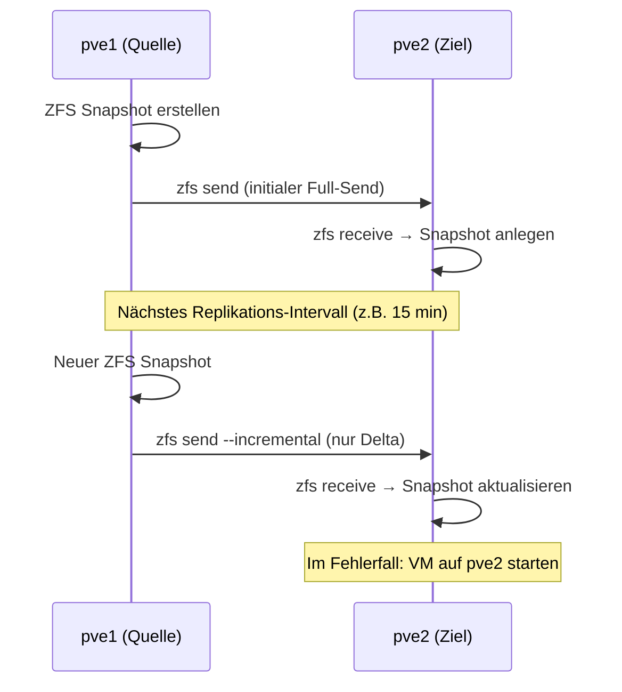

---
tags:
  - virtualization
  - proxmox
  - replication
  - disaster-recovery
  - zfs
  - hochverfügbarkeit
aliases:
  - Proxmox Replication
  - Proxmox Replikation
  - PVE Replication
---

# Proxmox Replication

> [!ABSTRACT] TL;DR
> Proxmox VE hat eine eingebaute **Storage-Replikation** auf Basis von ZFS-Snapshots (`zfs send/receive`). VMs und Container werden asynchron auf andere Cluster-Nodes repliziert — ohne Ceph, ohne Shared Storage. Im Fehlerfall kann die VM auf dem Replikations-Ziel-Node gestartet werden. Replikationsintervall: mindestens 15 Minuten, konfigurierbar bis täglich.

---

## Konzept und Abgrenzung

### Replication vs. HA vs. Ceph

| Merkmal | **Replication** | **HA Manager** | **Ceph** |
|---|---|---|---|
| **Datenverfügbarkeit** | Asynchrone Kopie (RPO ≥ 15 min) | Shared Storage vorausgesetzt | Synchron, immer verfügbar |
| **Failover-Typ** | Manuell (oder via HA mit repliziertem Storage) | Automatisch | Automatisch (bei Ceph + HA) |
| **Storage-Anforderung** | ZFS auf Quell- und Ziel-Node | Shared Storage (Ceph/NFS) | Ceph selbst |
| **Netzwerk-Overhead** | Gering (nur Deltas via ZFS) | Keiner | Hoch (synchrone Writes) |
| **Zielgruppe** | 2-3 Nodes ohne Ceph | Cluster mit Shared Storage | Enterprise-Cluster |
| **Kosten** | Günstig (lokale Disks) | Mittel | Hoch (≥ 3 SSDs pro Node) |

> [!TIP] Wann Replication statt Ceph?
> Replication ist ideal für kleine Cluster (2–3 Nodes) ohne Budget für SSDs in jedem Node. Die VM läuft auf lokalem ZFS-Storage — schnell und günstig. Im Fehlerfall wird sie manuell auf dem Replikations-Ziel gestartet. Für vollautomatisches Failover: Ceph + HA.

### Wie Replication funktioniert



---

## Voraussetzungen

| Anforderung | Details |
|---|---|
| **Cluster** | Beide Nodes müssen im gleichen Proxmox-Cluster sein |
| **Storage-Backend** | Muss **ZFS** sein (auf Quell- und Ziel-Node) |
| **Netzwerk** | Cluster-Netzwerk muss erreichbar sein (Port 22 SSH zwischen Nodes) |
| **VM/CT-Zustand** | VM muss gestoppt oder mit laufendem Gast (Snapshot-Modus) sein |
| **Disk-Format** | Nur `raw` auf ZFS (`zvol`) — kein `qcow2` |

> [!IMPORTANT] ZFS ist Pflicht
> Proxmox Replication funktioniert **ausschließlich mit ZFS** als Storage-Backend. LVM, Directory, NFS und andere Backends werden nicht unterstützt. Beide Nodes (Quelle und Ziel) müssen ZFS verwenden.

---

## Replication einrichten

### Via Web-UI

```
VM auswählen → Replication → Add
```

| Feld | Beschreibung | Empfehlung |
|---|---|---|
| **Target** | Ziel-Node | Anderen Node im Cluster wählen |
| **Schedule** | Replikationsintervall (cron-Syntax) | `*/15 * * * *` (alle 15 min) |
| **Rate** | Maximale Bandbreite (MB/s) | 0 = unbegrenzt |
| **Comment** | Beschreibung | z.B. "DR nach pve2" |

### Via CLI

```bash
# Replication-Job erstellen (VM 100 → pve2, alle 15 Minuten)
pvesh create /nodes/pve1/replication \
    --id 100-0 \
    --target pve2 \
    --schedule "*/15 * * * *" \
    --comment "DR-Replikation nach pve2"

# Replication-Job für Container 200
pvesh create /nodes/pve1/replication \
    --id 200-0 \
    --target pve2 \
    --schedule "0 * * * *" \
    --comment "Stündliche Replikation"

# Mit Bandbreitenbegrenzung (50 MB/s)
pvesh create /nodes/pve1/replication \
    --id 100-1 \
    --target pve3 \
    --schedule "0 2 * * *" \
    --rate 50 \
    --comment "Nächtliche Replikation nach pve3 (begrenzt)"

# Alle Replication-Jobs anzeigen
pvesh get /replication

# Replication-Job deaktivieren
pvesh set /nodes/pve1/replication/100-0 --disable 1

# Replication-Job löschen
pvesh delete /nodes/pve1/replication/100-0
```

### Schedule-Beispiele

| Schedule | Bedeutung |
|---|---|
| `*/15 * * * *` | Alle 15 Minuten (Minimum) |
| `*/30 * * * *` | Alle 30 Minuten |
| `0 * * * *` | Jede Stunde (zur vollen Stunde) |
| `0 */4 * * *` | Alle 4 Stunden |
| `0 2 * * *` | Täglich um 02:00 Uhr |

---

## Replication überwachen

```bash
# Alle Replication-Jobs und ihr Status
pvesh get /replication

# Details eines Jobs
pvesh get /nodes/pve1/replication/100-0

# Replication-Log anzeigen
pvesh get /nodes/pve1/replication/100-0/log

# Status aller Replikationen (kurze Übersicht)
pvesr status

# Replication manuell auslösen (sofort, nicht auf Zeitplan warten)
pvesr run 100-0

# Letzte Replikationsergebnisse
journalctl -u pvesr -n 100 --no-pager

# Fehlerhafte Replikationen
journalctl -u pvesr -p err -S -24h
```

### Status-Bedeutung

| Status | Bedeutung |
|---|---|
| `OK` | Letzte Replikation erfolgreich |
| `syncing` | Replikation läuft gerade |
| `error` | Letzte Replikation fehlgeschlagen |
| `warn` | Warnung (z.B. Zeitüberschreitung) |

---

## Failover-Prozedur

Wenn der Quell-Node (pve1) ausfällt:

### Manueller Failover

```bash
# Auf dem Ziel-Node (pve2):

# 1. Prüfen ob replizierte Snapshots vorhanden sind
zfs list -t snapshot | grep vm-100

# 2. VM aus repliziertem Snapshot starten
# Web-UI: pve2 → VM 100 erscheint dort (im letzten Replikations-Zustand)
qm start 100

# 3. VM läuft nun auf pve2 mit den Daten des letzten Replikations-Zeitpunkts
# Datenverlust: Alles was seit der letzten Replikation auf pve1 passiert ist
```

> [!WARNING] Datenverlust (RPO)
> Der **Recovery Point Objective (RPO)** entspricht dem Replikationsintervall. Bei 15-Minuten-Intervall können maximal 15 Minuten Daten verloren gehen. Für kritische Daten: kürzeres Intervall wählen oder zusätzlich Proxmox Backup Server nutzen.

### Replication nach Wiederherstellung von pve1

```bash
# Wenn pve1 wieder online:

# 1. Replication-Richtung umkehren (pve2 → pve1 Resync)
# VM auf pve2 stoppen
qm stop 100

# 2. Replication-Job neu erstellen (von pve2 zurück nach pve1)
pvesh create /nodes/pve2/replication \
    --id 100-0 \
    --target pve1 \
    --schedule "*/15 * * * *"

# 3. Initialen Sync abwarten
pvesr run 100-0

# 4. VM zurück auf pve1 migrieren
qm migrate 100 pve1 --online
```

---

## Multi-Node-Replication

Eine VM kann an mehrere Nodes repliziert werden — für maximale Redundanz:

```bash
# VM 100 gleichzeitig nach pve2 UND pve3 replizieren
pvesh create /nodes/pve1/replication \
    --id 100-0 \
    --target pve2 \
    --schedule "*/15 * * * *"

pvesh create /nodes/pve1/replication \
    --id 100-1 \
    --target pve3 \
    --schedule "*/30 * * * *"

# Ergebnis: VM-Daten auf 3 Nodes vorhanden
# pve1 → Primär (läuft hier)
# pve2 → Replikat 1 (15-Minuten-Intervall)
# pve3 → Replikat 2 (30-Minuten-Intervall, z.B. für Offsite-Node)
```

---

## Replication + HA kombinieren

Replication und HA können kombiniert werden: VMs werden auf einem Replikations-Ziel repliziert, und HA kann die VM im Fehlerfall automatisch auf dem Ziel-Node starten — wenn der replizierte Storage als "local" auf dem Ziel erkannt wird:

```bash
# 1. Replication einrichten (VM 100 → pve2)
pvesh create /nodes/pve1/replication \
    --id 100-0 --target pve2 --schedule "*/15 * * * *"

# 2. VM für HA registrieren
ha-manager add vm:100 --state started --group ha-gruppe

# Verhalten bei Ausfall von pve1:
# → HA erkennt Ausfall
# → HA startet VM 100 auf pve2 (nutzt letzten replizierten Snapshot)
# → RPO: letzte Replikation (max. 15 Minuten Datenverlust)
```

> [!NOTE] Replication + HA = günstiger DR
> Diese Kombination ist der Mittelweg zwischen reinem lokalem Storage (kein Failover) und Ceph (teuer, komplex). Gut geeignet für KMU mit 2–3 Nodes und SSDs pro Node.

---

## ZFS-Snapshots der Replikation

Proxmox Replication erstellt automatisch ZFS-Snapshots mit dem Präfix `__replicate_`:

```bash
# Replikations-Snapshots auf dem Ziel-Node anzeigen
zfs list -t snapshot | grep __replicate_

# Beispielausgabe:
# datastore/vm-100-disk-0@__replicate_100-0_1705320000  0B  -  ...
# datastore/vm-100-disk-0@__replicate_100-0_1705320900  0B  -  ...

# Replikations-Snapshots manuell löschen (nur wenn Job gelöscht wurde)
# ACHTUNG: Nicht manuell löschen wenn Job noch aktiv!
zfs destroy datastore/vm-100-disk-0@__replicate_100-0_1705320000
```

> [!DANGER] Replikations-Snapshots nicht manuell löschen
> Die Replikations-Snapshots werden für den inkrementellen Transfer benötigt. Werden sie manuell gelöscht, muss beim nächsten Lauf ein **Full-Transfer** durchgeführt werden — abhängig von der VM-Größe können das Hunderte GB sein.

---

## Troubleshooting

### Replikation schlägt fehl

```bash
# Fehlerdetails anzeigen
pvesh get /nodes/pve1/replication/100-0/log
journalctl -u pvesr -p err -S -1h

# Häufige Fehlerursachen:
# 1. Ziel-Node nicht erreichbar
ping pve2
ssh root@pve2 "echo OK"

# 2. ZFS-Pool auf Ziel voll
ssh root@pve2 "zpool list"
ssh root@pve2 "df -h"

# 3. Snapshot-Konflikt
ssh root@pve2 "zfs list -t snapshot | grep vm-100"
# Falls verwaiste Snapshots: Job neu erstellen nach manuellem Cleanup

# 4. Bandbreite überlastet (Timeout)
# Rate begrenzen:
pvesh set /nodes/pve1/replication/100-0 --rate 20
```

### Initialer Full-Transfer dauert zu lange

```bash
# Replikationsgeschwindigkeit überwachen
# Auf dem Ziel-Node während Sync:
zpool iostat -v 2

# Manuell mit Bandbreitenbegrenzung starten
pvesh set /nodes/pve1/replication/100-0 --rate 50   # 50 MB/s
pvesr run 100-0
```

---

## Verwandte Notizen

- [[Was ist Proxmox]]
- [[Proxmox Storage]]
- [[Proxmox Cluster und HA]]
- [[Proxmox Backup Server]]
- [[Proxmox Troubleshooting]]
- [[Proxmox CLI Cheatsheet]]
