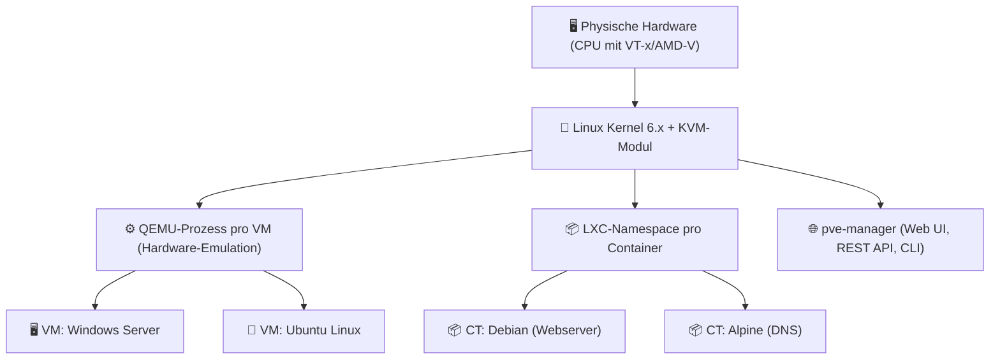

---
tags:
  - virtualization
  - proxmox
  - grundlagen
  - kvm
  - lxc
  - open-source
aliases:
  - Was ist Proxmox
  - Proxmox Grundlagen
  - Proxmox VE Einführung
---

# Was ist Proxmox VE

> [!ABSTRACT] TL;DR
> Proxmox VE (Virtual Environment) ist eine **Open-Source-Typ-1-Hypervisor-Plattform** auf Basis von Debian Linux. Sie kombiniert **KVM** für vollständige Maschinenvirtualisierung mit **LXC** für leichtgewichtige Container — alles über eine einheitliche Weboberfläche verwaltbar. Kostenlos nutzbar, optional mit Enterprise-Subscription für Support und stabilen Update-Kanal.

---

## Was ist Proxmox VE?

Proxmox VE ist eine von der österreichischen Firma **Proxmox Server Solutions GmbH** entwickelte Open-Source-Plattform für Enterprise-Virtualisierung. Sie basiert auf **Debian GNU/Linux** und integriert zwei Virtualisierungstechnologien in einer gemeinsamen Management-Oberfläche:

- **KVM (Kernel-based Virtual Machine)** — vollständige Hardware-Virtualisierung für beliebige Betriebssysteme
- **LXC (Linux Containers)** — leichtgewichtige Betriebssystem-Level-Virtualisierung für Linux-Workloads

Proxmox VE ist **kostenlos** nutzbar (AGPL-Lizenz), bietet aber optional eine **Enterprise-Subscription** mit getesteten Paketen, stabilem Update-Kanal und professionellem Support.

> [!NOTE] Verbreitung
> Proxmox VE ist besonders in Homelab-Umgebungen, kleinen und mittelständischen Unternehmen sowie bei Hosting-Providern verbreitet. Seit den drastischen Lizenzpreiserhöhungen von VMware durch Broadcom (2023/2024) wechseln auch Enterprise-Kunden vermehrt zu Proxmox.

---

## Architektur

### Hypervisor-Typ und Ring-Modell

Proxmox VE ist ein **Typ-1-Hypervisor** — er läuft direkt auf der Hardware, nicht innerhalb eines Host-Betriebssystems. Der Linux-Kernel mit dem eingebauten KVM-Modul übernimmt die Rolle des Hypervisors und nutzt die Hardware-Virtualisierungserweiterungen der CPU:

- **Intel:** VT-x (Virtualization Technology) + EPT (Extended Page Tables)
- **AMD:** AMD-V (SVM Mode) + NPT (Nested Page Tables / RVI)

Im Gegensatz zu Hyper-V gibt es bei Proxmox keine separate „Parent Partition" — der Proxmox-Host selbst ist das privilegierte Management-OS und läuft direkt auf dem Kernel. VMs (QEMU/KVM) und Container (LXC) laufen als Prozesse unter diesem Kernel.



### Kernkomponenten

| Komponente | Beschreibung |
|---|---|
| **KVM** | Linux-Kernel-Modul für Hardware-Virtualisierung (Intel VT-x / AMD-V) |
| **QEMU** | Emulationsschicht — stellt virtualisierte Hardware für KVM-VMs bereit |
| **LXC** | Linux-Container auf Kernel-Ebene — teilen sich Host-Kernel, kein Overhead |
| **libvirt** | Abstraktionsschicht für VM-Management (wird von pve intern verwendet) |
| **Corosync** | Cluster-Kommunikation und Quorum-Management |
| **pve-manager** | Web-UI, REST-API und CLI-Tools (pveam, pvecm, pvesm, qm, pct) |
| **vzdump** | Backup-Tool für VMs und Container |

### KVM vs. LXC — Wann was verwenden?

| Merkmal | **KVM (VM)** | **LXC (Container)** |
|---|---|---|
| **Isolation** | Vollständige Hardware-Isolation | Kernel wird mit Host geteilt |
| **Overhead** | Höher (eigener Kernel, QEMU) | Minimal (kein eigener Kernel) |
| **Gastbetriebssystem** | Beliebig (Windows, Linux, BSD, macOS*) | Nur Linux |
| **Performance** | Nahe native mit KVM | Nahezu native (≈ Bare Metal) |
| **Sicherheit** | Höher (starke Isolation) | Geringer (Kernel-Sharing) |
| **Use Case** | Windows-Server, Legacy-Systeme, andere OS | Linux-Dienste, Web-Apps, Datenbanken |
| **Boot-Zeit** | 10–60 Sekunden | 1–3 Sekunden |
| **Ressourceneffizienz** | Gut | Sehr gut |

> [!TIP] Faustregel
> Wenn Linux und kein Root-Dateisystem-Zugriff auf Kernel-Level nötig ist → **LXC Container**.
> Wenn Windows, BSD, oder vollständige Kernel-Isolation erforderlich → **KVM VM**.

---

## Lizenzmodell

| Lizenz | Kosten | Update-Kanal | Support | Geeignet für |
|---|---|---|---|---|
| **No-Subscription** | Kostenlos | `pve-no-subscription` (weniger getestet) | Community-Forum | Homelab, Test |
| **Community** | ab ~110 €/Jahr/Node | `pvetest` stable | E-Mail-Ticket (10 Tickets) | KMU, SMB |
| **Basic** | ab ~360 €/Jahr/Node | `pve-enterprise` | 3 Tickets/Jahr | Produktion |
| **Standard** | ab ~700 €/Jahr/Node | `pve-enterprise` | Unbegrenzt (8x5) | Unternehmen |
| **Premium** | ab ~1.400 €/Jahr/Node | `pve-enterprise` | Unbegrenzt (24x7) | Enterprise |

> [!NOTE] Kostenlos = vollständig funktionsfähig
> Die Community-Edition (ohne Subscription) ist **vollständig funktionsfähig** — alle Features sind verfügbar. Der einzige Unterschied ist der Update-Kanal und der Support-Zugang. Lediglich der „You do not have a valid subscription"-Hinweis im Login erscheint (entfernbar).

---

## Vergleich mit anderen Hypervisoren

| Merkmal | **Proxmox VE** | **VMware ESXi** | **Hyper-V** | **KVM (nackt)** |
|---|---|---|---|---|
| **Typ** | Typ-1 (KVM-basiert) | Typ-1 | Typ-1 | Typ-1 (Kernel) |
| **Lizenz** | Open Source (AGPL) | Proprietär (Broadcom) | Proprietär / enthalten | Open Source (GPL) |
| **Kosten** | Kostenlos / Subscription | Sehr hoch (post-Broadcom) | In Windows Server enthalten | Kostenlos |
| **Web-UI** | ✅ Vollständig | ✅ vSphere Client | ⚠️ Hyper-V Manager (veraltet) | ❌ (nur Virt-Manager/Cockpit) |
| **Container** | ✅ LXC nativ | ❌ (nur über Tanzu) | ❌ (nur Docker in VM) | ❌ |
| **Cluster / HA** | ✅ Built-in | ✅ vSphere HA | ✅ Failover Cluster | ⚠️ manuell |
| **Ceph Storage** | ✅ Built-in integriert | ❌ | ❌ | ⚠️ separat |
| **Backup-Tool** | ✅ vzdump + PBS | ✅ VDP (separat) | ⚠️ Drittanbieter | ❌ |
| **Windows-VMs** | ✅ (KVM + VirtIO) | ✅ | ⭐⭐⭐⭐⭐ nativ | ✅ |
| **Linux-VMs** | ⭐⭐⭐⭐⭐ | ⭐⭐⭐⭐ | ⭐⭐⭐ | ⭐⭐⭐⭐⭐ |
| **Zielgruppe** | Homelab, KMU, Hosting | Enterprise (historisch) | Microsoft-Umgebungen | Server-Admins |

---

## Kernkonzepte im Überblick

### Nodes, Cluster und Datacenter

| Begriff | Beschreibung |
|---|---|
| **Node** | Einzelner Proxmox-Host (physischer Server) |
| **Cluster** | Verbund von ≥ 3 Nodes mit gemeinsamer Konfiguration und HA |
| **Datacenter** | Logische Gruppierung aller Nodes im Web-UI |

### VM-IDs und CTID

Jede VM und jeder Container hat eine eindeutige numerische ID:
- **100–999**: Empfohlener Bereich für VMs
- **100–199**: Reserviert für Container in vielen Setups
- **1–99**: Intern (nicht nutzen)

### Storage-Typen

| Typ | Beschreibung | Shared |
|---|---|---|
| **Directory** | Einfaches Verzeichnis im Dateisystem | ❌ |
| **LVM / LVM-Thin** | Logische Volumes — LVM-Thin für Snapshots | ❌ |
| **ZFS** | Copy-on-Write-Dateisystem mit Snapshot-Support | ❌ / ✅ (über ZFS on DRBD) |
| **Ceph RBD** | Verteilter Ceph-Block-Storage — built-in in Proxmox | ✅ |
| **NFS** | Netzwerk-Dateisystem | ✅ |
| **iSCSI** | Block-Storage über Netzwerk | ✅ |
| **PBS** | Proxmox Backup Server — dediziertes Backup-Backend | ✅ |

Details → [[Proxmox Storage]]

### Netzwerk-Grundlagen

| Konzept | Beschreibung |
|---|---|
| **Linux Bridge (vmbr)** | Virtuelle Bridge — Standardnetzwerk in Proxmox |
| **Bond** | NIC-Teaming für Redundanz / Lastverteilung |
| **VLAN** | 802.1Q VLAN-Tagging auf Bridges |
| **OVS** | Open vSwitch — Alternative zu Linux Bridge |
| **SDN** | Software Defined Networking — ab PVE 7.x |

Details → [[Proxmox Netzwerk]]

---

## Web-UI und Verwaltung

### Proxmox Web-UI (Port 8006)

Die Web-UI ist das zentrale Verwaltungs-Interface. Sie ist vollständig browserbasiert und erfordert keine zusätzliche Client-Software. Aufruf über `https://<IP>:8006`.

```
┌─────────────────────────────────────────────────────────────┐
│  Datacenter                                                  │
│  └─► pve1 (Node)                                            │
│       ├─► 100 (ubuntu-server) [VM]                          │
│       ├─► 101 (win-server-2022) [VM]                        │
│       ├─► 200 (nginx-ct) [CT]                               │
│       └─► Storage / Netzwerk / Firewall / ...               │
│  └─► pve2 (Node)                                            │
│       └─► ...                                               │
└─────────────────────────────────────────────────────────────┘
```

### Management-Ebenen

| Ebene | Tool | Beschreibung |
|---|---|---|
| **Web-UI** | `https://<ip>:8006` | Vollständige grafische Verwaltung |
| **pvesh** | `pvesh get /nodes` | REST-API direkt per CLI aufrufen |
| **qm** | `qm start 100` | VM-Verwaltung (QEMU Manager) |
| **pct** | `pct enter 200` | Container-Verwaltung (Proxmox Container Toolkit) |
| **pvecm** | `pvecm status` | Cluster-Verwaltung |
| **pvesm** | `pvesm status` | Storage-Verwaltung |
| **SSH** | `ssh root@pve` | Direkter Shell-Zugriff (Debian Linux) |

> [!TIP] Alles ist API
> Alle Web-UI-Aktionen nutzen intern dieselbe REST-API. Mit `pvesh` lässt sich jede Aktion auch per Skript automatisieren — ideal für Infrastructure-as-Code.

---

## VirtIO — Paravirtualisierung

VirtIO ist das wichtigste Konzept für VM-Performance in Proxmox. Statt Hardware zu emulieren (langsam), kommuniziert das Gastbetriebssystem über ein optimiertes Protokoll direkt mit dem Hypervisor.

| Gerät | Emuliert (langsam) | VirtIO (schnell) |
|---|---|---|
| **Netzwerk** | `e1000`, `rtl8139` | `virtio-net` |
| **Disk-Controller** | `IDE`, `SATA` | `virtio-scsi`, `virtio-blk` |
| **Ballon** | – | `virtio-balloon` (Dynamic Memory) |
| **Random** | – | `virtio-rng` (Entropy) |
| **Serial** | – | `virtio-serial` (Console) |

### VirtIO-Treiber installieren

**Linux:** VirtIO-Treiber sind seit Kernel 2.6.25 im Mainline-Kernel enthalten — keine separate Installation nötig.

**Windows:** VirtIO-Treiber müssen manuell installiert werden:
```
1. VirtIO-ISO einbinden: https://fedorapeople.org/groups/virt/virtio-win/
2. Während der Windows-Installation: Treiber von der ISO laden
3. Nach Installation: virtio-win-guest-tools.exe ausführen (installiert alle Treiber + QEMU Guest Agent)
```

> [!WARNING] Windows ohne VirtIO-Treiber
> Eine Windows-VM mit SATA- statt VirtIO-Disk hat bis zu 60 % geringere I/O-Performance. VirtIO-Treiber vor der Installation einbinden oder nachträglich über den Geräte-Manager installieren.

---

## QEMU Guest Agent

Der **QEMU Guest Agent** ist ein Dienst im Gast-OS, der die Kommunikation zwischen Host und VM verbessert:

| Funktion | Ohne Agent | Mit Agent |
|---|---|---|
| **Graceful Shutdown** | ⚠️ ACPI-Signal (ggf. ignoriert) | ✅ Sicheres Herunterfahren |
| **IP-Adresse im Web-UI** | ❌ Nicht sichtbar | ✅ Direkt angezeigt |
| **Konsistente Snapshots** | ⚠️ Crash-konsistent | ✅ Dateisystem gequiesced (VSS/fsfreeze) |
| **Datei-Trim (SSD)** | ❌ | ✅ `fstrim` nach Klonen |
| **Befehle ausführen** | ❌ | ✅ `qm agent <id> exec` |

```bash
# Linux: QEMU Guest Agent installieren
# Ubuntu/Debian:
apt install qemu-guest-agent
systemctl enable --now qemu-guest-agent

# RHEL/Rocky/AlmaLinux:
dnf install qemu-guest-agent
systemctl enable --now qemu-guest-agent

# Status vom Host aus prüfen
qm agent 100 ping
qm agent 100 get-osinfo
```

---

## PCI-Passthrough (IOMMU)

Mit **PCI-Passthrough** können physische Geräte (GPU, NIC, HBA, USB-Controller) direkt und exklusiv an eine VM durchgereicht werden — die VM greift ohne Virtualisierungsschicht auf die Hardware zu.

### Typische Anwendungsfälle

| Anwendungsfall | Gerät |
|---|---|
| Gaming-VM / VFIO | GPU (NVIDIA/AMD) |
| High-Performance Netzwerk | 10/25 GbE NIC |
| Direkter Storage-Zugriff | HBA (RAID-Controller, SAS) |
| USB-Geräte | USB-Controller |

### IOMMU aktivieren

```bash
# 1. BIOS: Intel VT-d / AMD-Vi aktivieren

# 2. Kernel-Parameter setzen
nano /etc/default/grub

# Intel:
GRUB_CMDLINE_LINUX_DEFAULT="quiet intel_iommu=on iommu=pt"
# AMD:
GRUB_CMDLINE_LINUX_DEFAULT="quiet amd_iommu=on iommu=pt"

# 3. GRUB aktualisieren
update-grub

# 4. Kernel-Module laden
echo "vfio vfio_iommu_type1 vfio_pci vfio_virqfd" >> /etc/modules

# 5. Neustart und Prüfung
dmesg | grep -e DMAR -e IOMMU -e AMD-Vi
```

> [!IMPORTANT] `iommu=pt` (Passthrough-Modus)
> Der Parameter `iommu=pt` aktiviert den Passthrough-Modus, der nur Geräte in IOMMU-Gruppen abbildet, die tatsächlich durchgereicht werden. Das verhindert Performance-Einbußen für alle anderen Geräte.

---

## Feature-Überblick

Proxmox VE ist weit mehr als nur ein Hypervisor. Die Plattform integriert zahlreiche Enterprise-Features direkt:

### Virtualisierung

| Feature | Beschreibung |
|---|---|
| **KVM/QEMU-VMs** | Vollständige Hardware-Virtualisierung — Windows, Linux, BSD, beliebige OS |
| **LXC-Container** | Leichtgewichtige Linux-Container mit nahezu nativer Performance |
| **OCI-Container** | Docker-Hub/GHCR-Images direkt als LXC-Container (ab PVE 8.2) |
| **Nested Virtualization** | Hyper-V / KVM in einer PVE-VM ausführen (für Labs) |
| **PCI-Passthrough** | GPUs, NICs, HBAs direkt an VMs durchreichen (IOMMU) |
| **USB-Passthrough** | USB-Geräte an laufende VMs weiterleiten |
| **SPICE / noVNC** | Browser- und Client-basierter VM-Konsolenzugriff |
| **Cloud-Init** | Automatisierte VM-Erstkonfiguration (IP, SSH-Key, Hostname) |

### Storage

| Feature | Beschreibung |
|---|---|
| **Ceph (eingebaut)** | Verteilter, fehlertoleranter Block-Storage — direkt in PVE integriert |
| **ZFS** | CoW-Dateisystem mit Snapshots, RAID, Kompression — nativ unterstützt |
| **LVM / LVM-Thin** | Klassische und Thin-Provisioned Volumes |
| **NFS / SMB** | Netzwerk-Storage-Einbindung |
| **iSCSI** | Block-Storage über Netzwerk (SAN) |
| **Proxmox Backup Server** | Deduplizierte, verschlüsselte Backups mit Single-File-Restore |
| **vzdump** | Integriertes Backup-Tool für VMs und Container |

### Netzwerk

| Feature | Beschreibung |
|---|---|
| **Linux Bridges** | Standard-Netzwerkmodell — einfach und stabil |
| **VLAN-Aware Bridges** | 802.1Q-VLAN-Tagging pro VM/Container |
| **Bonding / LACP** | NIC-Teaming für Redundanz und höheren Durchsatz |
| **Open vSwitch** | Erweiterte Netzwerkfunktionen für komplexe Topologien |
| **SDN (Software Defined Networking)** | VNets, VXLAN, EVPN — ab PVE 7.x stabil |
| **Integrierte Firewall** | 3-Ebenen-Firewall (Datacenter / Node / VM) |

### Cluster und Hochverfügbarkeit

| Feature | Beschreibung |
|---|---|
| **Cluster-Management** | Bis zu 32 Nodes in einem Cluster |
| **Corosync** | Zuverlässige Cluster-Kommunikation mit Quorum |
| **HA Manager** | Automatischer VM-Neustart bei Node-Ausfall |
| **Live Migration** | VM/Container ohne Downtime zwischen Nodes verschieben |
| **Fencing** | IPMI/BMC-basiertes Node-Fencing für Split-Brain-Prävention |
| **Geo-Cluster** | Stretch-Cluster über mehrere Standorte möglich |

### Verwaltung und Betrieb

| Feature | Beschreibung |
|---|---|
| **Web-UI** | Vollständige browserbasierte Verwaltung (Port 8006) |
| **REST-API** | Vollständige API — jede UI-Aktion ist per API aufrufbar |
| **RBAC** | Benutzer, Gruppen, Rollen, ACLs, Pools |
| **Realm-Integration** | PAM, PVE-intern, LDAP, Active Directory, OIDC |
| **API-Tokens** | Für Automatisierung ohne Benutzer-Passwort |
| **2FA / WebAuthn** | TOTP, FIDO2/Yubikey, Recovery-Keys |
| **Monitoring** | RRD-Graphen, InfluxDB/Graphite-Export, Notification-System |
| **Notifications** | SMTP, Gotify, Sendmail — für Backups, Fehler, Updates |

> [!TIP] Alles in einer Oberfläche
> Der entscheidende Vorteil von Proxmox gegenüber „nacktem" KVM oder separaten Tools ist die **zentrale Integration**: Cluster, Storage (inkl. Ceph), Backups, Firewall, Benutzer und Monitoring — alles in einer Web-Oberfläche und über eine REST-API steuerbar.

---

## Versionsgeschichte

| Version | Basis | Jahr | Wichtige Neuerungen |
|---|---|---|---|
| **1.0** | Debian 4 | 2008 | Erster Release, OpenVZ + KVM |
| **3.x** | Debian 7 | 2013 | Ceph-Integration, HA-Manager |
| **4.0** | Debian 8 | 2015 | LXC statt OpenVZ, ZFS-Support |
| **5.x** | Debian 9 | 2017 | Hyper-Converged Infrastructure (HCI), Corosync 3 |
| **6.x** | Debian 10 | 2019 | SDN Preview, Proxmox Backup Server |
| **7.x** | Debian 11 | 2021 | Ceph Pacific, SDN stabil, PBS Integration |
| **8.x** | Debian 12 | 2023 | Ceph Quincy/Reef, SDN EVPN, Notifications, Datacenter Summary |

> [!IMPORTANT] Aktuelle Version: PVE 8.x
> Proxmox VE 8.x basiert auf Debian 12 (Bookworm) mit Kernel 6.x. Alle neuen Installationen sollten mit 8.x beginnen. Upgrades von 7.x auf 8.x sind in-place möglich.

---

## Systemanforderungen

| Komponente | Mindestanforderung | Empfehlung |
|---|---|---|
| **CPU** | 64-Bit mit Intel VT-x / AMD-V | AMD EPYC / Intel Xeon mit VT-d / IOMMU |
| **RAM** | 2 GB (Host-OS) + RAM für VMs | 32 GB+ (mindestens 2 GB pro gleichzeitig laufender VM) |
| **Storage** | 32 GB (OS-Disk) | NVMe SSD für OS; separate Disks für VM-Storage |
| **Netzwerk** | 1 GbE | 10 GbE (besonders für Ceph und Live Migration) |
| **Storage (Ceph)** | ≥ 3 Nodes, jeweils ≥ 1 dedizierte Disk | SSDs als OSD, separate Management-NIC |

> [!IMPORTANT] IOMMU für PCI-Passthrough
> Für PCIe-Passthrough (GPU, NIC, HBA direkt an VM) muss **IOMMU** im BIOS aktiviert sein:
> - Intel: `Intel VT-d`
> - AMD: `AMD-Vi (IOMMU)`
> Zudem muss IOMMU im Linux-Kernel-Parameter aktiviert werden (`intel_iommu=on` / `amd_iommu=on`).

---

## Verwandte Notizen

- [[Proxmox Installation]]
- [[Proxmox Netzwerk]]
- [[Proxmox Storage]]
- [[Proxmox VM und Container Verwaltung]]
- [[Proxmox Cluster und HA]]
- [[Hyper-V Index]]
- [[ESXi Index]]
