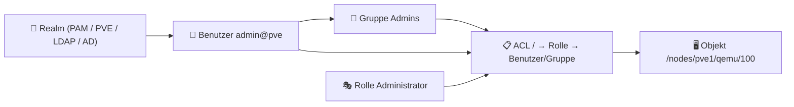

---
tags:
  - virtualization
  - proxmox
  - benutzerverwaltung
  - rbac
  - sicherheit
  - ldap
  - active-directory
aliases:
  - Proxmox Benutzerverwaltung
  - Proxmox Rollen
  - Proxmox RBAC
  - PVE Benutzer
---

# Proxmox Benutzerverwaltung

> [!ABSTRACT] TL;DR
> Proxmox VE verwendet ein mehrstufiges Berechtigungsmodell: **Realms** definieren, wie Benutzer sich authentifizieren (PAM, PVE-intern, LDAP, Active Directory). **Rollen** bündeln Berechtigungen. **ACLs** weisen Rollen auf bestimmten Pfaden (Nodes, VMs, Storage) zu. Dazu kommen **API-Tokens**, **Gruppen** und **Zwei-Faktor-Authentifizierung**.

---

## Konzept: Realms, Benutzer, Gruppen, Rollen, ACLs



Proxmox verwendet keine klassische Benutzer-Passwort-Datenbank allein — stattdessen werden Benutzer immer in einem **Realm** verwaltet. Ein Benutzer-Login lautet daher immer `benutzer@realm`.

---

## Realms (Authentifizierungsquellen)

| Realm | Suffix | Beschreibung |
|---|---|---|
| **Linux PAM** | `@pam` | Lokale Linux-Systembenutzer (`/etc/passwd`) — Standard für `root` |
| **Proxmox VE** | `@pve` | Interne PVE-Datenbank — empfohlen für dedizierte PVE-Benutzer |
| **LDAP** | `@ldap` | Externe LDAP-Verzeichnisdienste (OpenLDAP) |
| **Active Directory** | `@ad` | Microsoft Active Directory / LDAP-kompatibel |
| **OpenID Connect** | `@oidc` | OAuth2/OIDC — z.B. Keycloak, Authentik, GitHub |

### Realm-Verwaltung

```bash
# Alle konfigurierten Realms anzeigen
pvesh get /access/domains

# PVE-internen Realm-Benutzer erstellen (empfohlen statt PAM)
pveum user add admin@pve --password 'SicheresPasswort!' \
    --firstname Admin --lastname User \
    --email admin@example.com \
    --comment "Hauptadministrator"

# Benutzer löschen
pveum user delete admin@pve

# Benutzer-Passwort ändern
pveum passwd admin@pve
```

---

## LDAP / Active Directory

### LDAP-Realm einrichten (Web-UI)

```
Datacenter → Realms → Add → LDAP
```

| Feld | Beschreibung | Beispiel |
|---|---|---|
| **Realm** | Eindeutiger Name | `ldap` |
| **Base DN** | Suchbasis im Verzeichnis | `dc=example,dc=com` |
| **User Attribute** | Attribut für den Login-Namen | `uid` (LDAP) / `sAMAccountName` (AD) |
| **Server** | LDAP-Server | `ldap.example.com` |
| **Port** | 389 (LDAP) / 636 (LDAPS) | `636` |
| **SSL** | Verschlüsselt | ✅ empfohlen |

### Active Directory Realm (CLI)

```bash
# AD-Realm hinzufügen
pveum realm add ad \
    --type ad \
    --domain EXAMPLE.COM \
    --server dc01.example.com \
    --comment "Active Directory"

# AD-Sync konfigurieren (Benutzer/Gruppen aus AD importieren)
pveum realm sync ad --enable-new 1 --remove-vanished 0

# Synchronisation automatisieren (Cron)
echo "0 6 * * * root pveum realm sync ad" > /etc/cron.d/pve-ad-sync
```

> [!NOTE] AD-Benutzer bei erstem Login
> AD-Benutzer müssen bei PVE vorhanden sein bevor sie sich einloggen können — entweder durch Sync oder manuelle Anlage. Mit `--enable-new 1` beim Sync werden neue AD-Benutzer automatisch in PVE angelegt.

### OpenID Connect (OIDC)

```bash
# OIDC-Realm hinzufügen (z.B. Keycloak)
pveum realm add myoidc \
    --type openid \
    --issuer-url https://keycloak.example.com/realms/proxmox \
    --client-id proxmox \
    --client-key 'CLIENT_SECRET_HIER' \
    --username-claim email \
    --comment "Keycloak SSO"
```

---

## Benutzer verwalten

```bash
# Alle Benutzer auflisten
pveum user list

# Benutzer-Details
pveum user list --output-format json | python3 -m json.tool

# Benutzer aktivieren / deaktivieren
pveum user modify admin@pve --enable 1
pveum user modify admin@pve --enable 0

# Ablaufdatum setzen
pveum user modify temp@pve --expire $(date -d "+30 days" +%s)
```

---

## Gruppen

Gruppen fassen mehrere Benutzer zusammen — ACLs können auf Gruppen gesetzt werden statt auf Einzelbenutzer:

```bash
# Gruppe erstellen
pveum group add admins --comment "Systemadministratoren"
pveum group add helpdesk --comment "Helpdesk - read-only"
pveum group add vm-owners --comment "VM-Eigentümer"

# Benutzer zu Gruppe hinzufügen
pveum user modify alice@pve --groups admins
pveum user modify bob@pve --groups helpdesk,vm-owners    # Mehrere Gruppen

# Gruppen anzeigen
pveum group list

# Gruppendetails
pveum group list --output-format json

# Gruppe löschen
pveum group delete helpdesk
```

---

## Rollen (RBAC)

Rollen sind Sammlungen von **Privileges** (einzelnen Berechtigungen). Proxmox liefert einige Built-in-Rollen:

### Built-in Rollen

| Rolle | Beschreibung | Typischer Einsatz |
|---|---|---|
| **Administrator** | Vollzugriff auf alles | Systemadministratoren |
| **PVEAdmin** | Fast alles außer System-Konfiguration | Senior-Admins ohne root-Äquivalent |
| **PVEDatastoreAdmin** | Vollzugriff auf Storage | Storage-Admins |
| **PVEDatastoreUser** | Storage nutzen (Backups speichern) | Backup-Nutzer |
| **PVEPoolAdmin** | Pool-Verwaltung | Team-Leads |
| **PVEPoolUser** | Zugriff auf Pool-Ressourcen | Entwickler, Teams |
| **PVEVMAdmin** | Vollzugriff auf VMs | VM-Administratoren |
| **PVEVMUser** | VMs starten/stoppen/konsolidieren | VM-Benutzer |
| **PVEAuditor** | Nur lesen — kein Schreibzugriff | Read-only Monitoring |
| **NoAccess** | Explizit kein Zugriff | Ausnahmen in ACL-Hierarchie |

### Eigene Rolle erstellen

```bash
# Verfügbare Privileges anzeigen
pveum role list
pvesh get /access/roles/PVEVMUser    # Details einer Rolle

# Eigene Rolle mit spezifischen Privileges erstellen
pveum role add VMOperator \
    --privs "VM.PowerMgmt,VM.Console,VM.Monitor,VM.Audit"

# Rolle erweitern
pveum role modify VMOperator \
    --privs "VM.PowerMgmt,VM.Console,VM.Monitor,VM.Audit,VM.Snapshot"

# Alle Privileges (Referenz)
# Sys.*     → Host-System-Berechtigungen
# VM.*      → VM- und Container-Berechtigungen
# Datastore.* → Storage-Berechtigungen
# Pool.*    → Pool-Berechtigungen
# User.*    → Benutzerverwaltungs-Berechtigungen
# SDN.*     → SDN-Berechtigungen
```

---

## ACLs (Access Control Lists)

ACLs verknüpfen **Benutzer/Gruppen** mit **Rollen** auf bestimmten **Pfaden**:

### ACL-Pfad-Hierarchie

```
/                           → Gesamtes Datacenter (alle Nodes, alle VMs)
/nodes                      → Alle Nodes
/nodes/pve1                 → Spezifischer Node
/nodes/pve1/qemu/100        → Spezifische VM (ID 100)
/nodes/pve1/lxc/200         → Spezifischer Container (ID 200)
/storage                    → Alle Storages
/storage/local-lvm          → Spezifischer Storage
/pool/entwicklung           → Spezifischer Pool
```

> [!IMPORTANT] Vererbung
> ACLs werden in der Hierarchie vererbt. Eine Rolle auf `/` gilt für alle Objekte. Eine Rolle auf `/nodes/pve1/qemu/100` gilt nur für diese eine VM. `NoAccess` auf einem Kind-Objekt überschreibt eine übergeordnete Erlaubnis.

### ACLs setzen

```bash
# Benutzer als Administrator (globaler Vollzugriff)
pveum acl modify / --users admin@pve --roles Administrator

# Gruppe auf alle VMs eines Nodes berechtigen
pveum acl modify /nodes/pve1 --groups vm-owners --roles PVEVMAdmin

# Helpdesk: Nur lesen auf alles
pveum acl modify / --groups helpdesk --roles PVEAuditor

# Entwickler: Vollzugriff nur auf ihre VMs (via Pool)
pveum acl modify /pool/entwicklung --groups developer --roles PVEVMUser

# Backup-Service: Nur Storage-Schreibzugriff
pveum acl modify /storage/pbs-backup --users backup-service@pve --roles PVEDatastoreUser

# ACLs anzeigen
pveum acl list
pvesh get /access/acl
```

---

## Pools

Pools gruppieren VMs, Container und Storage für einfachere Berechtigungsverwaltung:

```bash
# Pool erstellen
pveum pool add entwicklung --comment "Entwicklungs-VMs"
pveum pool add produktion --comment "Produktions-VMs"

# VMs zu Pool hinzufügen
pveum pool modify entwicklung --vms 100,101,102

# Storage zu Pool hinzufügen
pveum pool modify entwicklung --storage dev-storage

# Pools anzeigen
pveum pool list

# Pool-Details
pveum pool list --output-format json
```

---

## API-Tokens

API-Tokens ermöglichen den Zugriff auf die Proxmox-API ohne Benutzer-Passwort — ideal für Automatisierung (Ansible, Terraform, Scripts):

```bash
# Token erstellen (für Benutzer admin@pve)
pveum user token add admin@pve ansible-token \
    --privsep 1 \
    --comment "Ansible Automation Token"
# Ausgabe: admin@pve!ansible-token=xxxxxxxx-xxxx-xxxx-xxxx-xxxxxxxxxxxx
# WICHTIG: Token-Secret wird nur einmal angezeigt!

# Token mit eingeschränkten Privilegien (privsep=1 = Privilege Separation)
# Token kann maximal die Rechte des Benutzers haben
pveum user token add backup-service@pve pbs-token --privsep 1

# Token-Liste anzeigen
pveum user token list admin@pve

# Token widerrufen
pveum user token remove admin@pve ansible-token
```

### Token in API-Requests nutzen

```bash
# API-Anfrage mit Token-Authentifizierung
curl -H "Authorization: PVEAPIToken=admin@pve!ansible-token=TOKENVALUE" \
    https://pve:8006/api2/json/nodes

# Terraform Provider (Telmate/Proxmox)
provider "proxmox" {
  pm_api_url          = "https://pve:8006/api2/json"
  pm_api_token_id     = "admin@pve!terraform"
  pm_api_token_secret = "xxxxxxxx-xxxx-xxxx-xxxx-xxxxxxxxxxxx"
}
```

> [!TIP] Privilege Separation aktivieren (`--privsep 1`)
> Mit `privsep=1` kann ein API-Token maximal die Berechtigungen des zugehörigen Benutzers haben. Selbst wenn der Benutzer `Administrator` ist, kann dem Token nur `PVEVMUser` zugewiesen werden — zusätzliche Sicherheitsebene für Automatisierung.

---

## Zwei-Faktor-Authentifizierung (2FA)

### TOTP (Time-based One-Time Password)

```bash
# 2FA für Benutzer aktivieren (Web-UI)
# Benutzer → oben rechts auf Benutzername klicken
# → Two Factor Authentication → Add → TOTP
# → QR-Code mit Authenticator-App scannen (Google Authenticator, Bitwarden, Aegis)

# Via CLI: TOTP-Secret generieren und setzen
pveum user tfa add admin@pve totp \
    --totp "otpauth://totp/Proxmox:admin@pve?secret=GEHEIMESBASE32SECRET"
```

### WebAuthn (FIDO2 / Yubikey)

```bash
# WebAuthn-Konfiguration (Datacenter → Options → WebAuthn)
# Erfordert HTTPS mit gültigem Zertifikat

# Via CLI (Datacenter-Konfiguration)
pvesh set /cluster/config/options \
    --webauthn "rp=pve.example.com,origin=https://pve.example.com:8006,id=pve.example.com"
```

### Recovery Keys

```bash
# Recovery Keys erstellen (Fallback wenn TOTP-Gerät verloren)
# Web-UI: Two Factor Authentication → Recovery Keys → Generate
# → 10 Einmal-Codes, sicher aufbewahren!
```

> [!WARNING] 2FA für root aktivieren
> `root@pam` sollte zwingend mit 2FA gesichert sein. Alternativ: SSH-Key-only für root + dedizierter Admin-User mit 2FA für Web-UI.

---

## Praxisbeispiel: Mehrmandanten-Setup

```bash
# Szenario: Hosting-Provider mit mehreren Kunden

# Pools pro Kunde
pveum pool add kunde-a --comment "Kunde A GmbH"
pveum pool add kunde-b --comment "Kunde B AG"

# Benutzer pro Kunde
pveum user add admin-a@pve --password 'PassA!' --comment "Kunde A Admin"
pveum user add admin-b@pve --password 'PassB!' --comment "Kunde B Admin"

# Rollen zuweisen — nur auf ihren Pool
pveum acl modify /pool/kunde-a --users admin-a@pve --roles PVEVMAdmin
pveum acl modify /pool/kunde-b --users admin-b@pve --roles PVEVMAdmin

# VMs den Pools zuweisen
pveum pool modify kunde-a --vms 100,101,102
pveum pool modify kunde-b --vms 200,201,202

# Ergebnis: admin-a@pve sieht nur VMs 100-102, admin-b@pve nur 200-202
```

---

## Verwandte Notizen

- [[Was ist Proxmox]]
- [[Proxmox Installation]]
- [[Proxmox Best Practices]]
- [[Proxmox CLI Cheatsheet]]
- [[Proxmox Troubleshooting]]
