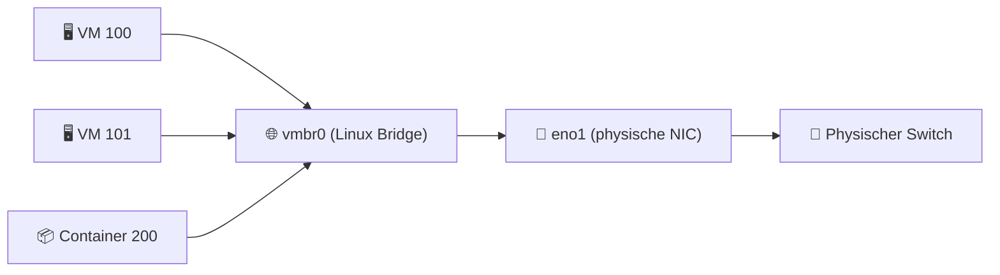

---
tags:
  - virtualization
  - proxmox
  - netzwerk
  - bridge
  - vlan
  - bond
  - sdn
aliases:
  - Proxmox Netzwerk
  - PVE Netzwerk
  - Proxmox Bridge
---

# Proxmox Netzwerk

> [!ABSTRACT] TL;DR
> Proxmox VE nutzt **Linux Bridges (vmbr)** als Standard-Netzwerkmodell — VMs und Container verbinden sich über virtuelle Bridge-Ports mit dem physischen Netzwerk. Bonds ermöglichen NIC-Teaming für Redundanz. VLANs per 802.1Q-Tagging. Für komplexe Szenarien steht **Open vSwitch (OVS)** und ab PVE 7.x das eingebaute **SDN-Framework** zur Verfügung.

---

## Grundkonzept: Linux Bridges

In Proxmox VE wird Netzwerk über **Linux Bridges** realisiert. Eine Bridge verhält sich wie ein virtueller Switch:



Alle Konfiguration liegt in `/etc/network/interfaces`.

---

## Netzwerk-Konfigurationsdatei

```bash
# Datei öffnen
nano /etc/network/interfaces

# Konfiguration ohne Reboot anwenden
ifreload -a

# Status prüfen
ip addr show
brctl show          # Bridge-Status
bridge link show    # Detaillierter Bridge-Status
```

---

## Bridge-Typen und Anwendungsfälle

### Standard Linux Bridge (vmbr)

Die einfachste und häufigste Konfiguration:

```
# Physische NIC (untagged, kein IP)
auto eno1
iface eno1 inet manual

# Management-Bridge mit IP
auto vmbr0
iface vmbr0 inet static
    address 192.168.1.10/24
    gateway 192.168.1.1
    bridge-ports eno1
    bridge-stp off
    bridge-fd 0
    dns-nameservers 192.168.1.1
    dns-search example.local
```

| Parameter | Beschreibung |
|---|---|
| `bridge-ports` | Physische NIC(s), die der Bridge zugewiesen werden |
| `bridge-stp off` | Spanning Tree Protocol deaktivieren (empfohlen für einzelne Uplinks) |
| `bridge-fd 0` | Forward Delay auf 0 setzen (kein Warten beim Port-Aktivieren) |

### Isolierte Bridge (keine physische NIC)

Für interne VM-zu-VM-Kommunikation ohne physisches Netzwerk:

```
# Isolierte Bridge für Testumgebungen
auto vmbr99
iface vmbr99 inet manual
    bridge-ports none
    bridge-stp off
    bridge-fd 0
```

---

## VLANs

### Methode 1: VLAN-Aware Bridge (empfohlen ab PVE 6.x)

Eine einzige Bridge für alle VLANs — das Tagging wird per VM/Container-Konfiguration gesteuert:

```
auto eno1
iface eno1 inet manual

auto vmbr0
iface vmbr0 inet static
    address 192.168.1.10/24
    gateway 192.168.1.1
    bridge-ports eno1
    bridge-stp off
    bridge-fd 0
    bridge-vlan-aware yes       # VLAN-Aware aktivieren
    bridge-vids 2-4094          # Alle VLANs erlauben
```

VMs erhalten dann einen VLAN-Tag in ihrer Netzwerkkonfiguration (Web-UI: Network → VLAN Tag).

### Methode 2: Separate VLAN-Interfaces (klassisch)

```
# VLAN-Interface erstellen
auto eno1.10
iface eno1.10 inet manual

# Bridge für VLAN 10
auto vmbr10
iface vmbr10 inet manual
    bridge-ports eno1.10
    bridge-stp off
    bridge-fd 0
```

> [!TIP] VLAN-Aware Bridge bevorzugen
> Die VLAN-Aware Bridge ist flexibler und erfordert weniger Konfigurationszeilen. Sie ist die empfohlene Methode für neue Setups.

---

## NIC Bonding (Teaming)

Bonding kombiniert mehrere NICs für Redundanz und/oder höheren Durchsatz.

### Bond-Modi

| Modus | Name | Beschreibung | Failover | Durchsatz |
|---|---|---|---|---|
| **0** | balance-rr | Round-Robin über alle NICs | ✅ | Σ aller NICs |
| **1** | active-backup | Nur eine NIC aktiv, andere Standby | ✅ | Einzelne NIC |
| **2** | balance-xor | XOR-basiert, deterministisch | ✅ | Σ (mit Switch-Support) |
| **4** | 802.3ad (LACP) | IEEE 802.3ad Link Aggregation | ✅ | Σ (Switch muss LACP unterstützen) |
| **5** | balance-tlb | Adaptive Transmit Load Balancing | ✅ | Tx: Σ, Rx: Einzelne NIC |
| **6** | balance-alb | Adaptive Load Balancing | ✅ | Σ (Tx + Rx) |

### Bond mit LACP (802.3ad) konfigurieren

```
# Physische NICs
auto eno1
iface eno1 inet manual
    bond-master bond0

auto eno2
iface eno2 inet manual
    bond-master bond0

# Bond-Interface
auto bond0
iface bond0 inet manual
    bond-slaves eno1 eno2
    bond-miimon 100             # Link-Check alle 100 ms
    bond-mode 802.3ad           # LACP
    bond-xmit-hash-policy layer3+4  # Hashing-Methode

# Management-Bridge über Bond
auto vmbr0
iface vmbr0 inet static
    address 192.168.1.10/24
    gateway 192.168.1.1
    bridge-ports bond0
    bridge-stp off
    bridge-fd 0
```

> [!NOTE] Switch-Konfiguration
> Für LACP (802.3ad) müssen die entsprechenden Switch-Ports als LACP-Port-Channel konfiguriert sein. Bei active-backup (Mode 1) ist keine Switch-Konfiguration nötig.

---

## Open vSwitch (OVS)

OVS ist eine Alternative zu Linux Bridges für komplexe Netzwerktopologien:

```bash
# OVS installieren
apt install openvswitch-switch

# OVS Bridge erstellen (in /etc/network/interfaces)
```

```
allow-ovs vmbr0
iface vmbr0 inet static
    ovs_type OVSBridge
    ovs_ports eno1 vlan10
    address 192.168.1.10/24
    gateway 192.168.1.1

allow-vmbr0 eno1
iface eno1 inet manual
    ovs_type OVSPort
    ovs_bridge vmbr0

allow-vmbr0 vlan10
iface vlan10 inet manual
    ovs_type OVSIntPort
    ovs_bridge vmbr0
    ovs_options tag=10
```

> [!NOTE] OVS vs. Linux Bridge
> Für die meisten Anwendungsfälle sind Linux Bridges ausreichend und einfacher zu konfigurieren. OVS empfiehlt sich bei: komplexen SDN-Anforderungen, OpenFlow-Nutzung oder wenn Neutron (OpenStack) integriert werden soll.

---

## SDN (Software Defined Networking)

Ab PVE 7.x ist SDN ein integriertes Feature für komplexe Multi-Tenant-Netzwerke:

```bash
# SDN-Pakete installieren
apt install libpve-network-perl ifupdown2

# SDN-Konfiguration im Web-UI: Datacenter → SDN
```

SDN ermöglicht:
- **VNet** — Virtuelle Netzwerke mit VLAN- oder VXLAN-Basis
- **Zones** — Netzwerkbereiche (Simple, VLAN, VXLAN, EVPN)
- **Subnets** — IP-Verwaltung mit DHCP und DNS
- **EVPN (BGP-EVPN)** — Verteilte L2-Netzwerke über mehrere Nodes (für Cluster)

---

## Proxmox Firewall

Proxmox hat eine integrierte Firewall auf drei Ebenen:

| Ebene | Ort | Beschreibung |
|---|---|---|
| **Datacenter** | Cluster-weit | Gemeinsame IP-Sets, Alias-Definitionen |
| **Node** | Pro Host | Host-Firewall-Regeln |
| **VM / CT** | Pro VM/Container | VM-spezifische Regeln |

```bash
# Firewall-Konfiguration (CLI)
# Datacenter-Regeln: /etc/pve/firewall/cluster.fw
# Node-Regeln: /etc/pve/nodes/<node>/host.fw
# VM-Regeln: /etc/pve/firewall/<vmid>.fw

# Firewall-Status prüfen
pve-firewall status

# Firewall neu laden
pve-firewall reload
```

Beispiel-VM-Firewallregel (`/etc/pve/firewall/100.fw`):

```ini
[OPTIONS]
enable: 1
policy_in: DROP
policy_out: ACCEPT

[RULES]
IN ACCEPT -proto tcp -dport 22 -source 192.168.1.0/24 -comment "SSH nur aus LAN"
IN ACCEPT -proto tcp -dport 80,443 -comment "HTTP/HTTPS erlauben"
```

---

## Nützliche Netzwerk-Diagnose-Befehle

```bash
# Alle Netzwerk-Interfaces anzeigen
ip addr show

# Bridge-Status
bridge link show
brctl show

# VLAN-Informationen einer Bridge
bridge vlan show

# Routing-Tabelle
ip route show

# Aktive Verbindungen (TCP)
ss -tulpn

# Netzwerkauslastung in Echtzeit
iftop -i vmbr0          # (apt install iftop)
nload vmbr0             # (apt install nload)

# Paketflow verfolgen (Ping-Test durch Bridge)
tcpdump -i vmbr0 -n host 192.168.1.100

# DNS-Auflösung testen
resolvectl query example.local
dig @192.168.1.1 example.local

# Bond-Status
cat /proc/net/bonding/bond0
```

---

## Verwandte Notizen

- [[Was ist Proxmox]]
- [[Proxmox Installation]]
- [[Proxmox Storage]]
- [[Proxmox Cluster und HA]]
- [[Proxmox Troubleshooting]]
