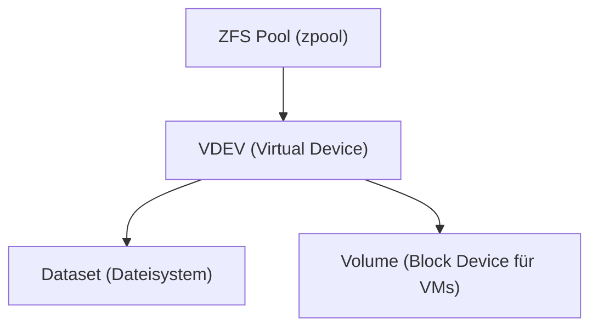

---
tags:
  - virtualization
  - proxmox
  - storage
  - zfs
  - ceph
  - lvm
aliases:
  - Proxmox Storage
  - PVE Storage
  - Proxmox Speicher
---

# Proxmox Storage

> [!ABSTRACT] TL;DR
> Proxmox VE unterstützt zahlreiche Storage-Backends — von einfachen Verzeichnissen über ZFS und LVM-Thin bis zu verteiltem Ceph-Block-Storage. Das Storage-Modell unterscheidet zwischen **File-Level** (Images als Dateien) und **Block-Level** (raw Disk-Images). ZFS ist der empfohlene lokale Storage-Typ; Ceph für verteilte Setups im Cluster.

---

## Storage-Modell

Proxmox trennt zwischen **Storage-Backend** (wie Daten gespeichert werden) und **Content-Typen** (was gespeichert wird):

### Content-Typen

| Content-Typ | Beschreibung |
|---|---|
| `images` | VM-Disk-Images (qcow2, raw) |
| `rootdir` | LXC-Container-Root-Dateisysteme |
| `iso` | ISO-Images (Installationsmedien) |
| `vztmpl` | LXC-Container-Templates |
| `backup` | Backup-Dateien (vzdump) |
| `snippets` | Cloud-Init-Configs, Hook-Skripte |

### Storage-Backends im Überblick

| Backend | Typ | Snapshots | Shared | Empfehlung |
|---|---|---|---|---|
| **Directory** | File | ✅ (qcow2) | ❌ | Einfachste Option, für ISO/Backup |
| **LVM** | Block | ❌ | ❌ (bei lokalem LVM) | Legacy, kaum Snapshots |
| **LVM-Thin** | Block | ✅ | ❌ | Gut für lokale VMs mit Snapshots |
| **ZFS** | File+Block | ✅ | ❌ (lokal) | **Empfohlen für lokalen Storage** |
| **Ceph RBD** | Block | ✅ | ✅ | **Empfohlen für Cluster-Storage** |
| **NFS** | File | ✅ (qcow2) | ✅ | Einfaches Shared Storage |
| **SMB/CIFS** | File | ✅ (qcow2) | ✅ | Windows-Integration |
| **iSCSI** | Block | ❌ (raw) | ✅ | SAN-Integration |
| **PBS** | Backup | – | ✅ | Proxmox Backup Server |

---

## ZFS (empfohlen für lokalen Storage)

### ZFS-Grundlagen

ZFS ist ein Copy-on-Write-Dateisystem mit eingebauten RAID-Funktionen, Snapshots und Selbstheilung. In Proxmox PVE ist ZFS nativ integriert — kein separates Tool nötig.



### RAID-Level

| RAID-Level | Beschreibung | Min. Disks | Redundanz | Empfehlung |
|---|---|---|---|---|
| **stripe (RAID-0)** | Kein Redundanz, maximale Kapazität | 1 | ❌ | Nur für Temp-Daten |
| **mirror (RAID-1)** | Spiegelung, beste Performance | 2 | 1 Disk | **Für 2-Disk-Setups** |
| **raidz1 (RAID-5)** | 1 Parity-Disk | 3 | 1 Disk | Kapazität > Redundanz |
| **raidz2 (RAID-6)** | 2 Parity-Disks | 4 | 2 Disks | **Empfohlen für Produktion** |
| **raidz3** | 3 Parity-Disks | 5 | 3 Disks | Maximale Redundanz |

### ZFS-Pool erstellen und verwalten

```bash
# Verfügbare Disks anzeigen (immer /dev/disk/by-id/ verwenden!)
ls -la /dev/disk/by-id/ | grep -v part

# Mirror-Pool erstellen (2 Disks)
zpool create -f datastore mirror \
    /dev/disk/by-id/ata-SAMSUNG_SSD_S123-part1 \
    /dev/disk/by-id/ata-WDC_HDD_WD123-part1

# RAIDZ2-Pool erstellen (4+ Disks)
zpool create -f datastore raidz2 \
    /dev/disk/by-id/disk1 \
    /dev/disk/by-id/disk2 \
    /dev/disk/by-id/disk3 \
    /dev/disk/by-id/disk4

# Pool-Status anzeigen
zpool status
zpool list

# Detaillierte I/O-Statistiken
zpool iostat -v 2

# Datei-System (Dataset) erstellen
zfs create datastore/vm-images
zfs create datastore/backups

# ZFS als Storage in PVE registrieren
pvesm add zfspool datastore --pool datastore --content images,rootdir

# Alle Storage-Backends anzeigen
pvesm status
```

### ZFS-Performance-Tuning

```bash
# ARC-Größe anpassen (Standardmäßig bis 50 % RAM)
echo "options zfs zfs_arc_max=4294967296" > /etc/modprobe.d/zfs.conf
# 4294967296 = 4 GB ARC Maximum

# L2ARC (zweite Cache-Ebene auf SSD) hinzufügen
zpool add datastore cache /dev/disk/by-id/nvme-ssd-cache

# SLOG (ZFS Intent Log für synchrone Writes auf SSD) hinzufügen
zpool add datastore log /dev/disk/by-id/nvme-ssd-log

# Kompression aktivieren (empfohlen — spart Platz, verbessert oft Performance)
zfs set compression=lz4 datastore

# Deduplication (ACHTUNG: hoher RAM-Bedarf — 5 GB RAM pro 1 TB Daten)
# NUR aktivieren wenn viele identische Daten vorhanden
zfs set dedup=on datastore

# ZFS-Tuning überprüfen
zfs get compression,dedup,recordsize datastore
```

### ZFS-Snapshots

```bash
# Snapshot erstellen
zfs snapshot datastore/vm-images@2024-01-15

# Alle Snapshots anzeigen
zfs list -t snapshot

# Snapshot zurückrollen (destruktiv — alle Änderungen nach dem Snapshot gehen verloren!)
zfs rollback datastore/vm-images@2024-01-15

# Snapshot löschen
zfs destroy datastore/vm-images@2024-01-15

# Snapshot auf anderen Pool klonen
zfs send datastore/vm-images@backup | zfs receive backup-pool/vm-images
```

---

## LVM-Thin (lokaler Block-Storage mit Snapshots)

LVM-Thin ist die Standard-Option wenn ZFS nicht genutzt wird und Snapshots gewünscht sind.

```bash
# Physical Volume erstellen
pvcreate /dev/sdb

# Volume Group erstellen
vgcreate pve-data /dev/sdb

# Thin Pool erstellen (gesamten VG nutzen)
lvcreate -l 100%FREE -T pve-data/data

# LVM-Thin als PVE Storage registrieren
pvesm add lvmthin pve-data --vgname pve-data --thinpool data --content images,rootdir

# Status
pvesm status
pvdisplay
lvdisplay
```

---

## Ceph (verteilter Cluster-Storage)

Ceph ist das empfohlene Shared-Storage-Backend für Proxmox-Cluster. Es ist nativ in PVE integriert.

### Ceph-Anforderungen

- Mindestens **3 Nodes** (für Quorum)
- Mindestens **3 OSD-Disks** (eine pro Node)
- Dediziertes **Storage-Netzwerk** (10 GbE empfohlen)
- SSDs als OSD für gute Performance

### Ceph installieren und einrichten

```bash
# Auf jedem Cluster-Node: Ceph installieren
pveceph install --repository no-subscription

# Ceph initialisieren (auf einem Node)
pveceph init --network 10.0.0.0/24    # Storage-Netzwerk

# Monitor erstellen (auf jedem Node)
pveceph mon create

# OSD erstellen (pro Disk auf jedem Node)
pveceph osd create /dev/sdb
pveceph osd create /dev/sdc

# Pool erstellen
pveceph pool create vm-pool --add_storages

# Ceph-Status prüfen
ceph status
ceph osd tree
ceph df
```

### Ceph-Status verstehen

```bash
# Gesamtstatus
ceph status

# OSD-Auslastung
ceph osd df

# Gesundheits-Details
ceph health detail

# Echtzeit-Performance
ceph iostat

# Pool-Statistiken
rados df
```

---

## NFS und SMB

### NFS als Storage einbinden

```bash
# NFS-Storage hinzufügen (Web-UI: Datacenter → Storage → Add → NFS)
# Oder per CLI:
pvesm add nfs nfs-backup \
    --server 192.168.1.50 \
    --export /mnt/backup \
    --content backup,iso \
    --options vers=4

# Mount-Status prüfen
mount | grep nfs
```

### SMB/CIFS als Storage

```bash
pvesm add cifs cifs-storage \
    --server 192.168.1.50 \
    --share Backup \
    --username admin \
    --password MyPass \
    --content backup
```

---

## Storage-Operationen

### Disk-Images verwalten

```bash
# VM-Disk-Image anzeigen
qm config 100 | grep scsi

# Disk-Image vergrößern (VM sollte gestoppt sein)
qm resize 100 scsi0 +20G

# Disk von einem Storage auf anderen migrieren
qm move-disk 100 scsi0 ceph-pool --delete

# Disk-Image manuell konvertieren (qcow2 → raw)
qemu-img convert -f qcow2 -O raw disk.qcow2 disk.raw

# Disk-Image-Info
qemu-img info /var/lib/vz/images/100/vm-100-disk-0.qcow2
```

### Backups mit vzdump

```bash
# VM-Backup erstellen
vzdump 100 --storage pbs-backup --mode snapshot --compress zstd

# Alle VMs sichern
vzdump --all --storage pbs-backup --mode snapshot

# Backup wiederherstellen
qmrestore /var/lib/vz/dump/vzdump-qemu-100-2024_01_15.vma.zst 100

# Container-Backup wiederherstellen
pct restore 200 /var/lib/vz/dump/vzdump-lxc-200-2024_01_15.tar.zst
```

---

## Verwandte Notizen

- [[Was ist Proxmox]]
- [[Proxmox Installation]]
- [[Proxmox VM und Container Verwaltung]]
- [[Proxmox Cluster und HA]]
- [[Proxmox Backup Server]]
- [[Proxmox Troubleshooting]]
