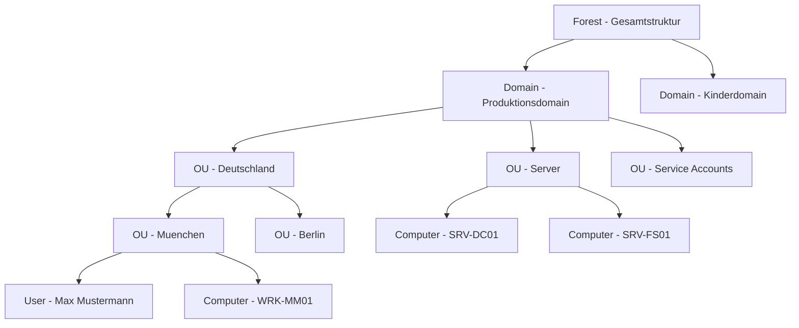
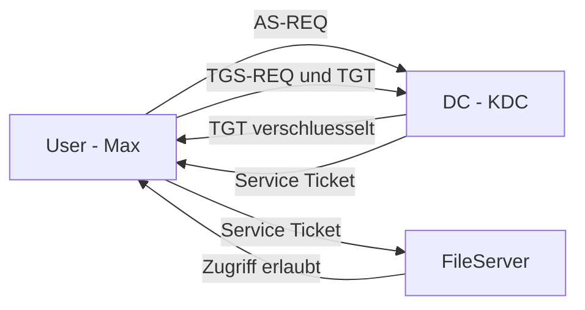

# AD Grundlagen

> [!ABSTRACT]
> Active Directory Domain Services (AD DS) ist das zentrale Identitäts- und Authentifizierungssystem in Windows-Unternehmensnetzwerken. Es speichert Benutzer, Computer, Gruppen und Richtlinien in einer hierarchischen LDAP-Datenbank und stellt Kerberos-Authentifizierung sowie DNS-Integration bereit.

---

## Was ist Active Directory?

Active Directory (AD) ist Microsofts **Verzeichnisdienst** für Windows-Domänennetzwerke — ein zentrales Repository für Identitäten, Ressourcen und Richtlinien im Unternehmensnetzwerk. Microsoft entwickelte Active Directory ab 1996 und veröffentlichte es erstmals mit **Windows 2000 Server** als Ablösung der proprietären Windows NT-Domänenstruktur. Die Grundlage bilden offene Standards: LDAP v3 (RFC 4511) als Zugriffsprotokoll, Kerberos v5 (RFC 4120) als Authentifizierungsprotokoll und DNS für die DC-Lokalisierung.

Die Datenbank selbst ist eine **Jet-Datenbankdatei** (`NTDS.DIT`, Extensible Storage Engine), die alle Objekte des Verzeichnisses speichert — Benutzer, Computer, Gruppen, Richtlinien und die Konfiguration des gesamten Forests.

### Active Directory Dienste-Familie

"Active Directory" bezeichnet im Unternehmensalltag meist **AD DS** — technisch ist es jedoch eine Familie verwandter Dienste:

| Dienst | Kürzel | Funktion |
|--------|--------|---------|
| **Active Directory Domain Services** | AD DS | Kernverzeichnisdienst — Identitäten, Kerberos, GPOs, Replikation |
| **Active Directory Lightweight Directory Services** | AD LDS | LDAP-Verzeichnis ohne Domänenfunktionen, für Applikationen |
| **Active Directory Federation Services** | AD FS | Identitätsföderation und SSO (SAML 2.0, OAuth 2.0, WS-Federation) |
| **Active Directory Rights Management Services** | AD RMS | Informationsschutz und Dokumenten-Rechteverwaltung (IRM) |
| **Active Directory Certificate Services** | AD CS | Interne PKI — Zertifizierungsstellen und Zertifikatsverwaltung |

### Aufgaben von AD DS

| Aufgabe | Beschreibung |
|---------|-------------|
| **Identitätsverwaltung** | Zentrales Repository für Benutzer, Computer, Gruppen, Dienstkonten (gMSA) |
| **Authentifizierung** | Kerberos v5 als Standard, NTLM als Fallback für Legacy-Systeme |
| **Autorisierung** | Zugriffssteuerung auf Ressourcen über Gruppenmitgliedschaft und ACLs |
| **Konfigurationsverwaltung** | Gruppenrichtlinien (GPOs) steuern zentral alle Domänenmitglieder |
| **Replikation** | Multi-Master-Replikation zwischen DCs — jeder DC ist gleichwertig |
| **Namensauflösung** | DNS-Integration; SRV-Records für automatische DC-Lokalisierung |

### Versions-Entwicklung

| Windows Server | Functional Level | Wesentliche Neuerungen |
|----------------|-----------------|------------------------|
| Windows 2000 | Win2000 | Erstveröffentlichung, LDAP, Kerberos, Global Catalog, Sites |
| Windows Server 2003/R2 | Win2003 | Forest Trusts, SID-History, Renamed Domain Controller |
| Windows Server 2008/R2 | Win2008/R2 | Read-Only DC (RODC), Fine-Grained Password Policies, AD Recycle Bin |
| Windows Server 2012/R2 | Win2012/R2 | Dynamic Access Control, Kerberos Claims, VM-Klonung |
| Windows Server 2016 | Win2016 | Privileged Access Management (PAM), AES-256 Kerberos optional |
| Windows Server 2019/2022 | Win2016 | AES-256 Kerberos Standard, Azure Arc, Hot-Patching |

### Vergleich mit anderen Verzeichnisdiensten

| Verzeichnisdienst | Hersteller | Protokolle | Einsatz |
|-------------------|-----------|------------|--------|
| **AD DS** | Microsoft | LDAP v3, Kerberos v5, DNS | Windows-Domänenumgebungen |
| **OpenLDAP** | Open Source | LDAP v3 | Linux/Unix-Umgebungen |
| **FreeIPA** | Red Hat | LDAP v3, Kerberos v5 | Linux-Domänenersatz für AD |
| **389 Directory Server** | Red Hat | LDAP v3 | RHEL-Umgebungen |
| **Azure AD / Entra ID** | Microsoft | OAuth 2.0, SAML 2.0, OIDC | Cloud-Identitätsverwaltung |

---

## Kernkonzepte

### Forest → Domain → OU



### Wichtige Begriffe

| Begriff | Beschreibung |
|---------|-------------|
| **Forest** | Gesamtstruktur — teilt Schema und GC, nicht unbedingt Vertrauen |
| **Domain** | Sicherheitsgrenze, eigene Kerberos-Realm |
| **OU (Organizational Unit)** | Container für GPO-Delegation und Organisation |
| **DC (Domain Controller)** | Server, der AD hostet (Active Directory-Datenbank) |
| **GC (Global Catalog)** | Enthält alle Objekte des Forests (für forest-weite Suche) |
| **FSMO-Rollen** | Einzelne DCs mit besonderen Aufgaben (5 Rollen) |
| **Schema** | Definiert alle Objektklassen und Attribute (forest-weit eindeutig) |
| **Replication** | AD-Änderungen werden zwischen DCs synchronisiert |

---

## FSMO-Rollen (Flexible Single Master Operations)

5 Rollen, die nur von jeweils einem DC gleichzeitig gehalten werden:

| Rolle | Scope | Funktion |
|-------|-------|----------|
| **Schema Master** | Forest | Schema-Änderungen (Attribute, Klassen) |
| **Domain Naming Master** | Forest | Domains hinzufügen/entfernen |
| **PDC Emulator** | Domain | Zeitquelle, Passwortänderungen, Gruppenrichtlinien |
| **RID Master** | Domain | Vergabe von RID-Pools für neue Objekte |
| **Infrastructure Master** | Domain | Cross-Domain Gruppen-Referenzen |

```powershell
# FSMO-Rolleninhaber anzeigen
netdom query fsmo
Get-ADDomain | Select-Object PDCEmulator, RIDMaster, InfrastructureMaster
Get-ADForest | Select-Object SchemaMaster, DomainNamingMaster
```

---

## Authentifizierung: Kerberos

AD nutzt **Kerberos** als Standard-Authentifizierungsprotokoll:



```powershell
# Kerberos-Tickets anzeigen
klist tickets

# Tickets löschen (erzwingt neue Authentifizierung)
klist purge
```

---

## AD-Datenbank (NTDS.DIT)

```
C:\Windows\NTDS\
├── ntds.dit          ← Haupt-Datenbank (alle AD-Objekte)
├── edb.log           ← Transaction Logs
├── edb*.log          ← weitere Transaction Logs
└── edb.chk           ← Checkpoint-Datei

SYSVOL-Freigabe (repliziert zwischen DCs):
C:\Windows\SYSVOL\
├── domain\
│   ├── Policies\     ← GPOs
│   └── scripts\      ← Anmeldeskripte
```

---

## AD-Ports und Protokolle

| Port | Protokoll | Funktion |
|------|-----------|----------|
| 53 (TCP/UDP) | DNS | Namensauflösung (Pflicht!) |
| 88 (TCP/UDP) | Kerberos | Authentifizierung |
| 135 (TCP) | RPC Endpoint Mapper | DC-Kommunikation |
| 389 (TCP/UDP) | LDAP | Verzeichnis-Abfragen |
| 445 (TCP) | SMB | SYSVOL-Replikation, Gruppenrichtlinien |
| 464 (TCP/UDP) | Kerberos Password | Passwortänderungen |
| 636 (TCP) | LDAPS | LDAP über TLS |
| 3268 (TCP) | Global Catalog | Forest-weite Suche |
| 3269 (TCP) | LDAPS Global Catalog | GC über TLS |
| 49152–65535 (TCP) | RPC Dynamic | DC-Replikation |

---

## Objektklassen

| Klasse | Beschreibung |
|--------|-------------|
| `user` | Benutzeraccount |
| `computer` | Computer-Account (DC, Workstation, Server) |
| `group` | Sicherheitsgruppe oder Verteilergruppe |
| `organizationalUnit` | Container für Objekte und GPO-Delegation |
| `contact` | Externe E-Mail-Kontakte |
| `serviceAccount` | Für Dienste (managed Service Accounts gMSA) |
| `groupPolicyContainer` | GPO-Objekte |

---

## Gruppentypen und Gültigkeitsbereiche

| Kombination | Mitglieder | Verwendbar in |
|-------------|-----------|--------------|
| **Domain Local Security** | Aus allen Domains + externe | Ressourcen der eigenen Domain |
| **Global Security** | Nur aus eigener Domain | Alle Domains im Forest |
| **Universal Security** | Aus allen Domains | Alle Domains im Forest |
| **Distribution** | Beliebig | Nur für E-Mail-Verteilung |

```
AGDLP-Prinzip (Best Practice):
Accounts → Global Groups → Domain Local Groups → Permissions
```

---

## Sites und Subnets (Replikationstopologie)

```powershell
# Sites anzeigen
Get-ADReplicationSite -Filter *

# Site-Links anzeigen
Get-ADReplicationSiteLink -Filter *

# Subnet zu Site hinzufügen
New-ADReplicationSubnet -Name "192.168.1.0/24" -Site "Hauptbuero"
```

---

## Verwandte Notizen

- [[AD Installation]] — Domain Controller einrichten
- [[Benutzer und Gruppen]] — Objekte verwalten
- [[Group Policy]] — GPO-Konfiguration
- [[AD Troubleshooting]] — Fehlersuche bei Replikation und Kerberos
- [[Windows DNS]] — DNS ist Voraussetzung für AD
