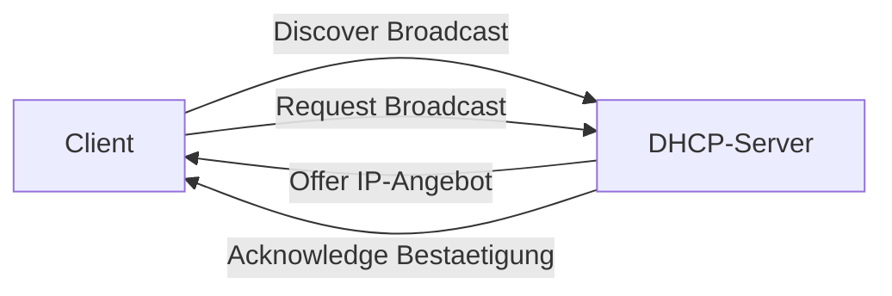

# Windows DHCP

> [!ABSTRACT]
> Der Windows DHCP-Server vergibt IP-Adressen, Gateway, DNS und weitere Netzwerkoptionen automatisch an Clients. DHCP-Failover (Windows Server 2012+) ermöglicht redundante DHCP-Server ohne Unterbrechung. Integration mit AD ermöglicht sichere dynamische DNS-Updates.

---

## Was ist DHCP?

DHCP (Dynamic Host Configuration Protocol) ist ein **Netzwerkprotokoll zur automatischen Konfiguration von IP-Netzwerkparametern** für Hosts. Es ist in **RFC 2131** (1997) standardisiert und die Weiterentwicklung des älteren BOOTP-Protokolls (RFC 951, 1985). DHCP löst die manuelle IP-Konfiguration ab und ermöglicht die zentrale Verwaltung von IP-Adressbereichen (Scopes) inkl. Gateway, DNS-Server, Domain-Namen und weiteren Netzwerkoptionen.

Das Protokoll arbeitet nach dem **Client-Server-Modell** auf den UDP-Ports 67 (Server) und 68 (Client). Adressen werden **zeitlich befristet vergeben** (Lease), sodass nicht genutzte Adressen automatisch in den Pool zurückkehren.

### DHCP-Adressvergabe: DORA

Die Adressvergabe erfolgt in vier Schritten (bekannt als DORA-Prozess):

| Schritt | Richtung | Typ | Inhalt |
|---------|---------|-----|--------|
| **Discover** | Client → Broadcast | UDP 68→67 | Client sucht DHCP-Server (kein IP bekannt → 0.0.0.0) |
| **Offer** | Server → Client | UDP 67→68 | Server bietet IP-Adresse + Konfiguration an |
| **Request** | Client → Broadcast | UDP 68→67 | Client wählt Angebot und teilt es allen Servern mit |
| **Acknowledge** | Server → Client | UDP 67→68 | Server bestätigt die Zuweisung |



### Lease-Verwaltung

| Zeitpunkt | Bezeichnung | Verhalten |
|-----------|-------------|-----------|
| **0 %** | Lease-Start | IP-Adresse wird zugewiesen |
| **50 % (T1)** | Renewal | Client verlängert Lease direkt beim zuständigen DHCP-Server (Unicast) |
| **87,5 % (T2)** | Rebinding | Client versucht Lease bei jedem erreichbaren DHCP-Server zu verlängern (Broadcast) |
| **100 %** | Ablauf | Lease verfällt; IP geht zurück in den Pool; Client verliert Konnektivität |

### DHCP-Optionen

DHCP überträgt neben der IP-Adresse weitere Konfigurationsparameter als nummerierte Optionen (RFC 2132):

| Option | Nummer | Inhalt |
|--------|--------|--------|
| Subnet Mask | 1 | z.B. `255.255.255.0` |
| Router | 3 | Standard-Gateway, z.B. `192.168.1.1` |
| DNS-Server | 6 | z.B. `192.168.1.10, 192.168.1.11` |
| Domain Name | 15 | z.B. `firma.local` |
| Lease Time | 51 | Gültigkeitsdauer in Sekunden |
| WPAD | 252 | Web-Proxy-Autodiscovery |

Optionen können auf vier Ebenen gesetzt werden (spezifischere überschreibt allgemeinere):
**Server** → **Scope** → **Klasse** → **Reservierung**

### DHCP-Autorisierung in Active Directory

In AD-Umgebungen müssen DHCP-Server **in AD autorisiert** werden. Nicht autorisierte Server schalten sich ab, sobald sie einen AD-DC erkennen. Dies schützt vor Rogue-DHCP-Servern, die falsche Gateways oder DNS-Server vergeben könnten.

---

### GUI

```
Server Manager → Verwalten → Rollen und Features hinzufügen
→ Serverrollen → DHCP-Server → Installieren

Nach Installation:
Server Manager → Benachrichtigung (Flagge oben) → "DHCP konfigurieren"
→ Assistent öffnet sich
→ Sicherheitsgruppen erstellen: Weiter
→ AD-Autorisierung: Benutzeranmeldeinformationen verwenden → Commit

DHCP-Konsole öffnen:
Server Manager → Tools → DHCP
```

### PowerShell

```powershell
# DHCP-Rolle installieren
Install-WindowsFeature DHCP -IncludeManagementTools

# DHCP-Server in AD autorisieren (Pflicht in AD-Umgebungen!)
Add-DhcpServerInDC -DnsName SRV-DHCP01.firma.local -IPAddress 192.168.1.11

# Autorisierung prüfen
Get-DhcpServerInDC
```

---

## Scopes erstellen

### GUI

```
DHCP-Konsole → SRV-DHCP01 → IPv4 → Rechtsklick → Neuer Bereich

Bereichsassistent:
1. Name:          Büronetzwerk
2. Startadresse:  192.168.1.100
   Endadresse:    192.168.1.200
   Subnetzmaske:  255.255.255.0
3. Ausschlüsse:   192.168.1.100 – 192.168.1.110 (für Server/Drucker)
4. Leasedauer:    8 Stunden
5. DHCP-Optionen jetzt konfigurieren: Ja
   → Router (Gateway):     192.168.1.1
   → DNS-Server:           192.168.1.10, 192.168.1.11
   → DNS-Domänenname:      firma.local
6. Bereich aktivieren: Ja
```

### PowerShell

```powershell
# Einfachen Scope erstellen
Add-DhcpServerv4Scope `
    -Name "Büronetzwerk" `
    -StartRange "192.168.1.100" `
    -EndRange "192.168.1.200" `
    -SubnetMask "255.255.255.0" `
    -State "Active" `
    -LeaseDuration "8.00:00:00"     # 8 Stunden

# Exclusion (IP-Bereich aus Vergabe ausschließen)
Add-DhcpServerv4ExclusionRange `
    -ScopeId "192.168.1.0" `
    -StartRange "192.168.1.100" `
    -EndRange "192.168.1.110"        # Reserviert für Server/Drucker

# Scope-Optionen setzen (Gateway, DNS, Domain)
Set-DhcpServerv4OptionValue `
    -ScopeId "192.168.1.0" `
    -OptionId 3 `                    # Default Gateway
    -Value "192.168.1.1"

Set-DhcpServerv4OptionValue `
    -ScopeId "192.168.1.0" `
    -OptionId 6 `                    # DNS Server
    -Value "192.168.1.10", "192.168.1.11"

Set-DhcpServerv4OptionValue `
    -ScopeId "192.168.1.0" `
    -OptionId 15 `                   # DNS Domain Name
    -Value "firma.local"

# Alle Scopes anzeigen
Get-DhcpServerv4Scope

# Scope deaktivieren/aktivieren
Set-DhcpServerv4Scope -ScopeId "192.168.1.0" -State Inactive
Set-DhcpServerv4Scope -ScopeId "192.168.1.0" -State Active
```

---

## Reservierungen (feste IP für Gerät)

### GUI

```
DHCP-Konsole → IPv4 → Bereich [192.168.1.0] → Reservierungen
→ Rechtsklick → Neue Reservierung

Felder:
- Reservierungsname:  Drucker-Empfang
- IP-Adresse:         192.168.1.50
- MAC-Adresse:        00-11-22-33-44-55  (ohne Trennzeichen oder mit -)
- Beschreibung:       HP LaserJet 4015 im Empfang
- Unterstützte Typen: Beide (DHCP und BOOTP)
→ Hinzufügen
```

### PowerShell

```powershell
# Reservierung anlegen (MAC-Adresse → feste IP)
Add-DhcpServerv4Reservation `
    -ScopeId "192.168.1.0" `
    -IPAddress "192.168.1.50" `
    -ClientId "00-11-22-33-44-55" `    # MAC-Adresse
    -Name "Drucker-Empfang" `
    -Description "HP LaserJet 4015 im Empfang"

# Alle Reservierungen
Get-DhcpServerv4Reservation -ScopeId "192.168.1.0"

# Reservierung löschen
Remove-DhcpServerv4Reservation -ScopeId "192.168.1.0" -ClientId "00-11-22-33-44-55"
```

---

## DHCP-Optionen

### Serverweite vs. Scope-spezifische Optionen

```powershell
# Serverweite Optionen (gelten für alle Scopes)
Set-DhcpServerv4OptionValue `
    -OptionId 6 `
    -Value "192.168.1.10", "192.168.1.11"

# Scope-spezifische Optionen (überschreiben Serverweit)
Set-DhcpServerv4OptionValue `
    -ScopeId "192.168.2.0" `
    -OptionId 3 `
    -Value "192.168.2.1"
```

### Häufige DHCP-Optionen

| Option-ID | Beschreibung | Beispielwert |
|-----------|-------------|-------------|
| 1 | Subnetzmaske | 255.255.255.0 |
| 3 | Default Gateway | 192.168.1.1 |
| 6 | DNS-Server | 192.168.1.10, 192.168.1.11 |
| 15 | DNS-Domänenname | firma.local |
| 28 | Broadcast-Adresse | 192.168.1.255 |
| 42 | NTP-Server | 192.168.1.10 |
| 43 | Vendor-spezifisch | (für VoIP, WDS etc.) |
| 66 | TFTP-Server | 192.168.1.10 |
| 67 | Boot-Dateiname | boot\x64\pxeboot.n12 |

---

## DHCP Failover (Hochverfügbarkeit)

DHCP-Failover ermöglicht zwei DHCP-Server für den gleichen Scope:

```powershell
# Failover-Partnerschaft konfigurieren
Add-DhcpServerv4Failover `
    -Name "DHCP-Failover-LAN" `
    -ScopeId "192.168.1.0" `
    -PartnerServer "SRV-DHCP02.firma.local" `
    -Mode LoadBalance `                  # oder HotStandby
    -LoadBalancePercent 50 `             # 50/50 Aufteilung
    -AutoStateTransition $true `
    -MaxClientLeadTime "01:00:00" `      # 1 Stunde
    -StateSwitchInterval "00:10:00"      # 10 Minuten

# Modi:
# LoadBalance  → beide aktiv, teilen Vergaben
# HotStandby   → Primär aktiv, Sekundär übernimmt bei Ausfall

# Failover-Status
Get-DhcpServerv4Failover

# Löschen
Remove-DhcpServerv4Failover -Name "DHCP-Failover-LAN"
```

---

## Bestehende Leases

```powershell
# Aktuelle Leases anzeigen
Get-DhcpServerv4Lease -ScopeId "192.168.1.0"

# Bestimmten Client suchen
Get-DhcpServerv4Lease -ScopeId "192.168.1.0" | 
    Where-Object HostName -eq "WRK-IT01"

# Lease löschen (forciert Client-Erneuerung)
Remove-DhcpServerv4Lease -ScopeId "192.168.1.0" -ClientId "00-11-22-33-44-55"

# DHCP-Statistiken
Get-DhcpServerv4ScopeStatistics -ScopeId "192.168.1.0"
# Zeigt: Total, InUse, Available, PercentageInUse
```

---

## DNS-Dynamische Updates konfigurieren

```powershell
# DHCP registriert A und PTR Records für Clients in DNS
Set-DhcpServerv4DnsSetting `
    -ScopeId "192.168.1.0" `
    -DynamicUpdates "Always" `        # Always, Never, OnClientRequest
    -DeleteDnsRRonLeaseExpiry $true    # Records bei Ablauf löschen

# Für sichere DNS-Updates: DHCP-Server muss Mitglied der Gruppe
# "DnsUpdateProxy" in AD sein (bei mehrerern DHCP-Servern)
Add-ADGroupMember -Identity "DnsUpdateProxy" -Members "SRV-DHCP01$"
```

---

## Backup und Restore

```powershell
# DHCP-Datenbank sichern
Backup-DhcpServer -Path "C:\DHCPBackup"

# Auf Remote-Server sichern
Backup-DhcpServer -ComputerName SRV-DHCP01 -Path "\\SRV-FS01\Backup\DHCP"

# Konfiguration exportieren (für Migration)
Export-DhcpServer -File "C:\DHCPExport.xml" -Leases

# Importieren (auf neuem Server)
Import-DhcpServer -File "C:\DHCPExport.xml" -BackupPath "C:\DHCPBackup" -Leases
```

---

## Fehlerbehebung

```powershell
# DHCP-Ereignisse
Get-WinEvent -LogName "Microsoft-Windows-Dhcp-Server/Operational" -MaxEvents 50

# Client-seitig erneuern
ipconfig /release
ipconfig /renew

# Client-seitig DHCP-Lease anzeigen
ipconfig /all

# Welcher DHCP-Server antwortet?
netsh dhcp server show mibcount  # Auf Server
ipconfig /all | findstr "DHCP Server"  # Auf Client
```

---

## Verwandte Notizen

- [[Windows DNS]] — DNS und DHCP arbeiten zusammen (Dynamic Updates)
- [[AD Grundlagen]] — DHCP-Server muss in AD autorisiert sein
- [[Windows Server Installation]] — Netzwerkkonfiguration vor DHCP
