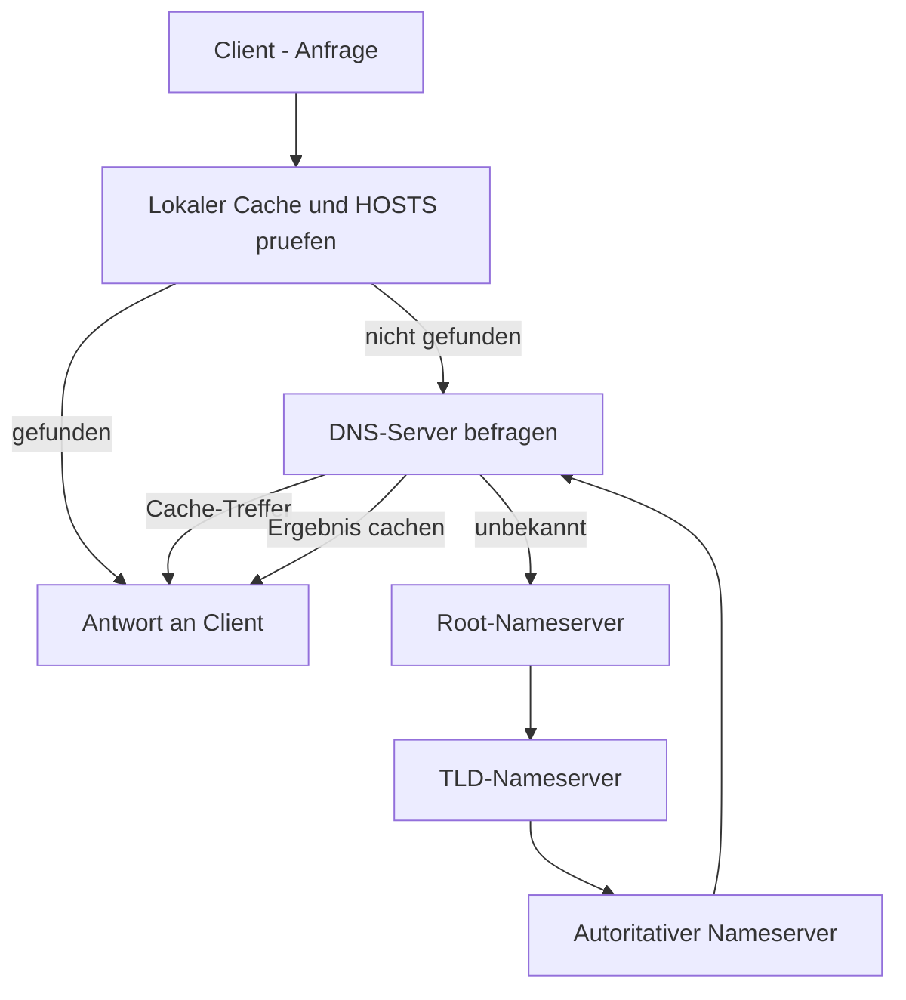

# Windows DNS

> [!ABSTRACT]
> Der Windows DNS-Server ist tief in Active Directory integriert — AD-Zonen werden in der AD-Datenbank gespeichert und automatisch zwischen DCs repliziert. DNS ist die Voraussetzung für alle AD-Funktionen: DC-Suche, Kerberos und LDAP nutzen alle DNS-SRV-Records.

---

## Was ist DNS?

DNS (Domain Name System) ist ein **hierarchisches, verteiltes Namensauflösungssystem** für IP-Netzwerke. Es wurde 1983 von **Paul Mockapetris** entwickelt (RFC 882/883, später ersetzt durch RFC 1034/1035) und löste die zentrale `HOSTS.TXT`-Datei ab, die manuell zwischen allen Computern synchronisiert werden musste.

DNS übersetzt menschenlesbare Namen (`server.firma.local`, `www.google.com`) in IP-Adressen und umgekehrt. Es ist ein **verteiltes Datenbanksystem** — keine einzelne Instanz kennt alle Namen, stattdessen ist der globale Namensraum in Zonen aufgeteilt, die jeweils von unterschiedlichen Nameservern verwaltet werden.

### DNS-Namensraum-Hierarchie

```
.                          ← Root (verwaltet von IANA/ICANN)
├── com.                   ← TLD (Top-Level Domain) — verwaltet von Verisign
│   ├── google.com.        ← SLD (Second-Level Domain) — verwaltet von Google
│   │   └── www.google.com.  ← Subdomain — verwaltet von Google
│   └── microsoft.com.
├── de.                    ← ccTLD (Country Code TLD) — verwaltet von DENIC
│   └── bund.de.
└── local.                 ← Private Domain (nicht im globalen DNS)
    └── firma.local.       ← AD-Domain, verwaltet intern
```

Jede Ebene **delegiert** die Verantwortung für untergeordnete Zonen an die jeweiligen Nameserver.

### DNS-Zonentypen

| Zonentyp | Speicherort | Eigenschaften | Empfehlung |
|----------|-------------|---------------|-----------|
| **Primär (Standard)** | Textdatei (`.dns`) auf einem Nameserver | Schreibbar, manuell verwaltet | Nur ohne AD |
| **Sekundär** | Nur-Lese-Kopie via Zonenübertragung (AXFR/IXFR) | Redundanz, kein Schreiben | Legacy-Umgebungen |
| **Stub** | Enthält nur NS-Records und SOA einer anderen Zone | Delegierung zu externer Zone | Externe Subdomains |
| **AD-integriert** | AD-Datenbank (NTDS.DIT) | Multi-Master, sichere Updates, DFSR-Replikation | **Standard in AD-Umgebungen** |

### Wichtige Record-Typen

| Record | RFC | Funktion | Beispiel |
|--------|-----|---------|---------|
| **A** | RFC 1035 | IPv4-Adresse | `srv-dc01.firma.local → 192.168.1.10` |
| **AAAA** | RFC 3596 | IPv6-Adresse | `srv-dc01.firma.local → 2001:db8::1` |
| **CNAME** | RFC 1035 | Alias-Record | `fileserver → srv-fs01.firma.local` |
| **MX** | RFC 1035 | Mailserver | `firma.local → mail.firma.local (Prio 10)` |
| **PTR** | RFC 1035 | Reverse DNS | `10.1.168.192.in-addr.arpa → srv-dc01` |
| **NS** | RFC 1035 | Nameserver der Zone | `firma.local NS srv-dc01.firma.local` |
| **SOA** | RFC 1035 | Start of Authority | Primärer NS, Seriennummer, TTL-Werte |
| **SRV** | RFC 2782 | Dienst-Lokalisierung | `_ldap._tcp.firma.local → srv-dc01:389` |
| **TXT** | RFC 1035 | Freitext | SPF, DKIM, DMARC, Domänenverifizierung |

> [!NOTE] SRV-Records und Active Directory
> AD registriert beim DC-Start automatisch SRV-Records. Clients nutzen diese um DCs zu finden:
> `_ldap._tcp.firma.local` → LDAP-fähige DCs
> `_kerberos._tcp.firma.local` → Kerberos-fähige DCs
> Fehlen diese Records, finden Clients keinen DC und AD-Anmeldungen schlagen fehl.

### DNS-Auflösungsablauf



| Begriff | Bedeutung |
|---------|-----------|
| **Rekursiver Query** | Client beauftragt DNS-Server mit der kompletten Auflösung |
| **Iterativer Query** | DNS-Server fragt Schritt für Schritt andere Server ab |
| **TTL (Time to Live)** | Cache-Gültigkeitsdauer in Sekunden; niedrig = schnell propagiert, hohe Last |
| **Forwarder** | DNS-Server leitet unbekannte Anfragen weiter (z.B. an 8.8.8.8 für Internet) |
| **Conditional Forwarder** | Weiterleitung nur für bestimmte Domains (z.B. Partner-Domains) |

---

```
AD benötigt DNS für:
├── DC-Registrierung (_ldap._tcp, _kerberos._tcp SRV-Records)
├── DC-Suche (Clients finden DCs über DNS)
├── Kerberos-Authentifizierung
└── SYSVOL-Zugriff (\\firma.local\SYSVOL)

AD-integrierte DNS-Zone:
├── In AD-Datenbank gespeichert (NTDS.DIT)
├── Automatische Replikation zwischen DCs
├── Sichere dynamische Updates (nur Domain-Mitglieder)
└── Keine manuelle Zonendatei-Verwaltung
```

---

## DNS-Rolle installieren

### GUI

```
Server Manager → Verwalten → Rollen und Features hinzufügen
→ Serverrollen → DNS-Server → Installieren
→ DNS-Konsole öffnen: Server Manager → Tools → DNS
```

### PowerShell

```powershell
# DNS-Server installieren (oft zusammen mit AD DS)
Install-WindowsFeature DNS -IncludeManagementTools

# DNS Management Console öffnen
dnsmgmt.msc
```

---

## Zonen-Typen

| Typ | Beschreibung | Empfehlung |
|-----|-------------|-----------|
| **Primär (AD-integriert)** | Zone in AD-Datenbank, sicher | ✅ Für AD-Domains |
| **Primär (Standard)** | Zone als Textdatei | Für Nicht-AD-Umgebungen |
| **Sekundär** | Read-Only-Kopie von Primär-Zone | Legacy-Redundanz |
| **Stub** | Nur NS-Records | Conditional Forwarding Alternative |
| **Forward-Lookupzone** | Name → IP | Standard |
| **Reverse-Lookupzone** | IP → Name (PTR) | Für einige Dienste nötig |

---

## Zonen verwalten

### GUI

```
DNS-Konsole (dnsmgmt.msc):

Zone erstellen:
SRV-DC01 → Forward-Lookupzonen → Rechtsklick → Neue Zone
1. Zonentyp:         Primäre Zone + "In Active Directory speichern"
2. AD-Replikationsbereich: Für alle DNS-Server in dieser Gesamtstruktur
3. Zonenname:        firma.local
4. Dynamisches Update: Nur sichere Updates → Weiter → Fertigstellen

Reverse-Lookupzone:
SRV-DC01 → Reverse-Lookupzonen → Rechtsklick → Neue Zone
1. Typ: Primär + AD-integriert
2. IPv4-Reverse-Lookupzone
3. Netzwerk-ID:  192.168.1   (automatisch → 1.168.192.in-addr.arpa)
```

### PowerShell

```powershell
# Modul laden
Import-Module DnsServer

# AD-integrierte Zone erstellen (für neue Domain)
Add-DnsServerPrimaryZone `
    -Name "firma.local" `
    -ReplicationScope "Forest" `
    -DynamicUpdate "Secure"

# Reverse-Lookupzone
Add-DnsServerPrimaryZone `
    -NetworkID "192.168.1.0/24" `
    -ReplicationScope "Forest" `
    -DynamicUpdate "Secure"

# Sekundäre Zone (für Legacy-Transfers)
Add-DnsServerSecondaryZone `
    -Name "extern.de" `
    -ZoneFile "extern.de.dns" `
    -MasterServers "8.8.8.8"
```

---

## DNS-Records

### GUI

```
DNS-Konsole → Forward-Lookupzonen → firma.local

A-Record erstellen:
→ Rechtsklick in der Zone → Neuer Host (A oder AAAA)
  Name:         webserver
  IP-Adresse:   192.168.1.50
  PTR-Eintrag erstellen: ✓ (wenn Reverse-Zone existiert)
  → Host hinzufügen

CNAME erstellen:
→ Rechtsklick → Neuer Alias (CNAME)
  Aliasname:    www
  Vollständig qualifizierter Zielhost: webserver.firma.local.

MX-Record erstellen:
→ Rechtsklick → Neue E-Mail-Austauschdaten (MX)
  Hostnamen des Mailservers: mail.firma.local.
  Mailserverpriorität:       10

Record löschen:
→ Record in Liste auswählen → Entf-Taste oder Rechtsklick → Löschen
```

### PowerShell

```powershell
# --- A-RECORD (Name → IPv4) ---

Add-DnsServerResourceRecordA `
    -Name "webserver" `
    -ZoneName "firma.local" `
    -IPv4Address "192.168.1.50" `
    -TimeToLive "01:00:00"

# --- AAAA-RECORD (Name → IPv6) ---

Add-DnsServerResourceRecord `
    -AAAA `
    -Name "webserver" `
    -ZoneName "firma.local" `
    -IPv6Address "fd00::50"

# --- CNAME (Alias) ---

Add-DnsServerResourceRecordCName `
    -Name "www" `
    -ZoneName "firma.local" `
    -HostNameAlias "webserver.firma.local."

# --- MX-RECORD (Mail) ---

Add-DnsServerResourceRecordMX `
    -ZoneName "firma.local" `
    -Name "@" `
    -MailExchange "mail.firma.local" `
    -Preference 10

# --- PTR-RECORD (IP → Name, Reverse) ---

Add-DnsServerResourceRecordPtr `
    -Name "50" `
    -ZoneName "1.168.192.in-addr.arpa" `
    -PtrDomainName "webserver.firma.local."

# --- TXT-RECORD (SPF, DKIM, etc.) ---

Add-DnsServerResourceRecord `
    -Txt `
    -Name "@" `
    -ZoneName "firma.de" `
    -DescriptiveText "v=spf1 include:firma.de -all"

# --- Records anzeigen ---

Get-DnsServerResourceRecord -ZoneName "firma.local"
Get-DnsServerResourceRecord -ZoneName "firma.local" -Name "webserver"
Get-DnsServerResourceRecord -ZoneName "firma.local" -RRType "A"

# --- Record löschen ---

Remove-DnsServerResourceRecord `
    -ZoneName "firma.local" `
    -Name "altserver" `
    -RRType "A" `
    -Force
```

---

## Conditional Forwarder

Leitet Anfragen für bestimmte Domains an spezifische DNS-Server weiter:

```powershell
# Conditional Forwarder erstellen
Add-DnsServerConditionalForwarderZone `
    -Name "tochter.de" `
    -MasterServers "192.168.2.10", "192.168.2.11" `
    -ReplicationScope "Forest"

# Für Azure Private DNS
Add-DnsServerConditionalForwarderZone `
    -Name "privatelink.blob.core.windows.net" `
    -MasterServers "168.63.129.16"    # Azure DNS

# Alle Conditional Forwarder anzeigen
Get-DnsServerZone | Where-Object ZoneType -eq "Forwarder"

# Löschen
Remove-DnsServerZone -Name "tochter.de" -Force
```

---

## Forwarder (Standard)

```powershell
# DNS-Forwarder anzeigen
Get-DnsServerForwarder

# Forwarder setzen (für Internet-Auflösung)
Set-DnsServerForwarder -IPAddress "8.8.8.8", "1.1.1.1" -UseRootHint $false

# Root-Hints verwenden (wenn Forwarder nicht antworten)
Set-DnsServerForwarder -UseRootHint $true
```

---

## DNS debuggen

```powershell
# DNS-Auflösung testen
Resolve-DnsName "firma.local"
Resolve-DnsName "_ldap._tcp.firma.local" -Type SRV
Resolve-DnsName "192.168.1.10" -Type PTR

# Nslookup
nslookup
> server 192.168.1.10
> set type=SRV
> _ldap._tcp.firma.local

# DNS-Cache leeren (Client)
Clear-DnsClientCache
ipconfig /flushdns

# DNS-Cache des Servers anzeigen/leeren
Get-DnsServerCache
Clear-DnsServerCache -Force

# DNS-Debug-Logging aktivieren (auf dem DNS-Server)
Set-DnsServerDiagnostics -All $true -LogFilePath "C:\Windows\System32\dns\dns.log"

# DNS-Ereignisse
Get-WinEvent -LogName "DNS Server"
```

---

## Dynamisches DNS und Aging/Scavenging

```powershell
# Veraltete Records automatisch entfernen (Scavenging)
Set-DnsServerScavenging `
    -ScavengingState $true `
    -ScavengingInterval "7.00:00:00"    # Wöchentlich prüfen

# Aging für Zone aktivieren
Set-DnsServerZoneAging `
    -Name "firma.local" `
    -Aging $true `
    -NoRefreshInterval "7.00:00:00" `
    -RefreshInterval "7.00:00:00"

# Manuelle Bereinigung starten
Start-DnsServerScavenging -Force
```

---

## Verwandte Notizen

- [[AD Grundlagen]] — DNS ist Voraussetzung für AD
- [[AD Installation]] — DNS bei DC-Promotion konfiguriert
- [[Windows DHCP]] — DHCP trägt DNS-Records dynamisch ein
- [[AD Troubleshooting]] — DNS-Fehler in AD diagnostizieren
