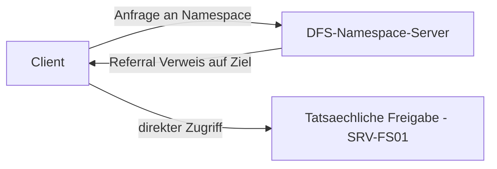

# DFS — Distributed File System

> [!ABSTRACT]
> DFS (Distributed File System) besteht aus zwei unabhängigen Komponenten: **DFS Namespace** (einheitlicher Zugriffspfad auf verteilte Freigaben) und **DFS Replikation** (Dateireplikation zwischen Servern). Zusammen ermöglichen sie Hochverfügbarkeit und geografisch verteilte Dateiserver hinter einem einzigen Pfad.

---

## Was ist DFS?

DFS (Distributed File System) ist ein **Windows-Server-Feature** bestehend aus zwei unabhängigen Komponenten: **DFS Namespace (DFS-N)** und **DFS Replication (DFS-R)**. Beide lösen unterschiedliche Probleme und können unabhängig voneinander eingesetzt werden.

DFS wurde mit **Windows NT 4.0** (1996) als Add-on eingeführt und ist seit **Windows 2000 Server** Bestandteil des Betriebssystems. DFS-Replikation ersetzte mit **Windows Server 2003 R2** (2006) den älteren FRS (File Replication Service), der bis dahin für SYSVOL-Replikation zuständig war.

### DFS-Komponenten im Vergleich

| Komponente | Zweck | Feature-Name |
|------------|-------|-------------|
| **DFS Namespace (DFS-N)** | Virtueller einheitlicher Pfad (`\\domain\share`) für physisch verteilte Freigaben | `FS-DFS-Namespace` |
| **DFS Replication (DFS-R)** | Multi-Master-Replikation von Verzeichnisinhalten zwischen Servern | `FS-DFS-Replication` |

> [!NOTE] Namespace ≠ Replikation
> DFS-N und DFS-R sind technisch vollständig unabhängig. Ein DFS-Namespace verweist auf Freigaben, er synchronisiert nichts. DFS-R repliziert Daten, erzeugt aber keinen einheitlichen Pfad.

### DFS Namespace

DFS-N stellt einen **virtuellen Verzeichnisbaum** bereit, hinter dem physische Freigaben auf verschiedenen Servern liegen. Clients erhalten beim Zugriff auf einen Namespace-Pfad eine **Referral** (Verweis) auf das tatsächliche Ziel — transparent für den Benutzer.

| Namespace-Typ | Speicherort | Verfügbarkeit |
|---------------|-------------|---------------|
| **Domänenbasiert (DomainV2)** | Active Directory + Namespace-Server | Hochverfügbar durch mehrere Namespace-Server |
| **Eigenständig (Standalone)** | Nur lokal auf dem Server | Single Point of Failure |

### DFS Replication und RDC

DFS-R ist eine **Multi-Master-Replikations-Engine** für Verzeichnisinhalte. Sie verwendet den **RDC-Algorithmus** (Remote Differential Compression):

RDC teilt Dateien in Blöcke auf, erzeugt Prüfsummen der einzelnen Blöcke und überträgt bei einer Änderung **nur die geänderten Blöcke** — nicht die gesamte Datei.

| Eigenschaft | Beschreibung |
|-------------|-------------|
| **Algorithmus** | Remote Differential Compression (RDC) |
| **Datenbankformat** | Jet-Datenbank im `DfsrPrivate`-Ordner des replizierten Verzeichnisses |
| **Änderungs-Erkennung** | USN-Journal (Update Sequence Number) des NTFS-Volumes |
| **SYSVOL** | AD-SYSVOL wird ab Win2008 DFL über DFS-R repliziert (vorher FRS) |
| **Konfliktlösung** | Last-Writer-Wins; Verlierer-Version in DfsrPrivate\ConflictAndDeleted |

### DFS-Replikation: Topologien

| Topologie | Beschreibung | Einsatz |
|-----------|-------------|--------|
| **Hub-Spoke** | Zentral-Server repliziert zu Außenstellen | Viele Standorte, Zentrale hat schnelle Leitung |
| **Full Mesh** | Jeder Server repliziert zu jedem anderen | Wenige Standorte (<4), alle mit guter Verbindung |
| **Custom** | Manuelle Verbindungskonfiguration | Komplexe Topologien, WAN-Optimierung |



---

---

## Installation

### GUI

```
Server Manager → Verwalten → Rollen und Features hinzufügen
→ Features → DFS-Namespace
            → DFS-Replikation
→ Installieren (inkl. Verwaltungstools)

DFS-Verwaltung öffnen:
Server Manager → Tools → DFS-Verwaltung
dfsmgmt.msc
```

### PowerShell

```powershell
# DFS-Namespace + DFS-Replikation installieren
Install-WindowsFeature `
    FS-DFS-Namespace, `
    FS-DFS-Replication `
    -IncludeManagementTools

# DFS Management Console öffnen
dfsmgmt.msc
```

---

## DFS Namespace

### Namespace erstellen

#### GUI

```
dfsmgmt.msc → Namespaces → Rechtsklick → "Neuen Namespace..."

Namespace-Server: SRV-FS01 → Weiter
Namespace-Name:   Daten     (Pfad wird: \\firma.local\Daten)
Namespace-Typ:
  ⦿ Domänenbasierter Namespace (empfohlen)
    ☑ Windows Server 2008-Modus aktivieren (DomainV2)
  ○ Eigenständiger Namespace (für Workgroup-Umgebungen)
→ Einstellungen... → Freigabeberechtigungen: "Alle Benutzer haben Leseberechtigung"
→ Weiter → Namespace erstellen
```

#### PowerShell

```powershell
# Namespace-Typ:
# Domain-basiert (empfohlen):  \\firma.local\Daten — repliziert via AD
# Eigenständig (standalone):   \\SRV-FS01\Daten   — nur ein Server

# Domain-basierten Namespace erstellen
New-DfsnRoot `
    -Path "\\firma.local\Daten" `
    -Type DomainV2 `               # DomainV2 = Windows 2008+ Modus
    -TargetPath "\\SRV-FS01\Daten" `
    -Description "Zentraler Dateizugriff"

# Namespace anzeigen
Get-DfsnRoot
Get-DfsnRoot -Path "\\firma.local\Daten"
```

### Ordner (Links) erstellen

#### GUI

```
dfsmgmt.msc → \\firma.local\Daten → Rechtsklick → "Neuen Ordner..."

Name:    Marketing
→ Hinzufügen
  Ordnerziel: \\SRV-FS01\Marketing → OK
→ Hinzufügen (zweites Ziel für Redundanz)
  Ordnerziel: \\SRV-FS02\Marketing → OK
→ OK
```

#### PowerShell

```powershell
# DFS-Ordner erstellen (Verlinkung auf tatsächliche Freigabe)
New-DfsnFolder `
    -Path "\\firma.local\Daten\Marketing" `
    -TargetPath "\\SRV-FS01\Marketing"

New-DfsnFolder `
    -Path "\\firma.local\Daten\HR" `
    -TargetPath "\\SRV-FS02\HR"

# Zweites Ziel für Redundanz hinzufügen
New-DfsnFolderTarget `
    -Path "\\firma.local\Daten\Marketing" `
    -TargetPath "\\SRV-FS02\Marketing"

# Alle Ordner des Namespace anzeigen
Get-DfsnFolder -Path "\\firma.local\Daten\*"

# Ziele eines Ordners anzeigen
Get-DfsnFolderTarget -Path "\\firma.local\Daten\Marketing"
```

---

## DFS Replikation

### Replikationsgruppe erstellen

```powershell
# Neue Replikationsgruppe (für Dateiserver-Replikation)
New-DfsReplicationGroup -GroupName "Marketing-Replikation"

# Mitglieder hinzufügen
Add-DfsrMember -GroupName "Marketing-Replikation" -ComputerName "SRV-FS01", "SRV-FS02"

# Replizierter Ordner (auf beiden Servern muss der Ordner existieren)
New-DfsReplicatedFolder `
    -GroupName "Marketing-Replikation" `
    -FolderName "Marketing"

# Mitgliedschaft konfigurieren (Primäres Mitglied + lokaler Pfad)
Set-DfsrMembership `
    -GroupName "Marketing-Replikation" `
    -FolderName "Marketing" `
    -ComputerName "SRV-FS01" `
    -ContentPath "D:\Freigaben\Marketing" `
    -PrimaryMember $true     # SRV-FS01 = initialer Primär (für erste Sync)

Set-DfsrMembership `
    -GroupName "Marketing-Replikation" `
    -FolderName "Marketing" `
    -ComputerName "SRV-FS02" `
    -ContentPath "D:\Freigaben\Marketing"

# Verbindungen zwischen Mitgliedern erstellen
Add-DfsrConnection `
    -GroupName "Marketing-Replikation" `
    -SourceComputerName "SRV-FS01" `
    -DestinationComputerName "SRV-FS02"
```

---

## Replikation überwachen

```powershell
# Replikationsstatus
Get-DfsrState -ComputerName SRV-FS01
Get-DfsrState -ComputerName SRV-FS02

# Backlog anzeigen (nicht replizierte Dateien)
Get-DfsrBacklog `
    -SourceComputerName SRV-FS01 `
    -DestinationComputerName SRV-FS02 `
    -GroupName "Marketing-Replikation" `
    -FolderName "Marketing"

# DFSR-Diagnose
dfsrdiag pollad
dfsrdiag replicationstate

# DFSR Event Log
Get-WinEvent -LogName "DFS Replication"
```

---

## Namespace-Server-Replikation

```powershell
# Namespace-Server hinzufügen (zweiter Namespace-Server für HA)
New-DfsnRootTarget `
    -Path "\\firma.local\Daten" `
    -TargetPath "\\SRV-FS02\Daten"

# Namespace-Ziele anzeigen
Get-DfsnRootTarget -Path "\\firma.local\Daten"
```

---

## Referral-Reihenfolge und Fallback

```powershell
# Referral-Reihenfolge für Ordnerziel setzen
Set-DfsnFolderTarget `
    -Path "\\firma.local\Daten\Marketing" `
    -TargetPath "\\SRV-FS01\Marketing" `
    -ReferralPriorityClass SiteCostHigh     # Bevorzuge gleiche Site

# Prioritätsklassen:
# GlobalHigh        → Immer bevorzugt
# SiteCostHigh      → Bevorzuge Server in gleicher Site (AD Site)
# SiteCostNormal    → Standard
# SiteCostLow       → Verwende nur wenn nötig
# GlobalLow         → Immer zuletzt

# Referral-Timeout (wie lange Client die URL cached)
Set-DfsnFolder `
    -Path "\\firma.local\Daten\Marketing" `
    -TimeToLiveSec 3600     # 1 Stunde
```

---

## SYSVOL-Replikation (AD)

> [!NOTE] SYSVOL
> Active Directory repliziert SYSVOL (GPOs, Skripte) über DFSR (ab Windows Server 2008 R2). Ältere Domains nutzen noch FRS (File Replication Service).

```powershell
# SYSVOL-Replikationsstatus prüfen
dfsrdiag pollad

# Von FRS auf DFSR migrieren
# Schritt 1: Prepare
dfsrmig /setglobalstate 1
# Schritt 2: Redirected
dfsrmig /setglobalstate 2
# Schritt 3: Eliminated (FRS dauerhaft abschalten)
dfsrmig /setglobalstate 3

# Status der Migration abfragen
dfsrmig /getglobalstate
dfsrmig /getmigrationstate
```

---

## Troubleshooting

```powershell
# DFS-Client-Cache leeren (bei fehlgeleiteten Zugriffen)
dfsutil /pktflush
dfsutil /spcflush

# Referral-Test: Wohin leitet DFS um?
dfsutil /root:\\firma.local\Daten /view
dfsutil /path:\\firma.local\Daten\Marketing /view

# DFSR-Dienst neu starten
Restart-Service DFSR
```

---

## Verwandte Notizen

- [[SMB Freigaben]] — Die tatsächlichen Freigaben hinter DFS
- [[NTFS Berechtigungen]] — Berechtigungen auf den realen Freigaben
- [[AD Grundlagen]] — AD-Sites für DFS Referral-Optimierung
