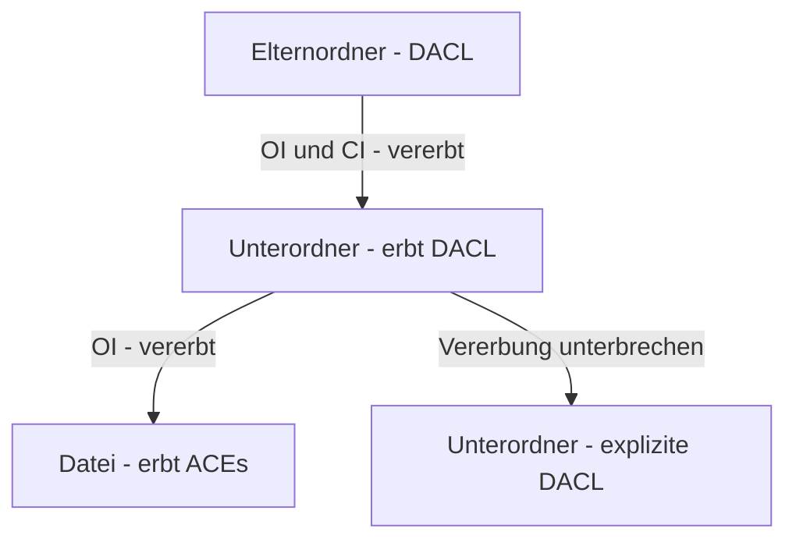

# NTFS Berechtigungen

> [!ABSTRACT]
> NTFS-Berechtigungen steuern den Zugriff auf Dateien und Ordner auf NTFS-Volumes. Sie gelten sowohl beim lokalen Zugriff als auch beim Netzwerkzugriff (kombiniert mit Freigabe-Berechtigungen). Die Vererbung sorgt dafür, dass Unterordner die Einstellungen des Elternordners erben.

---

## Was ist NTFS?

NTFS (New Technology File System) ist das **Standard-Dateisystem für Windows NT** und alle nachfolgenden Windows-Versionen. Microsoft entwickelte NTFS Anfang der 1990er Jahre und führte es erstmals mit **Windows NT 3.1** (1993) ein — als Ablösung von FAT (File Allocation Table) für Server- und Unternehmensumgebungen.

Im Unterschied zu FAT unterstützt NTFS **Zugriffssteuerungslisten** (ACLs), Journaling, Datei-Komprimierung, Verschlüsselung (EFS), Quotas und Transaktionen. Für Windows-Server ist NTFS die einzige sinnvolle Wahl für Volumes mit Zugriffssteuerung.

### NTFS-Versionen

| NTFS-Version | Windows | Neuerungen |
|-------------|---------|-----------|
| **1.0** | Windows NT 3.1 (1993) | Erstveröffentlichung |
| **1.1** | Windows NT 3.51 | Volume Compression |
| **3.0** | Windows 2000 | Disk Quotas, Sparse Files, Reparse Points, EFS |
| **3.1** | Windows XP / Server 2003 | MFT-Verbesserungen, erweiterte Metadaten |

Alle modernen Windows-Systeme (Vista/2008+) verwenden NTFS 3.1.

### Das ACL-Sicherheitsmodell

NTFS-Zugriffssteuerung basiert auf einem **SID-basierten ACL-Modell** (Access Control List). Jedes Objekt (Datei, Ordner) besitzt einen **Security Descriptor** mit:

| Komponente | Funktion |
|-----------|---------|
| **Owner (Eigentümer)** | SID des Eigentümers — kann immer die ACL der eigenen Objekte ändern |
| **DACL** (Discretionary ACL) | Steuert den Zugriff — Menge der ACEs (Erlauben/Verweigern) |
| **SACL** (System ACL) | Steuert die Auditierung — welche Zugriffe werden protokolliert |

Jeder Eintrag in der DACL ist ein **ACE** (Access Control Entry) bestehend aus:
- **SID** des Sicherheitsprinzipals (Benutzer oder Gruppe)
- **Zugriffsmaske** (welche Rechte)
- **Typ** (Allow oder Deny)
- **Vererbungs-Flags** (gilt für Unterordner / Dateien)

> [!IMPORTANT] SID-basiert, nicht namensbasiert
> NTFS-ACLs speichern die **SID** — nicht den Anzeigenamen. Das Umbenennen eines Benutzerkontos ändert die Berechtigungen nicht. Das Löschen und Neuerstellen eines Kontos (gleicher Name, neue SID) verliert alle ACL-Einträge.

### Vererbungsmodell

NTFS-Vererbung überträgt automatisch die DACL eines übergeordneten Objekts auf untergeordnete Objekte. Die Vererbung kann auf einem beliebigen Objekt unterbrochen werden.

| Vererbungs-Flag | Bedeutung |
|----------------|-----------|
| **OI** (Object Inherit) | ACE wird auf Dateien im Ordner angewendet |
| **CI** (Container Inherit) | ACE wird auf Unterordner angewendet |
| **IO** (Inherit Only) | ACE gilt nur für untergeordnete Objekte, nicht für den Ordner selbst |
| **NP** (No Propagate Inherit) | Vererbung endet eine Ebene tiefer |



### Standard-Berechtigungen vs. Spezielle Berechtigungen

Windows zeigt in der GUI sechs **Standard-Berechtigungen** — diese sind Zusammenfassungen der 13 **speziellen Berechtigungen** (Zugriffsrechte-Bits):

| Standard-Berechtigung | Enthaltene Rechte (vereinfacht) |
|----------------------|--------------------------------|
| **Vollzugriff** | Alle 13 speziellen Berechtigungen |
| **Ändern** | Lesen, Schreiben, Ausführen, Löschen |
| **Lesen & Ausführen** | Lesen aller Attribute, Ausführen |
| **Ordnerinhalt anzeigen** | Wie "Lesen & Ausführen", nur für Ordner |
| **Lesen** | Datei lesen, Attribute lesen, Berechtigungen lesen |
| **Schreiben** | Daten schreiben, Attribute schreiben, Anhängen |

### Wichtige Auswertungsregeln

| Regel | Beschreibung |
|-------|-------------|
| **Deny > Allow** | Explizites DENY überschreibt ALLOW — aus jeder Quelle |
| **Explizit > Vererbt** | Direkt gesetzte Berechtigungen haben Vorrang vor vererbten |
| **Additive Gruppenrechte** | Berechtigungen aus allen Gruppenmitgliedschaften werden addiert |
| **Eigentümer** | Kann immer die eigene ACL ändern (Take Ownership) |

### ACL-Struktur: Praxisbeispiel

```
Ordner: D:\Freigaben\Marketing
│
├── ACL (Access Control List)
│   │
│   ├── DACL (Discretionary ACL — Zugriffskontrolle)
│   │   ├── ACE 1: FIRMA\Marketing-Team    → Ändern (Erlauben) (vererbt)
│   │   ├── ACE 2: FIRMA\Buchhaltung       → Lesen (Erlauben) (explizit)
│   │   ├── ACE 3: FIRMA\Extern-Lieferant  → Lesen (Verweigern) (explizit)
│   │   └── ACE 4: SYSTEM                  → Vollzugriff (Erlauben) (vererbt)
│   │
│   └── SACL (System ACL — Auditierung)
│       └── Audit-ACE: FIRMA\Jeder → Löschen → Erfolg + Fehler protokollieren
│
└── Owner (Eigentümer): FIRMA\Administrator
    → Kann immer eigene ACL ändern, auch wenn Zugriff verweigert
```

### Vererbung: Praxisbeispiel

```
Standardmäßig erben untergeordnete Ordner und Dateien
die Berechtigungen des übergeordneten Ordners:

D:\Freigaben                (Berechtigungen: Domain-Admins = Vollzugriff)
├── Marketing               (erbt von D:\Freigaben)
│   ├── Projekte            (erbt von Marketing)
│   │   └── datei.docx      (erbt von Projekte)
│   └── Berichte            (erbt von Marketing)
│       └── bericht.xlsx    (erbt von Berichte)
└── IT                      (erbt von D:\Freigaben, PLUS IT-Team = Vollzugriff)

Vererbung unterbrechen:
→ Rechtsklick → Eigenschaften → Sicherheit → Erweitert
→ "Vererbung deaktivieren"
→ Wählen: Kopieren (bestehende als explizite ACEs behalten) oder Entfernen
```

> [!WARNING] DENY mit Bedacht einsetzen
> `DENY` für `Jeder` blockiert auch `SYSTEM` und `Administratoren` — das kann dazu führen, dass niemand mehr auf die Datei zugreifen kann. Lieber Berechtigungen entfernen als explizites DENY setzen.

### Effektive Berechtigungen: Beispiel

Berechtigungen aus mehreren Gruppen werden **addiert** — außer bei DENY:

```
Benutzer Max Mustermann:
├── Persönliches Konto:    Lesen (Erlauben)
├── Gruppe Marketing:      Schreiben (Erlauben)
├── Gruppe Alle-Mitarb.:   Lesen + Ausführen (Erlauben)
└── Gruppe Extern:         Löschen (Verweigern)

Effektiv: Lesen + Schreiben + Ausführen — kein Löschen
```

> [!TIP] Effektive Berechtigungen prüfen
> Rechtsklick auf Ordner/Datei → Eigenschaften → Sicherheit → Erweitert → **Effektiver Zugriff**
> Oder: `Get-Acl "D:\Freigaben\Marketing" | Format-List`

### Share-Berechtigungen vs. NTFS

```
Netzwerkzugriff auf \\SRV-FS01\Marketing:

Freigabe-Berechtigung  (Marketing-Team: Vollzugriff)
                ↓ (erlaubt)
NTFS-Berechtigung      (Marketing-Team: Ändern)
                ↓
Effektiver Zugriff: ÄNDERN  (der restriktivere gewinnt)
```

---

## Berechtigungen anzeigen und setzen

### GUI

```
Datei-Explorer → Ordner → Rechtsklick → Eigenschaften → Sicherheit

Berechtigungen anzeigen:
→ Liste zeigt Gruppen/Benutzer und ihre Berechtigungen
→ Gruppe auswählen → unteres Feld zeigt genaue Rechte

Berechtigung hinzufügen:
→ Bearbeiten → Hinzufügen
  → Objektnamen eingeben: FIRMA\HR-Mitarbeiter
  → Namen überprüfen → OK
  Berechtigungen setzen:
  ✓ Lesen und Ausführen
  ✓ Ordnerinhalt anzeigen
  ✓ Lesen
→ OK

Berechtigung entfernen:
→ Bearbeiten → Gruppe auswählen → Entfernen → OK

Erweiterte Berechtigungen (Vererbung, Sonderberechtigung):
→ Erweitert
  → Vererbung deaktivieren (dann: kopieren oder entfernen)
  → Eigentümer ändern
  → Effektiver Zugriff: zeigt für bestimmten Benutzer alle Rechte
```

### PowerShell

```powershell
# ACL eines Ordners anzeigen
Get-Acl "D:\Freigaben\Marketing" | Format-List

# Nur die Berechtigungseinträge
(Get-Acl "D:\Freigaben\Marketing").Access | Format-Table -AutoSize

# Rekursiv (alle Unterordner)
Get-ChildItem "D:\Freigaben" -Recurse |
    ForEach-Object { Get-Acl $_.FullName } |
    Select-Object Path, @{N="Access"; E={$_.AccessToString}}
```

---

## Berechtigungen setzen

> [!TIP] GUI vs. PowerShell
> Für einzelne Ordner: GUI (Eigenschaften → Sicherheit) ist am schnellsten.
> Für viele Ordner oder Skripte: ICACLS oder PowerShell.

```powershell
# --- METHODE 1: PowerShell (empfohlen für Skripte) ---

$acl = Get-Acl "D:\Freigaben\HR"

# Neue Berechtigung erstellen
# Parameter: Identität, Rechte, Vererbung, Weitergabe, Typ
$rule = New-Object System.Security.AccessControl.FileSystemAccessRule(
    "FIRMA\HR-Mitarbeiter",
    "ReadAndExecute,ListDirectory",
    "ContainerInherit,ObjectInherit",
    "None",
    "Allow"
)

$acl.SetAccessRule($rule)
Set-Acl -Path "D:\Freigaben\HR" -AclObject $acl

# --- METHODE 2: ICACLS (klassisch, für Skripte und schnelle Befehle) ---

# Berechtigung setzen (RX = Lesen & Ausführen, F = Vollzugriff, M = Ändern)
icacls "D:\Freigaben\Marketing" /grant "FIRMA\Marketing-Mitarbeiter:(OI)(CI)M"
#                                              ^OI = ObjectInherit, CI = ContainerInherit

# Berechtigung entfernen
icacls "D:\Freigaben\Marketing" /remove "FIRMA\alte-Gruppe"

# Verweigern setzen
icacls "D:\Freigaben\Marketing" /deny "FIRMA\Praktikanten:(OI)(CI)D"
#                                                          D = Löschen

# Berechtigungen anzeigen
icacls "D:\Freigaben\Marketing"
```

---

## Vererbung

```powershell
# Vererbung deaktivieren und bestehende Berechtigungen kopieren
$acl = Get-Acl "D:\Freigaben\HR\Vertraulich"
$acl.SetAccessRuleProtection($true, $true)   # (isProtected, preserveInheritance)
Set-Acl -Path "D:\Freigaben\HR\Vertraulich" -AclObject $acl

# Vererbung wieder aktivieren
$acl.SetAccessRuleProtection($false, $true)
Set-Acl -Path "D:\Freigaben\HR\Vertraulich" -AclObject $acl

# ICACLS: Vererbung deaktivieren
icacls "D:\Freigaben\HR\Vertraulich" /inheritance:d    # disable + copy
icacls "D:\Freigaben\HR\Vertraulich" /inheritance:r    # remove inherited
```

---

## Eigentümer ändern (Ownership)

```powershell
# Eigentümer eines Ordners ändern
$acl = Get-Acl "D:\Daten\Verloren"
$owner = New-Object System.Security.Principal.NTAccount("FIRMA\IT-Admin")
$acl.SetOwner($owner)
Set-Acl -Path "D:\Daten\Verloren" -AclObject $acl

# ICACLS: Eigentümer ändern
icacls "D:\Daten\Verloren" /setowner "FIRMA\IT-Admin" /T /C

# Eigentümer eines Ordners anzeigen
(Get-Acl "D:\Daten").Owner
```

---

## Berechtigungen zurücksetzen

```powershell
# Berechtigungen von übergeordnetem Ordner vererben lassen
icacls "D:\Freigaben\Marketing" /reset /T

# Berechtigungen sichern und wiederherstellen
icacls "D:\Freigaben" /save "C:\Temp\freigaben-acl.txt" /T

# Wiederherstellen
icacls "D:\Freigaben" /restore "C:\Temp\freigaben-acl.txt"
```

---

## Effektiver Zugriff prüfen

```powershell
# Effektiven Zugriff eines Benutzers anzeigen (GUI)
# Ordner → Rechtsklick → Eigenschaften → Sicherheit → Erweitert → Effektiver Zugriff

# PowerShell: Zugriffstoken simulieren
# (eingeschränkt — berücksichtigt keine dynamischen Regeln)
$acl = Get-Acl "D:\Freigaben\HR"
$user = "FIRMA\jdoe"
$acl.Access | Where-Object {$_.IdentityReference -eq $user}
```

---

## Best Practices

> [!TIP] Empfohlenes Vorgehen
> Berechtigungen immer auf **Gruppen** vergeben, nie auf einzelne Benutzer.
> Folge dem **AGDLP-Prinzip**: Account → Global Group → Domain Local Group → Permission

```
Beispiel: Marketing-Freigabe
├── Erstelle Domain Local Group: "DL-Marketing-Lesen"
├── Erstelle Domain Local Group: "DL-Marketing-Schreiben"
├── Füge "GG-Marketing" (Global Group) in "DL-Marketing-Schreiben" ein
├── Vergib NTFS: "DL-Marketing-Lesen" → Lesen & Ausführen
├── Vergib NTFS: "DL-Marketing-Schreiben" → Ändern
└── Freigabe: "Everyone" oder "Authenticated Users" → Vollzugriff
    (Steuerung erfolgt nur über NTFS)
```

---

## Wichtige ICACLS-Berechtigungskürzel

| Kürzel | Bedeutung |
|--------|-----------|
| F | Full Control (Vollzugriff) |
| M | Modify (Ändern) |
| RX | Read & Execute |
| R | Read |
| W | Write |
| D | Delete |
| DE | Delete Child (in Verzeichnissen) |

| Vererbungsflag | Bedeutung |
|----------------|-----------|
| (OI) | Object Inherit (Dateien erben) |
| (CI) | Container Inherit (Unterordner erben) |
| (NP) | No Propagate (keine weitere Vererbung) |
| (I) | Inherited (von oben geerbt) |

---

## Verwandte Notizen

- [[SMB Freigaben]] — Freigabe-Berechtigungen (erste Zugriffsstufe)
- [[DFS]] — DFS Namespace und Berechtigungen
- [[AD Grundlagen]] — AD-Gruppen für NTFS-Berechtigungen
- [[Benutzer und Gruppen]] — Gruppenstruktur für AGDLP
