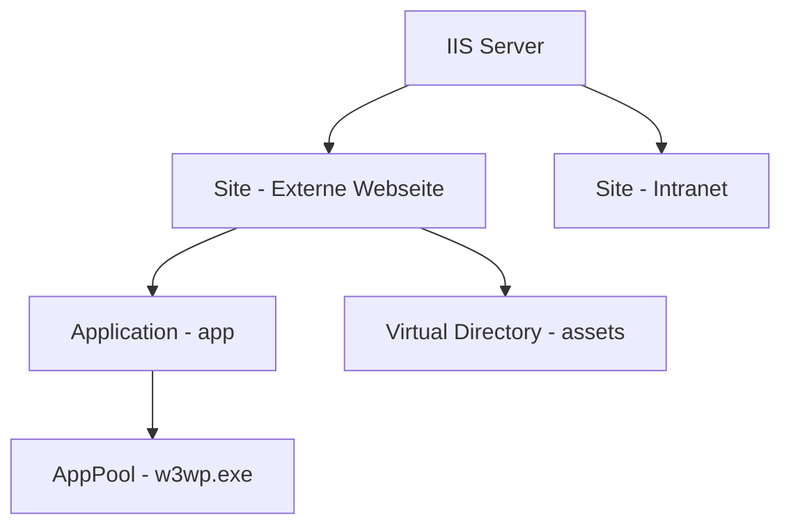

# IIS — Internet Information Services

> [!ABSTRACT]
> IIS (Internet Information Services) ist der in Windows Server integrierte Webserver. Er unterstützt HTTP/HTTPS, WebSockets, .NET/ASP.NET, PHP und mehr. Über Application Pools ist eine strikte Prozess-Isolation zwischen Websites möglich — ein Absturz einer App betrifft andere nicht.

---

## Was ist IIS?

IIS (Internet Information Services) ist der **in Windows Server integrierte Webserver** von Microsoft. Er wurde erstmals mit **Windows NT 3.51** (1995) als kostenloser Add-on veröffentlicht und ist seit Windows NT 4.0 Bestandteil des Betriebssystems. IIS ist nach Apache und Nginx einer der meistverbreiteten Webserver weltweit.

Mit IIS 6.0 (Windows Server 2003) führte Microsoft das **Worker-Process-Isolationsmodell** ein: Jeder Application Pool läuft als eigener `w3wp.exe`-Prozess unter einem dedizierten Sicherheitskontext. Das verhindert, dass eine fehlerhafte Anwendung andere Websites auf demselben Server destabilisiert.

### IIS-Versionen

| IIS-Version | Windows | Wesentliche Neuerungen |
|------------|---------|------------------------|
| **6.0** | Server 2003 | Worker-Process-Isolierung, Application Pools, w3wp.exe |
| **7.0** | Vista / Server 2008 | Modulares Pipeline-Modell, integrierter Managed/Native-Modus |
| **7.5** | Win 7 / Server 2008 R2 | WebSocket-Vorläufer, IIS Best Practices Analyzer |
| **8.0** | Win 8 / Server 2012 | WebSockets, SNI (mehrere SSL-Zertifikate auf einer IP), CPU-Drosselung |
| **8.5** | Win 8.1 / Server 2012 R2 | Enhanced Logging, Idle Worker Process Warmup |
| **10.0** | Win 10 / Server 2016+ | HTTP/2, Wildcard-Host-Header, IIS Administration API |

### Unterstützte Protokolle

| Protokoll | Port | Beschreibung |
|-----------|------|-------------|
| **HTTP/1.1** | 80 | Standard-Webprotokoll |
| **HTTPS** | 443 | TLS-verschlüsseltes HTTP |
| **HTTP/2** | 443 | Multiplexing, Header-Kompression (ab IIS 10) |
| **WebSockets** | 80/443 | Bidirektionale Verbindungen (ab IIS 8.0) |
| **FTP/FTPS** | 21/990 | Dateiübertragung (optionales Feature) |

### IIS-Objekthierarchie

IIS verwaltet Webinhalte in einer festen Hierarchie:

| Ebene | Objekt | Beschreibung |
|-------|--------|-------------|
| 1 | **Server** | IIS-Instanz auf dem Host |
| 2 | **Site** | Eigenständige Website (Port, Hostname, IP-Bindung) |
| 3 | **Application** | Web-Anwendung mit eigenem AppPool innerhalb einer Site |
| 4 | **Virtual Directory** | Pfad-Alias, der auf ein physisches Verzeichnis zeigt |



### Application Pools

Jeder Application Pool läuft als eigener **Worker Process** (`w3wp.exe`) unter einer eigenen Windows-Identität:

| AppPool-Identität | Beschreibung |
|------------------|-------------|
| **ApplicationPoolIdentity** | Virtuelles Konto (Standard, empfohlen) — geringste Rechte |
| **NetworkService** | Netzwerkzugriff mit Computer-Konto möglich |
| **LocalSystem** | Maximale Rechte — nur wenn zwingend nötig |
| **Custom Account** | Domänenkonto für Ressourcenzugriff im AD |

---

## Konzepte

```
IIS Hierarchie:
Server
├── Sites (Websites)
│   ├── Default Web Site (Port 80)
│   └── firmawebsite.de (Port 443)
│       ├── Virtuelles Verzeichnis /api → D:\API
│       └── Anwendung /shop → eigener AppPool
├── Application Pools (Prozess-Isolation)
│   ├── DefaultAppPool (.NET CLR v4)
│   └── ShopAppPool (.NET CLR v4, eigener Worker)
└── Module (Erweiterungen: URL Rewrite, ARR, WebDAV, ...)

Worker Process (w3wp.exe) = ein IIS-Anwendungspool-Prozess
```

---

## Installation

```powershell
# IIS mit häufig benötigten Features installieren
Install-WindowsFeature `
    Web-Server, `              # Basis-Webserver
    Web-Asp-Net45, `          # ASP.NET 4.5
    Web-Net-Ext45, `          # .NET-Erweiterbarkeit
    Web-ISAPI-Ext, `          # ISAPI-Erweiterungen
    Web-ISAPI-Filter, `       # ISAPI-Filter
    Web-Mgmt-Console, `       # IIS Management Console
    Web-Scripting-Tools, `    # Verwaltungs-Skripte (WebAdministration-Modul)
    Web-Log-Libraries, `      # Protokollierungsdienste
    Web-Http-Tracing, `       # HTTP-Protokollierung
    Web-Default-Doc, `        # Standarddokument (index.html etc.)
    Web-Dir-Browsing, `       # Verzeichnissuche
    Web-Http-Errors, `        # HTTP-Fehler
    Web-Static-Content, `     # Statische Inhalte
    Web-Http-Redirect `       # HTTP-Weiterleitungen
    -IncludeManagementTools

# IIS Manager öffnen
inetmgr
```

---

## Website erstellen

### GUI

```
IIS Manager (inetmgr) → Verbindungen → Sites → Rechtsklick → Website hinzufügen

Felder:
- Standortname:         firma-web
- Anwendungspool:       firma-web  (wird automatisch erstellt)
- Physischer Pfad:      D:\Websites\firma-web
- Bindungstyp:          http
- IP-Adresse:           Alle nicht zugewiesenen
- Port:                 80
- Hostname:             www.firma.local
→ OK

HTTPS-Binding hinzufügen:
→ Site auswählen → Bindungen... → Hinzufügen
  Typ:        https
  Port:       443
  Hostname:   www.firma.local
  SSL-Zertifikat: [Zertifikat aus Dropdown wählen]
→ OK
```

### PowerShell

```powershell
# WebAdministration-Modul laden
Import-Module WebAdministration

# Neues Verzeichnis für Website
New-Item "D:\Websites\firma-web" -ItemType Directory

# Website erstellen
New-Website `
    -Name "firma-web" `
    -PhysicalPath "D:\Websites\firma-web" `
    -Port 80 `
    -HostHeader "www.firma.local"

# HTTPS-Binding hinzufügen
New-WebBinding `
    -Name "firma-web" `
    -Protocol https `
    -Port 443 `
    -HostHeader "www.firma.local"

# SSL-Zertifikat dem Binding zuweisen
$cert = Get-ChildItem "Cert:\LocalMachine\My" | Where-Object {$_.Subject -match "firma.local"}
$binding = Get-WebBinding -Name "firma-web" -Protocol https
$binding.AddSslCertificate($cert.Thumbprint, "My")

# Website starten/stoppen
Start-Website -Name "firma-web"
Stop-Website -Name "firma-web"

# Alle Websites
Get-Website
```

---

## Application Pools

### GUI

```
IIS Manager → Anwendungspools → Rechtsklick → Anwendungspool hinzufügen

Felder:
- Name:                 ShopAppPool
- .NET CLR-Version:     .NET CLR Version v4.0
                        (bei .NET Core/5+: "Kein verwalteter Code")
- Verwaltete Pipeline:  Integriert
→ OK

AppPool konfigurieren:
→ ShopAppPool → Erweiterte Einstellungen...
  Identität:            Benutzerdefiniertes Konto → Festlegen... → FIRMA\svc-shop
  Prozessmodell:
    Leerlauftimeout:    20 Minuten
    Regelmäßiges Recycling: 1740 Minuten (täglich)
→ OK

AppPool starten/stoppen/recyceln:
→ AppPool auswählen → rechte Aktionsleiste → Starten / Stoppen / Recyceln
```

### PowerShell

```powershell
# Application Pool erstellen
New-WebAppPool -Name "ShopAppPool"

# AppPool konfigurieren
Set-ItemProperty "IIS:\AppPools\ShopAppPool" `
    -Name processModel.identityType `
    -Value SpecificUser     # LocalSystem, LocalService, NetworkService, ApplicationPoolIdentity, SpecificUser

# Mit spezifischem Dienstkonto
Set-ItemProperty "IIS:\AppPools\ShopAppPool" -Name processModel.userName -Value "FIRMA\svc-shop"
Set-ItemProperty "IIS:\AppPools\ShopAppPool" -Name processModel.password -Value "Passw0rd!"

# .NET CLR-Version
Set-ItemProperty "IIS:\AppPools\ShopAppPool" -Name managedRuntimeVersion -Value "v4.0"
# Für .NET Core/5+: managedRuntimeVersion = "" (No Managed Code)

# Recycling (periodischer Neustart des Worker Process)
Set-WebConfigurationProperty "/system.applicationHost/applicationPools/add[@name='ShopAppPool']/recycling/periodicRestart" `
    -Name "time" -Value "1.05:00:00"    # Täglich um 01:00 Uhr

# Website einem AppPool zuweisen
Set-ItemProperty "IIS:\Sites\firma-web" -Name applicationPool -Value "ShopAppPool"

# AppPool starten/stoppen/recyceln
Start-WebAppPool -Name "ShopAppPool"
Stop-WebAppPool -Name "ShopAppPool"
Restart-WebAppPool -Name "ShopAppPool"

# Alle AppPools
Get-WebConfiguration "/system.applicationHost/applicationPools/add" | Format-Table Name, State, ManagedRuntimeVersion
```

---

## SSL/TLS konfigurieren

```powershell
# Selbstsigniertes Zertifikat (nur für Test/Intern)
$cert = New-SelfSignedCertificate `
    -DnsName "www.firma.local" `
    -CertStoreLocation "Cert:\LocalMachine\My"

# Intern ausgestelltes Zertifikat importieren
Import-PfxCertificate `
    -FilePath "C:\Certs\firma-web.pfx" `
    -CertStoreLocation "Cert:\LocalMachine\My" `
    -Password (ConvertTo-SecureString "P@ss!" -AsPlainText -Force)

# TLS 1.0/1.1 deaktivieren (IIS-Host Security Hardening)
# Registry-Keys über PowerShell:
New-Item "HKLM:\SYSTEM\CurrentControlSet\Control\SecurityProviders\SCHANNEL\Protocols\TLS 1.0\Server" -Force
New-ItemProperty -Path "HKLM:\SYSTEM\CurrentControlSet\Control\SecurityProviders\SCHANNEL\Protocols\TLS 1.0\Server" `
    -Name "Enabled" -Value 0 -PropertyType DWORD -Force
```

---

## Logging

```powershell
# Log-Verzeichnis
# Standard: C:\inetpub\logs\LogFiles\W3SVC1\

# Logging-Format konfigurieren
Set-WebConfigurationProperty "/system.applicationHost/sites/site[@name='firma-web']/logFile" `
    -Name "directory" `
    -Value "D:\IIS-Logs\firma-web"

# Echtzeit-Logs (für Debugging)
Get-Content "C:\inetpub\logs\LogFiles\W3SVC1\u_ex$(Get-Date -Format 'yyMMdd').log" -Tail 20 -Wait
```

---

## Verwandte Notizen

- [[IIS Konfiguration]] — URL Rewrite, ARR Reverse Proxy, Authentication, WAF
- [[PKI - AD CS]] — Interne CA für IIS-Zertifikate
- [[Windows DNS]] — DNS-Einträge für IIS-Websites
