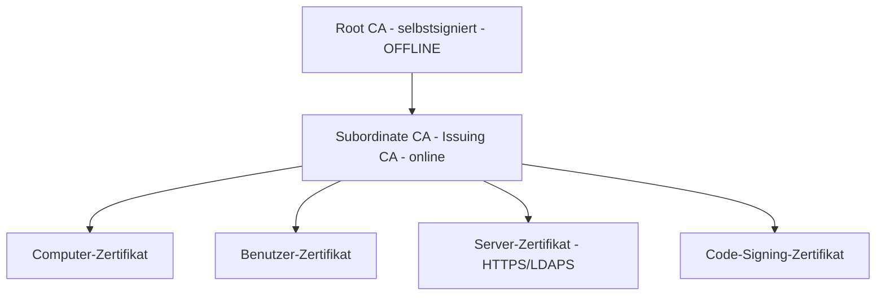

# PKI — AD CS (Public Key Infrastructure)

> [!ABSTRACT]
> AD CS (Active Directory Certificate Services) ist die Windows-eigene Public Key Infrastructure. Eine interne PKI stellt Zertifikate für HTTPS, Smartcard-Login, Wireless-Authentifizierung (802.1X), Code-Signing und mehr aus. Best Practice: **Offline Root CA** + **Online Issuing CA** als zweistufige Hierarchie.

---

## Was ist PKI?

Eine PKI (Public Key Infrastructure) ist ein **System aus Technologien, Prozessen und Richtlinien zur Verwaltung digitaler Zertifikate** und kryptographischer Schlüsselpaare. Sie bildet die Vertrauensbasis für verschlüsselte Kommunikation und digitale Identitäten in IT-Netzwerken.

Zertifikate folgen dem Standard **X.509 v3** (RFC 5280). AD CS ist Microsofts Implementierung einer PKI, integriert in Active Directory.

### Asymmetrische Kryptographie (Grundlage der PKI)

PKI basiert auf **asymmetrischen Schlüsselpaaren**:

| Schlüssel | Eigenschaft | Verwendung |
|-----------|-------------|------------|
| **Privater Schlüssel** | Geheim, verbleibt beim Besitzer | Entschlüsseln, Signieren |
| **Öffentlicher Schlüssel** | Öffentlich bekannt, frei verteilt | Verschlüsseln, Signatur prüfen |

Ein **digitales Zertifikat** bindet einen öffentlichen Schlüssel an eine Identität (Person, Server, Organisation) und wird von einer **Zertifizierungsstelle (CA)** digital signiert.

### X.509 v3 — Zertifikatsfelder

| Feld | Inhalt | Beispiel |
|------|--------|---------|
| **Subject** | Identität des Zertifikatsinhabers | `CN=webserver.firma.local, O=Firma GmbH` |
| **Issuer** | Ausstellende CA | `CN=Firma-Issuing-CA, DC=firma, DC=local` |
| **Serial Number** | Eindeutige Seriennummer der CA | `4a:2b:...` |
| **Validity Period** | Gültigkeitszeitraum | `2024-01-01 bis 2026-01-01` |
| **Public Key** | Algorithmus + öffentlicher Schlüssel | RSA 2048-Bit oder ECC P-256 |
| **Subject Alternative Names** | Weitere gültige Namen/IPs | `DNS: web.firma.local, IP: 192.168.1.50` |
| **Key Usage** | Erlaubte Verwendungen | Digital Signature, Key Encipherment |
| **Extended Key Usage** | Zweck des Zertifikats | Server Authentication (1.3.6.1.5.5.7.3.1) |
| **CRL Distribution Point** | URL der Sperrliste | `http://pki.firma.local/crl/ca.crl` |
| **Authority Info Access** | OCSP-URL | `http://ocsp.firma.local` |

### PKI-Hierarchie (Chain of Trust)



### Zertifikatssperrung

| Mechanismus | Standard | Funktionsprinzip | Aktualität |
|-------------|---------|-----------------|-----------|
| **CRL** (Certificate Revocation List) | RFC 5280 | Periodisch veröffentlichte Liste gesperrter Seriennummern | Stündlich bis täglich |
| **Delta CRL** | RFC 5280 | Nur Änderungen seit letzter vollständiger CRL | Stündlich |
| **OCSP** (Online Certificate Status Protocol) | RFC 6960 | Echtzeit-Abfrage für einzelnes Zertifikat | Sofort |

### AD CS Zertifikatsdienste

| AD CS-Rolle | Funktion |
|-------------|---------|
| **Certification Authority (CA)** | Kernrolle — stellt Zertifikate aus, verwaltet CRL |
| **Certificate Enrollment Web Service** | HTTP-basiertes Enrollment (für Nicht-AD-Mitglieder) |
| **Certificate Enrollment Policy Web Service** | Liefert Template-Informationen über HTTP |
| **Network Device Enrollment Service (NDES)** | SCEP — für Netzwerkgeräte (Router, Switches) |
| **Online Responder (OCSP)** | Beantwortet OCSP-Statusabfragen |

---

```
Zweistufige PKI-Hierarchie (empfohlen):

Root CA (Stammzertifizierungsstelle)
├── Offline (ausgeschaltet, nur für Ausstellung von SubCA-Zertifikaten)
├── Selbstsigniertes Root-Zertifikat
├── Lange Gültigkeitsdauer (10-20 Jahre)
└── Zertifikat in AD veröffentlicht → alle Domänenmitglieder vertrauen ihr

Subordinate/Issuing CA (Ausstellende ZS)
├── Online (24/7 aktiv)
├── Zertifikat von Root CA signiert
├── Stellt Endzertifikate aus (Benutzer, Computer, Server)
└── CRL (Certificate Revocation List) aktiv publiziert
```

---

## AD CS installieren

### GUI

```
Server Manager → Verwalten → Rollen und Features hinzufügen
→ Active Directory-Zertifikatsdienste
  ✓ Zertifizierungsstelle
  (optional: Zertifizierungsstellen-Webregistrierung für Browser-Enrollment)
→ Installieren

Nach Installation:
→ Server Manager → Benachrichtigung → "AD CS konfigurieren"

AD CS-Konfigurationsassistent:
1. Anmeldeinformationen: Domain Admin
2. Rollendienste: ✓ Zertifizierungsstelle
3. Installationstyp:
   → Enterprise-CA (für AD-Domäne, empfohlen)
   → Eigenständige CA (ohne AD, für Root CA offline)
4. CA-Typ:
   → Stammzertifizierungsstelle (Root CA)
   → Untergeordnete ZS (Issuing CA — benötigt Root CA)
5. Privater Schlüssel: Neuen privaten Schlüssel erstellen
6. Kryptografie:
   Anbieter: RSA#Microsoft Software Key Storage Provider
   Schlüssellänge: 4096 (Root CA) / 2048 (Issuing CA)
   Hashalgorithmus: SHA256
7. CA-Name: Firma-Root-CA / Firma-Issuing-CA
8. Gültigkeitsdauer: 20 Jahre (Root) / 5 Jahre (Issuing)
→ Konfigurieren
```

### PowerShell

```powershell
# Enterprise CA (nur in AD-Umgebung, automatische AD-Veröffentlichung)
Install-WindowsFeature ADCS-Cert-Authority -IncludeManagementTools

# Root CA konfigurieren (auf dediziertem Server, OFFLINE!)
Install-AdcsCertificationAuthority `
    -CAType EnterpriseRootCa `
    -CryptoProviderName "RSA#Microsoft Software Key Storage Provider" `
    -KeyLength 4096 `
    -HashAlgorithmName SHA256 `
    -ValidityPeriod Years `
    -ValidityPeriodUnits 20 `
    -CACommonName "Firma-Root-CA" `
    -Force

# Subordinate/Issuing CA auf anderem Server:
Install-WindowsFeature ADCS-Cert-Authority -IncludeManagementTools

Install-AdcsCertificationAuthority `
    -CAType EnterpriseSubordinateCa `
    -CryptoProviderName "RSA#Microsoft Software Key Storage Provider" `
    -KeyLength 2048 `
    -HashAlgorithmName SHA256 `
    -CACommonName "Firma-Issuing-CA" `
    -Force
# Dann: CSR an Root CA senden, Root CA signiert, SubCA installiert Zertifikat
```

---

## Zertifikatvorlagen (Templates)

```powershell
# Certification Authority MMC
certsrv.msc

# Vorlagen-Verwaltung
certlp.msc    # Certificate Templates Console

# Vorlagen per PowerShell anzeigen
Get-CATemplate

# Häufig verwendete Standardvorlagen:
# Computer              → Maschinenauth, IPsec, EFS
# WebServer             → IIS SSL/TLS Zertifikate
# User                  → E-Mail-Signatur, EFS, Smartcard
# DomainController      → DC-Authentifizierung
# Workstation           → Computer-Authentifizierung
# SmartcardUser         → Smartcard-Login

# Vorlage veröffentlichen (auf CA)
Add-CATemplate -TemplateName "WebServer"
```

---

## Zertifikate ausstellen

```powershell
# Zertifikat anfordern (auf dem Server der das Zertifikat braucht)

# Methode 1: Web-Enrollment (einfach, Browser-basiert)
# http://SRV-CA01/certsrv

# Methode 2: PowerShell-Anforderung
$certParams = @{
    DnsName           = "webserver.firma.local"
    CertStoreLocation = "Cert:\LocalMachine\My"
    Provider          = "Microsoft RSA SChannel Cryptographic Provider"
    KeyLength         = 2048
    HashAlgorithm     = "SHA256"
}
$cert = New-SelfSignedCertificate @certParams   # Nur für Test!

# Methode 3: Zertifikatsanforderung mit certreq
# certreq -new request.inf request.csr     → CSR erstellen
# certreq -submit request.csr              → Bei CA einreichen
# certreq -accept response.cer             → Zertifikat installieren

# Methode 4: Auto-Enrollment per GPO (empfohlen für alle Domänenmitglieder)
# GPO: Computer Konfiguration → Richtlinien → Windows-Einstellungen →
#      Sicherheitseinstellungen → Public Key-Richtlinien →
#      Zertifikatdiensteclient - automatische Registrierung
```

---

## Auto-Enrollment per GPO

```
GPO-Pfad:
Computer Konfiguration → Einstellungen → Windows-Einstellungen →
Sicherheitseinstellungen → Public Key-Richtlinien →
"Zertifikatdiensteclient - automatische Registrierung"

Einstellungen:
- Registrierungsmodell: Aktiviert
- Abgelaufene Zertifikate erneuern... → Aktiviert
- Ausstehende Zertifikate aktualisieren... → Aktiviert
- Vorlage: Computer (oder benutzerdefiniert)

Ergebnis:
- Alle Computer erhalten automatisch ein Computerzertifikat
- IIS kann dieses für HTTPS verwenden
- RDS/VPNs nutzen es für Authentifizierung
```

---

## CRL (Certificate Revocation List)

```powershell
# CRL-Konfiguration anzeigen
Get-CACRLDistributionPoint

# CRL manuell veröffentlichen
certutil -crl

# CRL-Status prüfen
certutil -getreg ca\CRLPublicationURLs
certutil -verify -urlfetch C:\CACerts\firma-ca.crl

# OCSP (Online Certificate Status Protocol) installieren (Alternative zu CRL)
Install-WindowsFeature ADCS-Online-Cert -IncludeManagementTools
```

---

## Zertifikate verwalten

```powershell
# Alle Zertifikate des lokalen Computers
Get-ChildItem "Cert:\LocalMachine\My" | Format-Table Subject, NotAfter, Thumbprint

# Ablaufende Zertifikate finden (30 Tage)
$datum = (Get-Date).AddDays(30)
Get-ChildItem "Cert:\LocalMachine\My" |
    Where-Object {$_.NotAfter -lt $datum} |
    Select-Object Subject, NotAfter, Thumbprint

# Root-CA-Zertifikat in Computer-Store prüfen
Get-ChildItem "Cert:\LocalMachine\Root" | Where-Object {$_.Subject -match "Firma"}

# Zertifikat exportieren (ohne privaten Schlüssel)
Export-Certificate `
    -Cert (Get-ChildItem "Cert:\LocalMachine\My\<Thumbprint>") `
    -FilePath "C:\Certs\server.cer" `
    -Type CERT

# Zertifikat exportieren (mit privatem Schlüssel, als PFX)
$cert = Get-ChildItem "Cert:\LocalMachine\My\<Thumbprint>"
Export-PfxCertificate `
    -Cert $cert `
    -FilePath "C:\Certs\server.pfx" `
    -Password (ConvertTo-SecureString "Passw0rd!" -AsPlainText -Force)

# Zertifikat importieren
Import-Certificate -FilePath "C:\Certs\ca.cer" -CertStoreLocation "Cert:\LocalMachine\Root"
```

---

## Verwandte Notizen

- [[AD Grundlagen]] — AD-Integration für Auto-Enrollment
- [[IIS Grundlagen]] — IIS-SSL-Zertifikate von interner CA
- [[Windows DNS]] — CDP/AIA URLs für CRL-Distribution
- [[RDS Grundlagen]] — RD Gateway Zertifikat von interner CA
