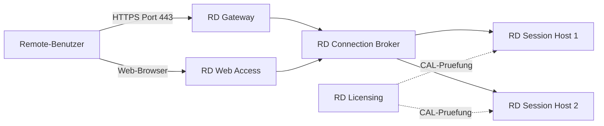

# RDS Grundlagen

> [!ABSTRACT]
> Remote Desktop Services (RDS) ermöglicht mehreren Benutzern gleichzeitig den Zugriff auf Windows-Anwendungen und Desktops über das Netzwerk. Es ersetzt die alten Terminal Services und umfasst mehrere Rollen: Session Host, Connection Broker, Web Access, Licensing und Gateway.

---

## Was ist RDS?

Remote Desktop Services (RDS) ist eine **Windows Server-Rolle für Multi-User-Remotezugriff auf Windows-Desktops und -Anwendungen**. Mehrere Benutzer können gleichzeitig Sitzungen auf demselben Server führen — jede Sitzung ist voneinander isoliert.

RDS war ursprünglich unter dem Namen **Terminal Services** bekannt und wurde mit **Windows NT 4.0 Terminal Server Edition** (1998) eingeführt. Mit Windows Server 2008 R2 erfolgte die Umbenennung zu Remote Desktop Services und eine grundlegende Überarbeitung der Architektur zu einer komponentenbasierten Rolle.

Das Kernprotokoll ist **RDP (Remote Desktop Protocol)**, ein proprietäres Microsoft-Protokoll auf **TCP-Port 3389** (und UDP 3389 für verbesserte Performance). RDP überträgt Bildschirminhalte, Tastatur- und Mauseingaben sowie optionale Ressourcen (Drucker, Laufwerke, Audio, Clipboard).

### RDS-Rollen im Überblick

| Rolle | Kürzel | Funktion |
|-------|--------|---------|
| **RD Session Host** | RDSH | Führt Anwendungen und Desktops für Remote-Benutzer aus — die eigentliche Rechenleistung |
| **RD Connection Broker** | RDCB | Load-Balancing zwischen mehreren RDSH-Servern, Reconnect nach Verbindungsabbruch |
| **RD Gateway** | RDG | Sicherer RDP-Zugang über HTTPS (Port 443) von extern — verhindert direktes Port-3389-Exposure |
| **RD Web Access** | RDWA | Webportal für RemoteApp-Anwendungen und Remote-Desktop-Verbindungen (Browser) |
| **RD Licensing** | RDL | Verwaltet RDS-CALs (Client Access Licenses) — nach 120-Tage-Gnadenfrist Pflicht |

### Einsatzszenarien

| Szenario | Beschreibung |
|----------|-------------|
| **Thin Client / Zero Client** | Günstige Endgeräte ohne eigene Software — alle Anwendungen laufen auf dem RDSH |
| **Legacy-Anwendungen** | Anwendungen die nur auf Windows laufen, für macOS/Linux-Clients veröffentlicht |
| **Remote Workers** | Mitarbeiter im Homeoffice mit vollem Zugriff auf Unternehmensanwendungen |
| **RemoteApp** | Einzelne Anwendungen werden veröffentlicht statt des ganzen Desktops |
| **Filialanbindung** | Ressourcenarme Endgeräte in Filialen greifen auf zentrale Server zu |

### RDS-Lizenzierung

> [!IMPORTANT] RDS-CALs sind Pflicht
> Neben der Windows Server-Lizenz benötigt jede Benutzer- oder Gerätesitzung eine **RDS Client Access License (CAL)**. Ohne Lizenzserver akzeptiert RDSH nach 120 Tagen keine Verbindungen mehr.

| CAL-Typ | Beschreibung | Empfohlen für |
|---------|-------------|--------------|
| **User CAL** | Pro Benutzerkonto — ein Benutzer kann sich von beliebig vielen Geräten verbinden | Mobile Worker, BYOD |
| **Device CAL** | Pro Gerät — beliebig viele Benutzer können dasselbe Gerät verwenden | Geteilte Terminals, Schichtbetrieb |

---

## RDS Architektur



---

## Lizenzierung

> [!IMPORTANT] RDS-Lizenzierung
> RDS benötigt neben Windows Server-Lizenzen zusätzliche **RDS Client Access Licenses (CALs)**. Es gibt zwei Typen:

| CAL-Typ | Beschreibung | Empfehlung |
|---------|-------------|-----------|
| **User CAL** | Pro Benutzerkonto, geräteunabhängig | Empfohlen für Mobile Worker |
| **Device CAL** | Pro Gerät, benutzerunabhängig | Empfohlen für geteilte Terminals |

```
Lizenzserver muss installiert und im AD registriert sein.
RDSH erkennt Lizenzserver automatisch in derselben AD-Site.
```

---

## RDS-Rollen installieren

### GUI

```
Server Manager → Verwalten → Rollen und Features hinzufügen
→ Installationstyp: "Remotedesktopdienste-Installation" wählen
  (NICHT "Rollenbasiert" — das würde nur Einzelrollen installieren)

Bereitstellungstyp:
→ "Schnellstart" (alles auf einem Server, für Test/Klein-Umgebung)
  oder
→ "Standardbereitstellung" (Rollen auf verschiedene Server verteilen)

Szenario-Typ:
→ "Sitzungsbasierter Desktop"

Server zuweisen:
→ SRV-RDS01.firma.local für alle Rollen (Schnellstart)
→ Installieren + Neustart

Lizenzserver konfigurieren:
→ Server Manager → Remote Desktop Services → Übersicht
→ RD-Lizenzierung → Aufgaben → Lizenzserver bearbeiten
→ Lizenzserver hinzufügen + CAL-Typ wählen
```

### PowerShell

```powershell
# Einzelner RDS-Server (All-In-One, für kleines Setup / Test)
Install-WindowsFeature `
    RDS-RD-Server, `           # Session Host
    RDS-Connection-Broker, `   # Connection Broker
    RDS-Web-Access, `          # Web Access
    RDS-Licensing `            # Licensing Server
    -IncludeManagementTools

# Neustart erforderlich
Restart-Computer

# Licensing-Server in AD registrieren
Add-RDLicenseServer -LicenseServer "SRV-RDS01.firma.local" -ConnectionBroker "SRV-RDS01.firma.local"

# Lizenzierungsmodus setzen
Set-RDLicenseConfiguration `
    -LicenseServer "SRV-RDS01.firma.local" `
    -Mode PerUser `            # PerUser oder PerDevice
    -ConnectionBroker "SRV-RDS01.firma.local" `
    -Force
```

---

## Benutzer für RDS berechtigen

```powershell
# Benutzer zur Gruppe "Remote Desktop Users" hinzufügen
Add-LocalGroupMember -Group "Remote Desktop Users" -Member "FIRMA\jdoe"

# Per AD-Gruppe (empfohlen)
Add-ADGroupMember -Identity "Remote Desktop Users" -Members "FIRMA\RDS-Benutzer"

# Per GPO (für alle Rechner einer OU):
# Computer Konfiguration → Richtlinien → Windows-Einstellungen →
# Sicherheitseinstellungen → Eingeschränkte Gruppen
# Gruppe: "Remote Desktop Users"
# Mitglieder: FIRMA\RDS-Benutzer-Gruppe
```

---

## RDP konfigurieren

```powershell
# RDP aktivieren
Set-ItemProperty -Path "HKLM:\System\CurrentControlSet\Control\Terminal Server" `
    -Name "fDenyTSConnections" -Value 0

# NLA (Network Level Authentication) aktivieren (empfohlen)
Set-ItemProperty -Path "HKLM:\System\CurrentControlSet\Control\Terminal Server\WinStations\RDP-Tcp" `
    -Name "UserAuthentication" -Value 1

# RDP-Port ändern (Standard: 3389)
Set-ItemProperty -Path "HKLM:\System\CurrentControlSet\Control\Terminal Server\WinStations\RDP-Tcp" `
    -Name "PortNumber" -Value 3389

# Firewall-Regel für RDP
Enable-NetFirewallRule -DisplayGroup "Remote Desktop"

# Gleichzeitige Verbindungen (Standardmäßig 2 auf Desktop-Servern)
# Für Produktions-RDS benötigt man RDS-Rollen + CALs
```

---

## Verbindungslimits und Timeouts per GPO

```
GPO-Pfad: Computer Konfiguration → Richtlinien → Administrative Vorlagen →
          Windows-Komponenten → Remotedesktopdienste →
          Remotedesktop-Sitzungshost → Sitzungszeitlimits

Empfohlene Einstellungen:
- Zeitlimit für aktive Sitzungen:         8 Stunden
- Zeitlimit für inaktive Sitzungen:       30 Minuten
- Zeitlimit für getrennte Sitzungen:      2 Stunden
- Aktion bei Zeitlimitüberschreitung:     Sitzung beenden (oder Trennen)
```

---

## RD Gateway einrichten

```powershell
# RD Gateway installieren
Install-WindowsFeature RDS-Gateway -IncludeManagementTools

# SSL-Zertifikat für RD Gateway nötig (internes Zertifikat oder öffentliches)
# Wird über Server Manager → RDS → Tasks → Zertifikate bearbeiten konfiguriert

# Verbindungsautorisierungsrichtlinie (CAP) — wer darf verbinden?
# Ressourcenautorisierungsrichtlinie (RAP) — auf was darf zugegriffen werden?
# Beide per GUI in: Server Manager → Remote Desktop Services → RD Gateway Manager
```

---

## Sitzungen verwalten

```powershell
# Aktive Sitzungen anzeigen
query session /server:SRV-RDS01

# Prozesse einer Sitzung
query process /server:SRV-RDS01

# Benutzer abmelden
logoff <SitzungsID> /server:SRV-RDS01

# Benutzer-Nachricht senden
msg <SitzungsID> /server:SRV-RDS01 "Server wird in 5 Minuten gewartet. Bitte speichern!"

# Shadow (Remote-Ansicht/Kontrolle einer Sitzung)
mstsc /shadow:<SitzungsID> /v:SRV-RDS01 /control /noConsentPrompt
```

---

## Verwandte Notizen

- [[RDS Konfiguration]] — Deployment und fortgeschrittene Konfiguration
- [[RemoteApp]] — Einzelne Anwendungen über RDS veröffentlichen
- [[Group Policy]] — RDS-Einstellungen per GPO verteilen
- [[Windows Admin Center]] — RDS-Management via WAC
