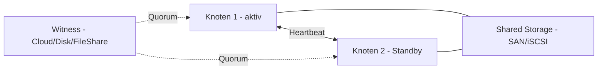

# Failover Clustering

> [!ABSTRACT]
> Failover Clustering ermöglicht Hochverfügbarkeit für Windows-Dienste: Bei einem Knotenausfall übernehmen die verbleibenden Knoten automatisch. Typische Einsatzgebiete: Hyper-V HA, SQL Server Always On, File Server HA. Voraussetzung: gemeinsamer Speicher (iSCSI, FC) oder Storage Spaces Direct (S2D).

---

## Was ist Failover Clustering?

Windows Server Failover Clustering (WSFC) ist eine **Hochverfügbarkeitstechnologie**, die mehrere Server zu einem Cluster zusammenfasst. Fällt ein Cluster-Knoten aus, übernehmen die verbleibenden Knoten automatisch die Dienste und Ressourcen — ohne manuelle Eingriffe.

WSFC wurde erstmals in **Windows NT 4.0 Enterprise** als "Wolfpack" eingeführt und kontinuierlich weiterentwickelt. Es ist die Grundlage für Hochverfügbarkeit von Hyper-V VMs, SQL Server Always On Availability Groups, Scale-Out File Servern und anderen Windows-Diensten.

### Cluster-Varianten

| Variante | Speicher | Anforderungen | Einsatz |
|----------|---------|---------------|--------|
| **Shared Storage Cluster** | Gemeinsamer SAN/iSCSI-Speicher | Externes Storage-System | Klassisch: Hyper-V, SQL Server, File Server |
| **Storage Spaces Direct (S2D)** | Lokale Disks werden gepoolt | Windows Server 2016+ Datacenter | Hyper-Converged Infrastructure (HCI) |
| **Azure Stack HCI** | S2D-basiert, Azure-verwaltet | Azure Arc-Verbindung | Moderne hybride Umgebungen |

### Cluster-Rollen

| Cluster-Rolle | Beschreibung |
|---------------|-------------|
| **Hyper-V HA** | VMs werden bei Knotenausfall auf anderen Knoten neugestartet |
| **File Server (HA)** | Hochverfügbare SMB-Freigaben mit einheitlichem Netzwerknamen |
| **SQL Server Always On FCI** | SQL-Instanz mit geteiltem Storage |
| **DHCP-Server** | Hochverfügbarer DHCP mit Failover-Replikation |
| **Generic Service/Application** | Beliebige Dienste clusterbar |

### Active/Passive vs. Active/Active

| Modus | Beschreibung | Ressourcennutzung | Einsatz |
|-------|-------------|-------------------|--------|
| **Active/Passive** | Ein Knoten aktiv, der andere wartet im Standby | Standby-Knoten ungenutzt | Einfachste HA-Form, klassisch |
| **Active/Active** | Beide Knoten laufen gleichzeitig mit eigenen Diensten | Beide Knoten voll genutzt | SQL Server, File Server mit mehreren Rollen |



### Quorum — Mehrheitsentscheidung zur Split-Brain-Vermeidung

Das Quorum verhindert, dass bei einem Netzwerkausfall zwischen Knoten beide Seiten gleichzeitig alle Ressourcen beanspruchen (Split-Brain) und dabei Datenkorrumption verursachen:

| Quorum-Modell | Stimmen | Wann einsetzen |
|---------------|---------|----------------|
| **Node Majority** | Nur Knoten-Stimmen | Ungerade Knotenanzahl (3, 5, 7) |
| **Node + Disk Witness** | Knoten + Witness-Disk (1 Stimme) | 2 Knoten, geteiltes Storage vorhanden |
| **Node + File Share Witness** | Knoten + SMB-Freigabe (1 Stimme) | Standortübergreifende Cluster |
| **Node + Cloud Witness** | Knoten + Azure Blob Storage (1 Stimme) | Azure-Anbindung vorhanden |

> [!IMPORTANT] Quorum-Regel
> Der Cluster ist betriebsfähig solange **mehr als die Hälfte** aller Quorum-Stimmen erreichbar ist.
> 3-Knoten-Cluster: Mindestens 2 Knoten müssen erreichbar sein (2/3 Stimmen).
> 2-Knoten + Cloud Witness: Mindestens 2/3 Stimmen nötig.

### Herzschlag (Heartbeat)

Cluster-Knoten kommunizieren kontinuierlich über ein dediziertes **Heartbeat-Netzwerk** (Empfehlung: separates Netzwerkinterface):

- Standard: Heartbeat alle **1 Sekunde** pro Knoten
- Ausfall-Erkennung: Nach **5 fehlenden Heartbeats** (~5 Sekunden) → Failover beginnt
- Failover-Zeit: Typisch 30–120 Sekunden (abhängig von Dienst und Konfiguration)

---

---

## Voraussetzungen

```powershell
# Auf ALLEN Cluster-Knoten:

# Failover Clustering Feature installieren
Install-WindowsFeature Failover-Clustering -IncludeManagementTools

# Domänenmitglied (Pflicht für Standard-Cluster)
# Gleiche Windows Server Edition (idealerweise Datacenter)
# Getestete/zertifizierte Hardware (für Produktion)

# Cluster-Konfiguration validieren (vor Erstellung, PFLICHT)
Test-Cluster -Node "SRV-HV01", "SRV-HV02" -Include "Storage", "Network", "Inventory"
```

---

## Cluster erstellen

### GUI

```
Failovercluster-Manager (cluadmin.msc):
→ Aktion → Cluster erstellen

Assistent Cluster erstellen:
1. Server auswählen:
   → SRV-HV01.firma.local hinzufügen
   → SRV-HV02.firma.local hinzufügen

2. Konfigurationsüberprüfung:
   → "Tests ausführen, um die Konfiguration zu überprüfen" → Ja
   → Alle Tests ausführen (Speicher, Netzwerk, System, Inventar)
   → Bericht prüfen — alle Fehler beheben vor Fortfahren!

3. Clustername und IP:
   Clustername:    CLUSTER01
   Netzwerk:       192.168.1.0/24
   IP-Adresse:     192.168.1.50

4. Speicher hinzufügen:
   → Verfügbaren Speicher zum Cluster hinzufügen: ✓
→ Weiter → Fertigstellen
```

### PowerShell

```powershell
# Neuen Cluster erstellen
New-Cluster `
    -Name "CLUSTER01" `
    -Node "SRV-HV01", "SRV-HV02" `
    -StaticAddress "192.168.1.50" `    # Cluster IP-Adresse
    -NoStorage                          # Storage separat hinzufügen

# Cluster-Status
Get-Cluster
Get-ClusterNode
```

---

## Storage konfigurieren

```powershell
# Verfügbare Disks anzeigen (nach iSCSI-/SAN-Verbindung)
Get-ClusterAvailableDisk

# Disk zum Cluster hinzufügen
Add-ClusterDisk -InputObject (Get-ClusterAvailableDisk)

# Cluster Shared Volume (CSV) erstellen (für Hyper-V)
$disk = Get-ClusterDisk -Name "Cluster Disk 1"
Add-ClusterSharedVolume -InputObject $disk

# CSV-Pfad
# C:\ClusterStorage\Volume1\

# CSV-Status
Get-ClusterSharedVolume | Format-Table Name, State, SharedVolumeInfo
```

---

## Quorum konfigurieren

```powershell
# Quorum anzeigen
Get-ClusterQuorum

# File Share Witness setzen (für 2-Knoten-Cluster mit externem Server)
Set-ClusterQuorum `
    -Cluster "CLUSTER01" `
    -FileShareWitness "\\SRV-DC01\ClusterWitness"

# Cloud Witness (Azure)
Set-ClusterQuorum `
    -Cluster "CLUSTER01" `
    -CloudWitness `
    -AccountName "meinstorage" `
    -AccessKey "<Azure Storage Key>"

# Node Majority (für 3+ Knoten, kein Witness nötig)
Set-ClusterQuorum -Cluster "CLUSTER01" -NodeMajority
```

---

## Hyper-V im Cluster (HA VMs)

```powershell
# Hyper-V muss auf allen Knoten installiert sein
Install-WindowsFeature Hyper-V -IncludeManagementTools

# VM auf CSV-Speicher erstellen
New-VM `
    -Name "SRV-HA01" `
    -Generation 2 `
    -MemoryStartupBytes 4GB `
    -SwitchName "External-LAN" `
    -Path "C:\ClusterStorage\Volume1\"

# VM als Cluster-Rolle hinzufügen (macht VM HA)
Add-ClusterVirtualMachineRole -VMName "SRV-HA01"

# HA VM anzeigen
Get-ClusterGroup | Where-Object GroupType -eq VirtualMachine

# VM manuell failovern (auf anderen Knoten verschieben)
Move-ClusterVirtualMachineRole -Name "SRV-HA01" -MigrationType Live

# VM auf bestimmten Knoten verschieben
Move-ClusterVirtualMachineRole -Name "SRV-HA01" -Node "SRV-HV02" -MigrationType Live
```

---

## Scale-Out File Server (SOFS)

```powershell
# SOFS-Rolle zum Cluster hinzufügen
Add-ClusterScaleOutFileServerRole -Name "SOFS-01"

# Freigabe auf CSV erstellen
New-SmbShare `
    -Name "HyperV-Storage" `
    -Path "C:\ClusterStorage\Volume1\Shares\HyperV-Storage" `
    -FullAccess "FIRMA\Cluster-Accounts", "FIRMA\IT-Admins" `
    -ContinuouslyAvailable $true `   # CA-Share für Hyper-V nötig
    -CachingMode None

# SOFS-Status
Get-SmbServerConfiguration | Select-Object *ClusterStorage*
```

---

## Cluster verwalten

```powershell
# Knoten anzeigen
Get-ClusterNode

# Knoten in Wartungsmodus (VM-Evakuierung)
Suspend-ClusterNode -Name "SRV-HV01" -Drain

# Knoten aus Wartungsmodus
Resume-ClusterNode -Name "SRV-HV01" -Failback Immediate

# Cluster-Rollen (alle Dienste/VMs)
Get-ClusterGroup | Format-Table Name, State, OwnerNode

# Cluster-Ereignisse
Get-WinEvent -LogName "Microsoft-Windows-FailoverClustering/Operational" -MaxEvents 30

# Cluster-Validierungsbericht
Test-Cluster -Node "SRV-HV01", "SRV-HV02"
```

---

## Troubleshooting

```powershell
# Cluster-Status
Get-ClusterGroup | Where-Object State -ne Online

# Netzwerk prüfen
Get-ClusterNetwork
Get-ClusterNetworkInterface

# Disk-Status
Get-ClusterDisk | Format-Table Name, State, Id

# Cluster-Log sammeln (wichtig für Support)
Get-ClusterLog -Destination "C:\Temp\ClusterLog"

# Quorum-Probleme → alle Knoten erreichbar?
Test-NetConnection -ComputerName SRV-HV02 -Port 3343   # Cluster-Port
```

---

## Verwandte Notizen

- [[Installation Hyper-V (Windows Server 2022)|Hyper-V]] — VMs, die im Cluster verwendet werden
- [[Installation Hyper-V (Windows Server 2022)|Hyper-V Administration]] — Live Migration ohne Cluster
- [[SMB Freigaben]] — Scale-Out File Server Freigaben
- [[Windows Server Installation]] — Clustervoraussetzungen
