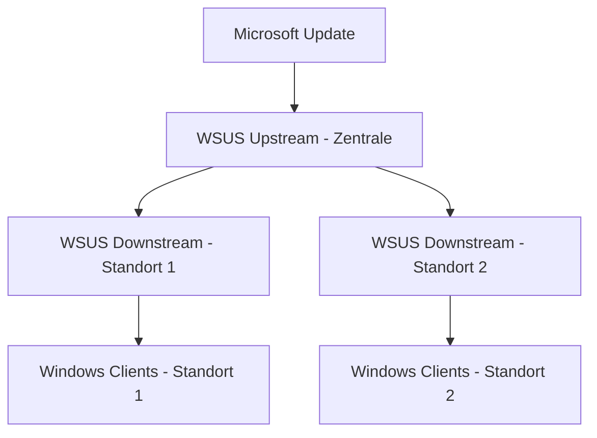

# WSUS — Windows Server Update Services

> [!ABSTRACT]
> WSUS ermöglicht zentrales Patch-Management für Windows-Systeme. Updates werden einmalig von Microsoft heruntergeladen und intern verteilt — spart Bandbreite und gibt Kontrolle über den Patch-Prozess. Integration mit GPO steuert, wann und welche Updates auf Clients angewendet werden.

---

## Was ist WSUS?

WSUS (Windows Server Update Services) ist ein **Microsoft-Dienst zur zentralen Verwaltung und Verteilung von Windows-Updates** im Unternehmensnetzwerk. Er ermöglicht Administratoren, Updates von Microsoft-Servern einmalig herunterzuladen und intern kontrolliert zu verteilen — statt dass jeder Client Updates direkt von Microsoft bezieht.

WSUS ist seit **Windows Server 2003 SP1** (2005) Bestandteil von Windows Server und wird über **Windows Update Agent (WUA)** auf den Clients gesteuert.

### Aufgaben und Einsatzbereiche

| Aufgabe | Beschreibung |
|---------|-------------|
| **Bandbreitenoptimierung** | Updates werden einmalig heruntergeladen und intern verteilt |
| **Patch-Kontrolle** | Administratoren genehmigen Updates manuell bevor sie verteilt werden |
| **Compliance-Überwachung** | Dashboard zeigt Patch-Status aller verwalteten Computer |
| **Zeitplanung** | Installationszeitpunkte werden zentral über GPO gesteuert |
| **Offline-Umgebungen** | WSUS ermöglicht Patch-Management ohne direkte Internet-Verbindung der Clients |

### Update-Kategorien in WSUS

| Kategorie | Beschreibung |
|-----------|-------------|
| **Critical Updates** | Kritische Fehler ohne Sicherheitsrelevanz |
| **Security Updates** | Sicherheits-relevante Patches |
| **Service Packs** | Kumulierte Updates (veraltet ab Windows 10) |
| **Feature Packs** | Neue Funktionen |
| **Update Rollups** | Gebündelte Patches |
| **Drivers** | Hardware-Treiber-Updates |
| **Definition Updates** | Defender-Signaturen, SpyWare-Definitionen |

### WSUS-Topologien

| Topologie | Beschreibung | Geeignet für |
|-----------|-------------|-------------|
| **Single WSUS** | Ein Server versorgt alle Clients | Kleine Umgebungen (<500 Clients) |
| **Autonomous Server** | Mehrere WSUS-Server, je eigene Genehmigungen | Standorte mit unabhängiger IT |
| **Replica-Modus** | Downstream-Server synchronisiert Genehmigungen vom Upstream | Zentrale Genehmigung, lokale Verteilung |
| **Upstream/Downstream** | Hierarchisch; Downstream bezieht Updates + Genehmigungen vom Upstream | WAN-Optimierung bei mehreren Standorten |



> [!NOTE] WSUS und Windows 10/11 Updates
> WSUS unterstützt Windows 10/11 Feature-Updates (Versionsupgrades) nur eingeschränkt. Für moderne Geräte empfiehlt Microsoft **Windows Autopatch** oder **Microsoft Endpoint Configuration Manager (Intune/MECM)**.

---

### GUI

```
Server Manager → Verwalten → Rollen und Features hinzufügen
→ Serverrollen → Windows Server Update Services
  ✓ WID-Konnektivität   (lokale Windows-Datenbank, für bis ~500 Clients)
  ✓ WSUS-Dienste
→ Inhaltsort: D:\WSUS  (hier werden Updates gespeichert, 50-200 GB!)
→ Installieren

Nach Installation:
Server Manager → Benachrichtigung → "Aufgaben nach der Bereitstellung"
→ WSUS-Konfigurationsassistent öffnet sich automatisch
```

### PowerShell

```powershell
# WSUS mit lokaler Datenbank (WID) installieren
Install-WindowsFeature UpdateServices `
    -IncludeManagementTools

# WSUS-Inhaltsverzeichnis konfigurieren (viel Speicherplatz nötig! 50-200 GB)
New-Item "D:\WSUS\UpdateServicesPackages" -ItemType Directory

# WSUS nach Installation konfigurieren
& "C:\Program Files\Update Services\Tools\WsusUtil.exe" postinstall `
    CONTENT_DIR=D:\WSUS

# WSUS-Konsole öffnen
# Server Manager → Tools → Windows Server Update Services
```

---

## Erstkonfiguration

```
WSUS Konfigurationsassistent:
1. Produktoptionen: Windows 10/11, Windows Server 2019/2022, Office 365
2. Klassifikationen: Critical, Security, Definition Updates, Updates
3. Synchronisierungsplan: Täglich um 03:00 Uhr
4. Erste Synchronisierung: Sofort starten
```

```powershell
# PowerShell-Konfiguration
$wsus = Get-WsusServer
$config = $wsus.GetConfiguration()

# Upstream-Server (Microsoft oder anderer WSUS)
$config.SyncFromMicrosoftUpdate = $true

# Sprachen
$config.AllUpdateLanguagesEnabled = $false
$config.SetEnabledUpdateLanguages("de", "en")
$config.Save()

# Produkte auswählen
$subscription = $wsus.GetSubscription()
$products = $wsus.GetUpdateCategories() | Where-Object Title -in @("Windows 11", "Windows Server 2022")
# Klassifikationen
$class = $wsus.GetUpdateClassifications() | Where-Object Title -in @("Critical Updates", "Security Updates")

# Synchronisierung
$subscription.StartSynchronization()
$subscription.GetSynchronizationProgress()
```

---

## Computer-Gruppen

### GUI

```
WSUS-Konsole:
→ Computer → Alle Computer → Rechtsklick → Computergruppe hinzufügen
  Name: Pilotgruppe → OK
  Name: Produktion → OK
  Name: Server-Produktion → OK

Computer einer Gruppe zuweisen:
→ Alle Computer → Computer auswählen → Rechtsklick → Mitgliedschaft ändern
  ✓ Pilotgruppe → OK
```

### PowerShell

```powershell
# Gruppen erstellen (für stufenweises Ausrollen)
$wsus = Get-WsusServer
$wsus.CreateComputerTargetGroup("Pilotgruppe")
$wsus.CreateComputerTargetGroup("Produktion")
$wsus.CreateComputerTargetGroup("Server-Produktion")

# Computer manuell zur Gruppe hinzufügen
$computer = $wsus.GetComputerTargetByName("WRK-IT01.firma.local")
$group = $wsus.GetComputerTargetGroups() | Where-Object Name -eq "Pilotgruppe"
$computer.AddTargetGroup($group)
```

---

## GPO für WSUS-Clients

```
GPO-Pfad: Computer Konfiguration → Richtlinien → Administrative Vorlagen →
          Windows-Komponenten → Windows Update

Wichtige Einstellungen:
→ "Internen Pfad für den Microsoft Updatedienst angeben"
   Updatedienst:       http://SRV-WSUS01:8530
   Statistikserver:    http://SRV-WSUS01:8530

→ "Automatische Updates konfigurieren"
   4 = Automatisch herunterladen und laut Zeitplan installieren
   Zeitplan: Jeden Mittwoch um 03:00 Uhr

→ "Keine automatischen Neustarts bei angemeldeten Benutzern"
   Aktiviert (für Desktop-PCs wichtig)

→ "Zielgruppenadressierung clientseitig aktivieren"
   Gruppenname: Pilotgruppe (muss in WSUS existieren!)
```

---

## Updates genehmigen

```powershell
# Updates in WSUS-Konsole anzeigen
# Updates → Nach Status prüfen → Erforderlich

# Per PowerShell genehmigen
$wsus = Get-WsusServer
$group = ($wsus.GetComputerTargetGroups() | Where-Object Name -eq "Pilotgruppe")

# Alle kritischen Security Updates genehmigen
$wsus.GetUpdates() |
    Where-Object {
        $_.UpdateClassificationTitle -eq "Security Updates" -and
        $_.IsApproved -eq $false -and
        $_.IsLatestRevision -eq $true
    } |
    ForEach-Object {
        $_.Approve("Install", $group)
    }
```

---

## Bereinigung und Wartung

```powershell
# WSUS Cleanup Wizard (entfernt nicht mehr benötigte Updates und Computer)
$cleanupScope = New-Object Microsoft.UpdateServices.Administration.CleanupScope
$cleanupScope.DeclineSupersededUpdates = $true
$cleanupScope.CleanupObsoleteUpdates = $true
$cleanupScope.CompressUpdates = $true
$cleanupScope.CleanupObsoleteComputers = $true
$cleanupScope.CleanupUnneededContentFiles = $true

$cleanupManager = $wsus.GetCleanupManager()
$result = $cleanupManager.PerformCleanup($cleanupScope)
$result

# IIS-Anwendungspool recyceln (bei Performance-Problemen)
Restart-WebAppPool WsusPool

# WSUS-Datenbankwartung (WID / SQL)
# SQL: regelmäßig Indizes neu aufbauen
Invoke-Sqlcmd -ServerInstance "\\.\pipe\MICROSOFT##WID\tsql\query" `
    -InputFile "C:\Scripts\WsusDBMaintenance.sql"
```

---

## Verwandte Notizen

- [[Group Policy]] — GPO für WSUS-Client-Konfiguration
- [[Windows Server Installation]] — Post-Install: WSUS als erste Maßnahme
- [[Server Manager]] — WSUS in Server Manager integriert
